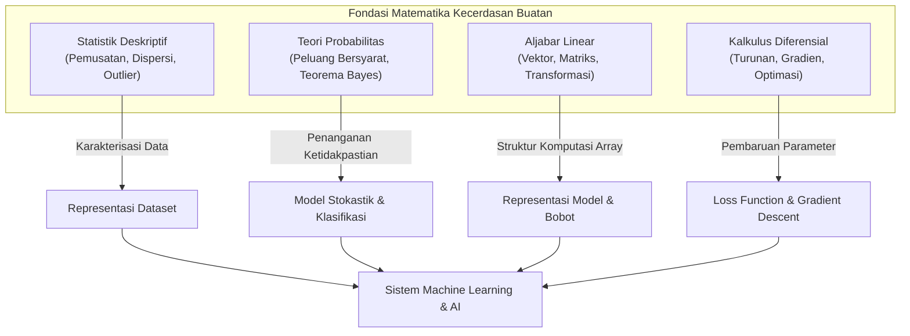
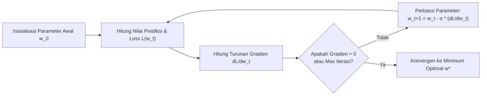

# Chapter 06: Probability, Statistics & Linear Algebra for AI

Selamat datang di **Chapter 06: Probability, Statistics & Linear Algebra for AI**. Bab ini merupakan fondasi kuantitatif bagi seluruh sistem kecerdasan buatan (*Artificial Intelligence*). Di balik setiap model bahasa besar (*Large Language Model*), visi komputer, robotika otonom, dan algoritma *Machine Learning*, terdapat hukum-hukum matematika terstruktur yang mengatur representasi data, pemodelan ketidakpastian, dan optimalisasi parameter.

Pada bab-bab sebelumnya, Anda telah mempelajari paradigma simbolik seperti algoritma pencarian ruang keadaan (*Search Algorithms*) dan sistem representasi pengetahuan berbasis kaidah logis (*Knowledge Representation & Reasoning*). Mulai bab ini, kita membangun jembatan kokoh menuju paradigma koneksionis dan komputasi sub-simbolik dengan memahami bahasa universal AI: **Probabilitas**, **Statistik Deskriptif**, **Aljabar Linear**, dan **Kalkulus Diferensial**.

---

## 1. Capaian Pembelajaran (Learning Objectives)

Setelah menyelesaikan bab ini secara komprehensif, pembelajar diharapkan mampu:
1. **Menjelaskan** peran fundamental Probability, Statistics, dan Linear Algebra dalam arsitektur sistem kecerdasan buatan.
2. **Menghitung** dan menginterpretasikan ukuran statistik deskriptif (mean, median, modus, rentang, varians sampel/populasi, standar deviasi, dan kuartil) secara tepat.
3. **Menerapkan** aturan dasar probabilitas, komplemen, gabungan, irisan, dan probabilitas bersyarat (*conditional probability*) dalam memodelkan ketidakpastian.
4. **Menjelaskan** dan menghitung probabilitas posterior menggunakan Teorema Bayes (*Bayes' Theorem*) serta mengidentifikasi fenomena *Base Rate Fallacy*.
5. **Mengoperasikan** manipulasi aljabar vektor meliputi penjumlahan vektor, perkalian skalar, norma ($L_1$, $L_2$), *Dot Product*, dan *Cosine Similarity*.
6. **Mengoperasikan** perkalian matriks formal, transposisi matriks, dan membedakannya secara tegas dari perkalian elemen demi elemen (*Hadamard product*).
7. **Menjelaskan** konsep fungsi, kemiringan (*slope*), turunan pertama, turunan parsial, dan vektor gradien pada tingkat pengantar.
8. **Menghubungkan** konsep matematika dengan kecerdasan buatan melalui perumusan fungsi loss *Mean Squared Error* (MSE) dan optimasi *Gradient Descent* sederhana.
9. **Mengimplementasikan** perhitungan matematika AI menggunakan kode Python dari awal (*from scratch*) tanpa ketergantungan pustaka luar yang rumit.
10. **Mengevaluasi** hasil numerik, keterbatasan komputasi, serta sensitivitas parameter terhadap stabilitas algoritma AI.

---

## 2. Prasyarat & Pengetahuan Awal

Untuk mempelajari bab ini dengan optimal, Anda disarankan telah memahami:
- **Chapter 01**: Definisi agen rasional dan siklus aksi-persepsi.
- **Chapter 05**: Logika proposisional dan penalaran deduktif formal.
- **Aljabar Sekolah Menengah**: Persamaan linear, fungsi kuadratik, dan konsep koordinat Kartesius.
- **Pemrograman Python Dasar**: Penggunaan list, perulangan, fungsi, dan manipulasi dictionary (lihat modul *Getting Started* GS-01 s/d GS-04).

---

## 3. Peta Konsep Bab

---

## 4. Part A — Mathematical Foundations for AI

### 4.1 Mengapa AI Membutuhkan Matematika?
Komputer tidak dapat membaca makna teks, piksel gambar, atau sinyal suara secara intuitif seperti manusia. Di dalam komputer, seluruh entitas dunia nyata harus diterjemahkan menjadi angka (*numbers*). 

Kecerdasan buatan mengandalkan empat pilar matematika utama:
1. **Aljabar Linear (*Linear Algebra*)**: Bahasa untuk menyimpan, mentransformasi, dan memproses data dalam jumlah masif secara paralel (vektor dan matriks).
2. **Teori Probabilitas (*Probability Theory*)**: Kerangka kerja formal untuk mengambil keputusan di bawah ketidakpastian (*uncertainty*), kebisingan sensor (*sensor noise*), dan data yang tidak lengkap.
3. **Statistik Deskriptif & Inferensial (*Statistics*)**: Metode untuk merangkum pola data mentah, mengevaluasi signifikansi pengamatan, dan mengukur variabilitas sampel.
4. **Kalkulus Diferensial (*Calculus*)**: Mesin utama yang menggerakkan proses belajar melalui pencarian arah pembaruan parameter yang meminimalkan tingkat kesalahan (*optimization*).

### 4.2 Notasi Matematika Dasar
Dalam literatur AI internasional (seperti Russell & Norvig, Goodfellow, dkk.), notasi matematika distandarisasi sebagai berikut:
- **Skalar ($s$)**: Bilangan tunggal real ($s \in \mathbb{R}$), ditulis huruf kecil biasa miring. Contoh: $x = 3.14$, $c = 10$.
- **Vektor ($\mathbf{v}$)**: Kumpulan berurutan $n$ buah skalar dalam ruang $\mathbb{R}^n$, ditulis huruf kecil tebal (*bold*). Secara default merupakan vektor kolom:
  $$\mathbf{x} = \begin{bmatrix} x_1 \\ x_2 \\ \vdots \\ x_n \end{bmatrix}$$
- **Matriks ($\mathbf{M}$)**: Tabel bilangan dua dimensi berukuran $m \times n$ dalam ruang $\mathbb{R}^{m \times n}$, ditulis huruf kapital tebal (*bold*):
  $$\mathbf{A} = \begin{bmatrix} a_{11} & a_{12} & \dots & a_{1n} \\ a_{21} & a_{22} & \dots & a_{2n} \\ \vdots & \vdots & \ddots & \vdots \\ a_{m1} & a_{m2} & \dots & a_{mn} \end{bmatrix}$$
- **Variabel & Fungsi**: Fungsi memetakan input ke output, dinotasikan $f: \mathbb{R} \to \mathbb{R}$ atau untuk multivariat $f: \mathbb{R}^n \to \mathbb{R}$. Contoh: $y = f(\mathbf{x}; \mathbf{w})$ di mana $\mathbf{x}$ adalah fitur input dan $\mathbf{w}$ adalah bobot parameter model.

---

## 5. Part B — Descriptive Statistics

Statistik deskriptif berfungsi merangkum, mendeskripsikan, dan memahami sifat distribusi kumpulan data (*dataset*) tanpa menarik kesimpulan melampaui data yang diamati.

### 5.1 Populasi vs Sampel
- **Populasi ($N$)**: Seluruh anggota kelompok pengamatan lengkap yang menjadi fokus perhatian (misalnya: seluruh pembacaan sensor suhu dari 10.000 perangkat IoT di seluruh gedung).
- **Sampel ($n$)**: Sebagian kecil representatif yang diambil dari populasi untuk dianalisis (misalnya: 50 pembacaan sensor yang dipilih acak).

### 5.2 Tipe-Tipe Data
1. **Data Numerik (Kuantitatif)**:
   - **Diskrit**: Nilai berupa cacahan bilangan bulat. Contoh: Jumlah paket hilang ($0, 1, 2, \dots$).
   - **Kontinu**: Nilai dapat berupa sembarang bilangan real pada interval tertentu. Contoh: Suhu ($23.45\text{ }^\circ\text{C}$), latency ($12.8\text{ ms}$).
2. **Data Kategorikal (Kualitatif)**:
   - **Nominal**: Kategori tanpa urutan hierarkis. Contoh: Status jaringan (`Wi-Fi`, `Ethernet`, `Cellular`).
   - **Ordinal**: Kategori yang memiliki peringkat/urutan logis. Contoh: Tingkat keparahan anomali (`Rendah`, `Sedang`, `Kritis`).

### 5.3 Ukuran Pemusatan Data (Central Tendency)
Ukuran pemusatan memberikan satu nilai representatif yang menggambarkan pusat distribusi data.

#### Mean (Rata-rata Hitung)
Rata-rata hitung merupakan jumlah seluruh nilai dibagi banyaknya data:
- **Mean Populasi ($\mu$)**:
  $$\mu = \frac{1}{N} \sum_{i=1}^N x_i$$
- **Mean Sampel ($\bar{x}$)**:
  $$\bar{x} = \frac{1}{n} \sum_{i=1}^n x_i$$

*Karakteristik*: Sangat sensitif terhadap nilai pencilan (*outliers*).

#### Median (Nilai Tengah)
Nilai yang membagi data terurut menjadi dua bagian sama banyak (50% di bawah, 50% di atas).
Jika data telah diurutkan $x_{(1)} \le x_{(2)} \le \dots \le x_{(n)}$:
$$\text{Median} = \begin{cases} x_{(\frac{n+1}{2})}, & \text{jika } n \text{ ganjil} \\ \frac{x_{(\frac{n}{2})} + x_{(\frac{n}{2} + 1)}}{2}, & \text{jika } n \text{ genap} \end{cases}$$

*Karakteristik*: Bersifat resisten (*robust*) terhadap outlier.

#### Modus (Mode)
Nilai atau kategori yang muncul dengan frekuensi tertinggi dalam dataset. Dataset dapat memiliki satu modus (*unimodal*), lebih dari satu modus (*bimodal/multimodal*), atau tidak memiliki modus jika semua nilai unik.

### 5.4 Ukuran Penyebaran Data (Dispersion)
Dua dataset dapat memiliki mean yang identik tetapi perilaku penyebaran yang sangat berbeda.

#### Rentang (Range)
Selisih antara nilai pengamatan terbesar dan terkecil:
$$\text{Range} = x_{\max} - x_{\min}$$

#### Varians (Variance)
Rata-rata kuadrat deviasi setiap titik data terhadap nilai rata-ratanya:
- **Varians Populasi ($\sigma^2$)**:
  $$\sigma^2 = \frac{1}{N} \sum_{i=1}^N (x_i - \mu)^2$$
- **Varians Sampel ($s^2$) — Koreksi Bessel**:
  $$s^2 = \frac{1}{n - 1} \sum_{i=1}^n (x_i - \bar{x})^2$$

> [!IMPORTANT]
> **Mengapa Pembagi Sampel Menggunakan $(n - 1)$?**
> Jika varians sampel dihitung menggunakan pembagi $n$, hasilnya secara sistematis akan selalu lebih kecil daripada varians populasi sebenarnya (*underestimate* / *biased estimator*). Pengurangan 1 derajat kebebasan (*Bessel's correction*) menjadikan $s^2$ sebagai penaksir tak berbias (*unbiased estimator*).

#### Standar Deviasi (Standard Deviation)
Akar kuadrat dari varians, sehingga memiliki satuan ukuran yang sama dengan data aslinya:
- Populasi: $\sigma = \sqrt{\sigma^2}$
- Sampel: $s = \sqrt{s^2}$

### 5.5 Kuartil, IQR, dan Deteksi Pencilan (Outliers)
- **Kuartil 1 ($Q_1$)**: Persentil ke-25 (25% data berada di bawah nilai ini).
- **Kuartil 2 ($Q_2$)**: Median / Persentil ke-50.
- **Kuartil 3 ($Q_3$)**: Persentil ke-75 (75% data berada di bawah nilai ini).
- **Interquartile Range ($\text{IQR}$)**:
  $$\text{IQR} = Q_3 - Q_1$$

#### Kriteria Pencilan Tukey
Nilai $x$ diklasifikasikan sebagai pencilan (*outlier*) jika berada di luar batas pagar dalam (*inner fences*):
$$\text{Batas Bawah} = Q_1 - 1.5 \times \text{IQR}$$
$$\text{Batas Atas} = Q_3 + 1.5 \times \text{IQR}$$

---

## 6. Part C — Probability Foundations

Probabilitas mengukur derajat kepastian atau peluang terjadinya suatu peristiwa dalam skala real antara $0$ (mustahil terjadi) hingga $1$ (pasti terjadi).

### 6.1 Ruang Sampel dan Kejadian
- **Eksperimen Acak (*Random Experiment*)**: Proses fisik atau komputasi yang menghasilkan luaran yang tidak dapat diprediksi dengan kepastian mutlak sebelumnya.
- **Ruang Sampel ($S$)**: Himpunan seluruh kemungkinan luaran eksperimen.
- **Kejadian (*Event*, $E$)**: Subhimpunan dari ruang sampel ($E \subseteq S$).

Pada ruang sampel berhingga yang memiliki kemungkinan sama (*equally likely outcomes*):
$$P(E) = \frac{|E|}{|S|}$$

### 6.2 Aksioma & Aturan Dasar Probabilitas
1. **Aksioma Non-negativitas**: Untuk setiap kejadian $A$, $0 \le P(A) \le 1$.
2. **Aksioma Kepastian**: $P(S) = 1$.
3. **Aturan Komplemen**: Peluang kejadian $A$ tidak terjadi adalah:
   $$P(A') = 1 - P(A)$$
4. **Aturan Penjumlahan (Gabungan)**:
   $$P(A \cup B) = P(A) + P(B) - P(A \cap B)$$
   Jika $A$ dan $B$ saling lepas (*mutually exclusive*, $A \cap B = \emptyset$), maka $P(A \cup B) = P(A) + P(B)$.

### 6.3 Probabilitas Bersyarat & Independensi
Probabilitas bersyarat $P(A|B)$ adalah peluang terjadinya kejadian $A$ jika diketahui kejadian $B$ telah terjadi:
$$P(A|B) = \frac{P(A \cap B)}{P(B)}, \quad \text{dengan } P(B) > 0$$

Dua kejadian $A$ dan $B$ dikatakan **independen secara stokastik** jika dan hanya jika:
$$P(A \cap B) = P(A) \times P(B) \iff P(A|B) = P(A)$$
Artinya, mengetahui kejadian $B$ sama sekali tidak mengubah keyakinan kita terhadap peluang terjadinya $A$.

### 6.4 Teorema Bayes & Hukum Probabilitas Total
Teorema Bayes menghubungkan probabilitas kondisional terbalik $P(H|E)$ dengan $P(E|H)$.

#### Hukum Probabilitas Total
Jika hipotesis $H$ membagi ruang sampel bersama komplemennya $\neg H$:
$$P(E) = P(E|H)P(H) + P(E|\neg H)P(\neg H)$$

#### Rumus Teorema Bayes
$$P(H|E) = \frac{P(E|H) \cdot P(H)}{P(E)} = \frac{P(E|H) \cdot P(H)}{P(E|H)P(H) + P(E|\neg H)P(\neg H)}$$

Komponen-komponen utama:
- **$P(H)$ [Prior Probability]**: Keyakinan probabilitas awal terhadap hipotesis sebelum bukti baru diobservasi.
- **$P(E|H)$ [Likelihood]**: Peluang mengamati bukti $E$ apabila hipotesis $H$ memang benar.
- **$P(E)$ [Evidence / Marginal Probability]**: Total probabilitas mengamati bukti $E$ di bawah seluruh kemungkinan kondisi.
- **$P(H|E)$ [Posterior Probability]**: Probabilitas terperbarui dari hipotesis $H$ setelah memperhitungkan bukti $E$.

#### Contoh Studi Kasus: Sensor Anomali & Base Rate Fallacy
Misalkan sebuah sensor industri bertugas mendeteksi kerusakan mesin kritis:
- Peluang awal mesin rusak: $P(\text{Rusak}) = 0.01$ (1% - kejadian langka).
- Sensitivitas sensor (*True Positive Rate*): $P(\text{Alarm}|\text{Rusak}) = 0.95$ (95%).
- Tingkat alarm palsu (*False Positive Rate*): $P(\text{Alarm}|\text{Normal}) = 0.05$ (5%).

Jika sensor berbunyi, berapa peluang mesin tersebut benar-benar rusak?
$$P(\text{Alarm}) = (0.95 \times 0.01) + (0.05 \times 0.99) = 0.0095 + 0.0495 = 0.0590 \text{ (5.9%)}$$
$$P(\text{Rusak}|\text{Alarm}) = \frac{0.0095}{0.0590} \approx 0.1610 \text{ (16.10\%)!}$$

> [!WARNING]
> **Base Rate Fallacy dalam Evaluasi AI**:
> Meskipun akurasi sensor mencapai 95%, probabilitas aktual mesin rusak saat alarm menyala hanya 16.10%! Kesalahan umum pengembang pemula adalah mengabaikan nilai *prior* (base rate), sehingga mengira ketika alarm berbunyi peluang kerusakan adalah 95%. Dalam AI deteksi penipuan (*fraud detection*) dan diagnosis medis, fenomena ini sangat krusial agar model tidak memicu kepanikan operasional akibat alarm palsu.

### 6.5 Variabel Acak, Nilai Harapan, dan Distribusi
- **Variabel Acak ($X$)**: Fungsi yang memetakan setiap luaran di ruang sampel ke sebuah nilai riil.
- **Nilai Harapan (*Expected Value*, $E[X]$)**: Nilai rata-rata teoretis berbobot probabilitas dari variabel acak diskrit:
  $$E[X] = \sum_{i} x_i P(X = x_i)$$
- **Distribusi Bernoulli**: Distribusi variabel acak biner dengan luaran sukses ($1$) berpeluang $p$ dan gagal ($0$) berpeluang $1-p$.
- **Distribusi Binomial**: Probabilitas mendapatkan tepat $k$ keberhasilan dari $n$ percobaan Bernoulli independen:
  $$P(X = k) = \binom{n}{k} p^k (1 - p)^{n - k}$$
- **Distribusi Normal (Gaussian)**: Distribusi kontinu simetris berbentuk lonceng dengan parameter mean $\mu$ dan varians $\sigma^2$:
  $$f(x) = \frac{1}{\sigma \sqrt{2\pi}} \exp\left( -\frac{(x - \mu)^2}{2\sigma^2} \right)$$
  Memenuhi Aturan Empiris 68–95–99.7: 68.27% data berada dalam $\mu \pm 1\sigma$, 95.45% dalam $\mu \pm 2\sigma$, dan 99.73% dalam $\mu \pm 3\sigma$.

---

## 7. Part D — Linear Algebra Foundations

Aljabar linear menyediakan struktur komputasi efisien untuk menyimpan dan memanipulasi jutaan variabel secara simultan.

### 7.1 Vektor dan Ruang Vektor
Vektor adalah barisan terurut bilangan:
$$\mathbf{u} = \begin{bmatrix} u_1 \\ u_2 \\ \vdots \\ u_n \end{bmatrix}, \quad \mathbf{v} = \begin{bmatrix} v_1 \\ v_2 \\ \vdots \\ v_n \end{bmatrix}$$

Operasi dasar vektor:
1. **Penjumlahan Vektor Element-wise**:
   $$\mathbf{u} + \mathbf{v} = \begin{bmatrix} u_1 + v_1 \\ u_2 + v_2 \\ \vdots \\ u_n + v_n \end{bmatrix}$$
2. **Perkalian Skalar**:
   $$c \mathbf{u} = \begin{bmatrix} c u_1 \\ c u_2 \\ \vdots \\ c u_n \end{bmatrix}$$

### 7.2 Hasil Kali Titik (Dot Product)
Hasil kali titik antara dua vektor $\mathbf{u}, \mathbf{v} \in \mathbb{R}^n$ menghasilkan sebuah skalar:
$$\mathbf{u} \cdot \mathbf{v} = \sum_{i=1}^n u_i v_i = u_1 v_1 + u_2 v_2 + \dots + u_n v_n$$

Secara geometris:
$$\mathbf{u} \cdot \mathbf{v} = \|\mathbf{u}\|_2 \|\mathbf{v}\|_2 \cos(\theta)$$
di mana $\theta$ adalah sudut yang dibentuk oleh kedua vektor.
- Jika $\mathbf{u} \cdot \mathbf{v} = 0$, maka $\cos(\theta) = 0 \implies \theta = 90^\circ$ (vektor bersifat **ortogonal** / tegak lurus).

### 7.3 Norma Vektor (Vector Norms)
Norma mengukur magnitudo atau panjang geometris sebuah vektor:
- **Norma $L_1$ (Manhattan Norm)**:
  $$\|\mathbf{v}\|_1 = \sum_{i=1}^n |v_i|$$
- **Norma $L_2$ (Euclidean Norm)**:
  $$\|\mathbf{v}\|_2 = \sqrt{\sum_{i=1}^n v_i^2}$$
- **Norma $L_\infty$ (Max Norm / Chebyshev)**:
  $$\|\mathbf{v}\|_\infty = \max_{i} |v_i|$$

#### Normalisasi Vektor Satuan (Unit Vector)
Vektor bersatuan panjang satu yang mempertahankan arah asli:
$$\hat{\mathbf{v}} = \frac{\mathbf{v}}{\|\mathbf{v}\|_2}$$

#### Kemiripan Kosinus (Cosine Similarity)
Mengukur kemiripan arah antara dua vektor terlepas dari besar skalanya:
$$\text{Cosine Similarity}(\mathbf{u}, \mathbf{v}) = \frac{\mathbf{u} \cdot \mathbf{v}}{\|\mathbf{u}\|_2 \|\mathbf{v}\|_2} = \cos(\theta)$$
Nilai berkisar antara $-1.0$ (berlawanan arah), $0.0$ (ortogonal/tidak berkorelasi), hingga $1.0$ (arah identik). Cosine similarity adalah metrik kunci dalam *information retrieval*, pencarian semantik teks (*embeddings*), dan *recommendation systems*.

### 7.4 Matriks & Operasi Matriks
Matriks $\mathbf{A} \in \mathbb{R}^{m \times n}$ memiliki $m$ baris dan $n$ kolom.

#### Transposisi Matriks ($\mathbf{A}^T$)
Operasi menukar baris menjadi kolom: elemen pada baris $i$ dan kolom $j$ berpindah ke baris $j$ dan kolom $i$:
$$(\mathbf{A}^T)_{ji} = \mathbf{A}_{ij}$$
Jika $\mathbf{A}$ berukuran $m \times n$, maka $\mathbf{A}^T$ berukuran $n \times m$.

#### Perkalian Matriks-Vektor
Jika $\mathbf{A} \in \mathbb{R}^{m \times k}$ dan $\mathbf{x} \in \mathbb{R}^{k \times 1}$, hasilnya adalah vektor $\mathbf{y} \in \mathbb{R}^{m \times 1}$:
$$y_i = \sum_{j=1}^k a_{ij} x_j$$

#### Perkalian Matriks-Matriks Formal
Dua matriks $\mathbf{A}$ dan $\mathbf{B}$ **hanya dapat dikalikan** jika jumlah kolom $\mathbf{A}$ sama dengan jumlah baris $\mathbf{B}$:
$$\mathbf{A}_{m \times k} \times \mathbf{B}_{k \times n} = \mathbf{C}_{m \times n}$$
Elemen hasil perkalian pada baris $i$ dan kolom $j$ adalah hasil kali titik baris ke-$i$ dari $\mathbf{A}$ dengan kolom ke-$j$ dari $\mathbf{B}$:
$$c_{ij} = \sum_{r=1}^k a_{ir} b_{rj}$$

> [!CAUTION]
> **Perkalian Matriks vs Perkalian Hadamard (Element-wise Product)**:
> Jangan pernah menyamakan perkalian matriks formal ($\mathbf{A} \mathbf{B}$) dengan perkalian Hadamard ($\mathbf{A} \odot \mathbf{B}$).
> - **Perkalian Hadamard ($\mathbf{A} \odot \mathbf{B}$)**: Mensyaratkan kedua matriks berukuran identik $(m \times n)$, di mana $c_{ij} = a_{ij} \times b_{ij}$.
> - **Perkalian Matriks ($\mathbf{A} \mathbf{B}$)**: Mensyaratkan dimensi dalam cocok $(m \times k) \times (k \times n)$, dan melibatkan operasi agregasi penjumlahan hasil kali.

### 7.5 Transformasi Linear Geometris
Perkalian matriks dapat dipandang sebagai transformasi geometris yang memetakan ruang vektor ke ruang vektor lain:
$$\mathbf{y} = \mathbf{T} \mathbf{x}$$
Transformasi linear memiliki dua sifat dasar:
1. $\mathbf{T}(\mathbf{u} + \mathbf{v}) = \mathbf{T}(\mathbf{u}) + \mathbf{T}(\mathbf{v})$
2. $\mathbf{T}(c\mathbf{u}) = c\mathbf{T}(\mathbf{u})$

Contoh: Rotasi 2D sebesar $90^\circ$ berlawanan arah jarum jam memiliki representasi matriks transformasi:
$$\mathbf{R}_{90^\circ} = \begin{bmatrix} 0 & -1 \\ 1 & 0 \end{bmatrix}$$
Jika titik $\mathbf{p} = [3, 2]^T$ dikalikan dengan $\mathbf{R}_{90^\circ}$:
$$\mathbf{p}' = \begin{bmatrix} 0 & -1 \\ 1 & 0 \end{bmatrix} \begin{bmatrix} 3 \\ 2 \end{bmatrix} = \begin{bmatrix} (0)(3) + (-1)(2) \\ (1)(3) + (0)(2) \end{bmatrix} = \begin{bmatrix} -2 \\ 3 \end{bmatrix}$$

---

## 8. Part E — Calculus & Optimization Introduction

Jika aljabar linear adalah kerangka data AI, maka kalkulus diferensial adalah mekanisme pembelajarannya (*learning mechanism*).

### 8.1 Fungsi, Kemiringan, dan Konsep Turunan
Turunan pertama $f'(x)$ dari fungsi kontinu mengukur laju perubahan sesaat (*instantaneous rate of change*) atau kemiringan garis singgung (*tangent slope*) pada titik $x$:
$$f'(x) = \lim_{h \to 0} \frac{f(x + h) - f(x)}{h}$$

Secara komputasi numerik, turunan dapat diaproksimasi menggunakan metode beda pusat (*Central Difference*):
$$f'(x) \approx \frac{f(x + h) - f(x - h)}{2h}$$

#### Makna Geometris Nilai Turunan:
- $f'(x) > 0$: Fungsi sedang **menaik** (bergerak ke kanan menaikkan nilai fungsi).
- $f'(x) < 0$: Fungsi sedang **menurun** (bergerak ke kanan menurunkan nilai fungsi).
- $f'(x) = 0$: Titik **stasioner** (kandidat nilai minimum lokal, maksimum lokal, atau titik belok).

### 8.2 Turunan Parsial dan Vektor Gradien
Untuk fungsi dengan banyak variabel $g(x_1, x_2, \dots, x_n)$, **turunan parsial** $\frac{\partial g}{\partial x_i}$ mengukur laju perubahan fungsi terhadap variabel $x_i$ dengan menganggap variabel lainnya konstan.

**Vektor Gradien ($\nabla g$)** adalah vektor yang mengumpulkan seluruh turunan parsial:
$$\nabla g(\mathbf{x}) = \begin{bmatrix} \frac{\partial g}{\partial x_1} \\ \frac{\partial g}{\partial x_2} \\ \vdots \\ \frac{\partial g}{\partial x_n} \end{bmatrix}$$

> [!NOTE]
> **Sifat Fundamental Vektor Gradien**:
> 1. Vektor gradien $\nabla g(\mathbf{x})$ selalu mengarah ke arah **peningkatan fungsi paling curam** (*steepest ascent*).
> 2. Besarnya magnitudo $\|\nabla g(\mathbf{x})\|$ menunjukkan seberapa curam kenaikan tersebut.
> 3. Oleh karena itu, arah kebalikan gradien $-\nabla g(\mathbf{x})$ adalah arah **penurunan fungsi paling cepat** (*steepest descent*)!

### 8.3 Fungsi Objektif: Mean Squared Error (MSE) Loss
Dalam pembelajaran mesin, kita mendefinisikan sebuah **Fungsi Loss (*Loss Function*)** yang mengukur seberapa buruk prediksi model dibandingkan target nyata.

Sebagai ilustrasi matematis, tinjau model linear sederhana berbobot skalar $w$:
$$\hat{y}_i = w \cdot x_i$$
Fungsi loss Mean Squared Error (MSE) dirumuskan:
$$L(w) = \frac{1}{N} \sum_{i=1}^N (\hat{y}_i - y_i)^2 = \frac{1}{N} \sum_{i=1}^N (w \cdot x_i - y_i)^2$$

Turunan loss terhadap bobot parameter $w$ diperoleh menggunakan aturan rantai (*chain rule*):
$$\frac{\partial L}{\partial w} = \frac{2}{N} \sum_{i=1}^N x_i (w \cdot x_i - y_i)$$

### 8.4 Algoritma Gradient Descent
Algoritma Gradient Descent adalah metode optimasi iteratif untuk menemukan parameter yang meminimalkan nilai fungsi loss.

Aturan pembaruan parameter:
$$w_{t+1} = w_t - \alpha \cdot \frac{\partial L}{\partial w_t}$$
di mana $\alpha > 0$ adalah **Laju Pembelajaran (*Learning Rate*)**.

#### Pengaruh Nilai Learning Rate ($\alpha$):
- **$\alpha$ Terlalu Kecil (misal $0.001$)**: Konvergensi sangat lambat, memerlukan ribuan langkah, dan rawan terhenti sebelum mencapai titik optimal.
- **$\alpha$ Ideal (misal $0.05 - 0.1$)**: Parameter melangkah mantap menuju titik minimum secara efisien.
- **$\alpha$ Terlalu Besar (misal $1.05$)**: Terjadi fenomena *overshooting*, di mana parameter melompati lembah minimum bolak-balik hingga nilai loss meledak menjadi divergen (*numerical overflow*).

---

## 9. Latihan Bertingkat & Pembahasan Komprehensif

### 9.1 Latihan Tingkat Dasar (Level 1)
**Soal 1.1**: Diberikan 5 data latensi jaringan (ms): $[12, 15, 12, 18, 23]$.
Hitunglah:
1. Mean ($\bar{x}$)
2. Median
3. Modus
4. Rentang (Range)
5. Varians sampel ($s^2$)

**Pembahasan 1.1**:
1. $\bar{x} = \frac{12 + 15 + 12 + 18 + 23}{5} = \frac{80}{5} = 16.0\text{ ms}$.
2. Urutkan data: $[12, 12, 15, 18, 23]$. Nilai tengah pada urutan ke-3 adalah $\text{Median} = 15.0\text{ ms}$.
3. Nilai dengan frekuensi terbanyak adalah $\text{Modus} = 12\text{ ms}$ (muncul 2 kali).
4. $\text{Range} = 23 - 12 = 11.0\text{ ms}$.
5. Varians sampel dengan pembagi $n - 1 = 4$:
   $$\sum (x_i - \bar{x})^2 = (12-16)^2 + (15-16)^2 + (12-16)^2 + (18-16)^2 + (23-16)^2$$
   $$= (-4)^2 + (-1)^2 + (-4)^2 + (2)^2 + (7)^2 = 16 + 1 + 16 + 4 + 49 = 86$$
   $$s^2 = \frac{86}{4} = 21.5\text{ ms}^2$$

---

### 9.2 Latihan Tingkat Menengah (Level 2)
**Soal 2.1**: Diberikan dua vektor embedding kata $\mathbf{u} = [2.0, 3.0, 6.0]^T$ dan $\mathbf{v} = [4.0, 0.0, 3.0]^T$.
1. Hitung norma $L_2$ dari $\mathbf{u}$ dan $\mathbf{v}$.
2. Hitung hasil kali titik (*dot product*) $\mathbf{u} \cdot \mathbf{v}$.
3. Hitung *Cosine Similarity* antara $\mathbf{u}$ dan $\mathbf{v}$.

**Pembahasan 2.1**:
1. $\|\mathbf{u}\|_2 = \sqrt{2^2 + 3^2 + 6^2} = \sqrt{4 + 9 + 36} = \sqrt{49} = 7.0$.  
   $\|\mathbf{v}\|_2 = \sqrt{4^2 + 0^2 + 3^2} = \sqrt{16 + 0 + 9} = \sqrt{25} = 5.0$.
2. $\mathbf{u} \cdot \mathbf{v} = (2 \times 4) + (3 \times 0) + (6 \times 3) = 8 + 0 + 18 = 26.0$.
3. $\text{Cosine Similarity} = \frac{\mathbf{u} \cdot \mathbf{v}}{\|\mathbf{u}\|_2 \|\mathbf{v}\|_2} = \frac{26.0}{7.0 \times 5.0} = \frac{26}{35} \approx 0.7429$.

---

### 9.3 Latihan Tingkat Lanjut (Level 3)
**Soal 3.1**: Tinjau fungsi kuadratik univariat $f(x) = (x - 4)^2 + 10$.
1. Turunkan fungsi $f'(x)$ secara analitis.
2. Tentukan titik stasioner dan buktikan bahwa titik tersebut merupakan minimum global.
3. Jika kita memulai algoritma Gradient Descent pada titik awal $x_0 = 1.0$ dengan laju pembelajaran $\alpha = 0.2$, hitung nilai posisi $x_1$ dan $x_2$ setelah dua iterasi pembaruan.

**Pembahasan 3.1**:
1. Menggunakan aturan rantai: $f'(x) = 2(x - 4)(1) = 2x - 8$.
2. Titik stasioner diperoleh saat $f'(x) = 0 \implies 2x - 8 = 0 \implies x^* = 4.0$.  
   Turunan kedua $f''(x) = 2 > 0$ untuk setiap $x$. Karena turunan kedua positif konstan, maka $x^* = 4.0$ adalah titik minimum global sejati dengan nilai minimum $f(4) = 10.0$.
3. **Iterasi 1**:
   - $x_0 = 1.0$
   - Gradien: $f'(x_0) = 2(1.0) - 8 = -6.0$
   - Pembaruan: $x_1 = x_0 - \alpha f'(x_0) = 1.0 - (0.2 \times (-6.0)) = 1.0 + 1.2 = 2.2$.
   - Nilai fungsi baru: $f(2.2) = (2.2 - 4)^2 + 10 = (-1.8)^2 + 10 = 3.24 + 10 = 13.24$ (turun dari $f(1)=19$).
4. **Iterasi 2**:
   - $x_1 = 2.2$
   - Gradien: $f'(x_1) = 2(2.2) - 8 = 4.4 - 8 = -3.6$
   - Pembaruan: $x_2 = x_1 - \alpha f'(x_1) = 2.2 - (0.2 \times (-3.6)) = 2.2 + 0.72 = 2.92$.
   - Nilai fungsi baru: $f(2.92) = (2.92 - 4)^2 + 10 = (-1.08)^2 + 10 = 1.1664 + 10 = 11.1664$.  
   Terlihat bahwa nilai $x$ bergerak mendekati target $4.0$ dan nilai loss menurun secara konsisten.

---

## 10. Tugas Mini Project: Mathematical Analysis of Sensor Data for AI Applications

### 10.1 Deskripsi Masalah
Dalam ekosistem pabrik pintar (*smart factory*), ribuan sensor getaran dan suhu memantau kesehatan turbin generator secara berkala. Sebagai teknisi AI, Anda diminta menganalisis dataset pembacaan sensor getaran (amplitudo dalam mm/s) untuk merumuskan sistem deteksi dini anomali dan optimasi parameter kalibrasi sensor.

### 10.2 Persyaratan Pengerjaan
Mahasiswa diwajibkan menyusun satu berkas skrip Python mandiri (`sensor_math_analysis.py`) atau notebook yang melakukan:
1. **Deskripsi Data**: Memuat dataset sampel getaran $N=20$ titik pengamatan yang memuat anomali lonjakan mekanis.
2. **Statistik Deskriptif**: Menghitung mean, median, varians sampel, standar deviasi, dan mendeteksi pencilan dengan metode Tukey ($1.5 \times \text{IQR}$).
3. **Analisis Probabilitas & Teorema Bayes**:
   - Menghitung peluang bersyarat sistem peringatan dini turbin.
   - Diketahui peluang turbin rusak kritis $P(\text{Kritis}) = 0.02$, sensitivitas deteksi getaran abnormal $P(\text{Peringatan}|\text{Kritis}) = 0.98$, dan tingkat alarm palsu $P(\text{Peringatan}|\text{Normal}) = 0.04$. Hitung peluang sesungguhnya turbin kritis saat peringatan berbunyi ($P(\text{Kritis}|\text{Peringatan})$).
4. **Penerapan Aljabar Linear**:
   - Merepresentasikan fitur getaran dan suhu turbin sebagai matriks data $\mathbf{X}_{20 \times 2}$.
   - Mengalikan matriks data dengan vektor bobot sensitivitas $\mathbf{w} = [0.7, 0.3]^T$ untuk menghasilkan skor komposit risiko.
   - Menghitung kemiripan kosinus antara profil getaran turbin saat ini dengan profil getaran turbin saat kegagalan historis.
5. **Kalkulus & Optimasi Sederhana**:
   - Menghitung gradien dan menjalankan 15 langkah Gradient Descent univariat untuk mengalibrasi offset sensor agar nilai rata-rata kesalahan mendekati nol.
6. **Dokumentasi & Laporan Analisis**: Menjelaskan temuan, interpretasi matematis, dan keterbatasan model dalam dokumen ringkas.

---

### 10.3 Rubrik Penilaian 100 Poin

| Kriteria Penilaian | Bobot | Deskripsi Skor Penuh (100%) | Deskripsi Skor Parsial (50-80%) | Tidak Terpenuhi (0-40%) |
|:---|:---:|:---|:---|:---|
| **Problem & Data Description** | 15 poin | Formulasi domain sensor jelas, deskripsi variabel lengkap, format input valid dan terdefinisi dengan baik. | Formulasi domain ada tetapi variabel kurang lengkap atau ada asumsi yang tidak dijelaskan. | Tidak ada formulasi masalah atau data fiktif tanpa penjelasan. |
| **Statistics Correctness** | 25 poin | Seluruh perhitungan mean, median, varians sampel (Bessel), standar deviasi, kuartil, dan deteksi Tukey 100% akurat. | Terjadi kesalahan kecil pada pembagi sampel ($N$ bukan $N-1$) atau rumus kuartil kurang tepat. | Perhitungan statistik salah secara konseptual. |
| **Probability Analysis** | 20 poin | Penerapan Teorema Bayes tepat langkah demi langkah, perhitungan evidensi benar, evaluasi base rate fallacy mendalam. | Rumus Bayes diterapkan tetapi penyebut evidensi tidak dihitung menggunakan hukum probabilitas total. | Salah menerapkan rumus Bayes atau salah menginterpretasikan hasil. |
| **Linear Algebra Application** | 20 poin | Matriks $\mathbf{X}$, perkalian matriks-vektor, dot product, dan kemiripan kosinus diimplementasikan dengan benar. | Dimensi matriks tidak konsisten atau salah membedakan perkalian dot vs Hadamard. | Tidak mengimplementasikan aljabar linear. |
| **Interpretation & Documentation** | 20 poin | Kode rapi ber-docstring, analisis hasil komprehensif, menghubungkan hasil matematika dengan AI, referensi terdaftar. | Kode berjalan tetapi dokumentasi minim atau interpretasi hasil kurang mengaitkan dengan konteks AI. | Kode tidak dapat dijalankan, tanpa komentar, atau plagiasi. |

---

## 11. Ringkasan Bab (Summary)

1. **Empat Pilar Matematika**: Aljabar Linear menyusun representasi data; Probabilitas memodelkan ketidakpastian; Statistik merangkum karakteristik pengamatan; Kalkulus mengoptimalkan parameter model.
2. **Mean vs Median**: Mean sangat rentan terhadap pencilan (*outliers*), sedangkan Median adalah ukuran pemusatan yang resisten.
3. **Koreksi Bessel**: Varians sampel mewajibkan pembagi $n - 1$ agar menjadi penaksir tak berbias (*unbiased estimator*) bagi varians populasi sebenarnya.
4. **Base Rate Fallacy**: Nilai probabilitas posterior $P(H|E)$ sangat dipengaruhi oleh probabilitas awal (*prior*). Pada kasus langka, bukti positif yang akurat sekalipun sering kali menghasilkan posterior yang lebih rendah dari dugaan intuitif manusia.
5. **Dot Product & Cosine Similarity**: Perkalian titik merefleksikan proyeksi dan sudut geometris. Dua vektor bersifat ortogonal jika hasil kali titiknya bernilai nol. Cosine similarity mengukur kesamaan arah dan menjadi fondasi *vector embeddings* pada model AI modern.
6. **Perkalian Matriks Formal**: Mensyaratkan kecocokan dimensi dalam $(m \times k) \times (k \times n) = (m \times n)$, berbeda secara fundamental dari perkalian element-wise Hadamard $\mathbf{A} \odot \mathbf{B}$.
7. **Gradient Descent**: Algoritma memperbarui parameter ke arah berlawanan dari vektor gradien ($-\nabla L$). Laju pembelajaran (*learning rate*) $\alpha$ harus dipilih secara proporsional guna mencegah osilasi lambat atau divergensi numerik tak terkendali.

---

## 12. Referensi Primer Terverifikasi

1. **Russell, S., & Norvig, P.** (2020). *Artificial Intelligence: A Modern Approach (4th ed.)*. Pearson. (Appendix A: Mathematical Background).
2. **Deisenroth, M. P., Faisal, A. A., & Ong, C. S.** (2020). *Mathematics for Machine Learning*. Cambridge University Press. https://mml-book.github.io/
3. **Strang, G.** (2019). *Linear Algebra and Learning from Data*. Wellesley-Cambridge Press.
4. **Wasserman, L.** (2004). *All of Statistics: A Concise Course in Statistical Inference*. Springer Texts in Statistics.
5. **ACM/IEEE-CS/AAAI.** (2024). *Computer Science Curricula 2023 (CS2023): AI Knowledge Area*. https://csed.acm.org/

