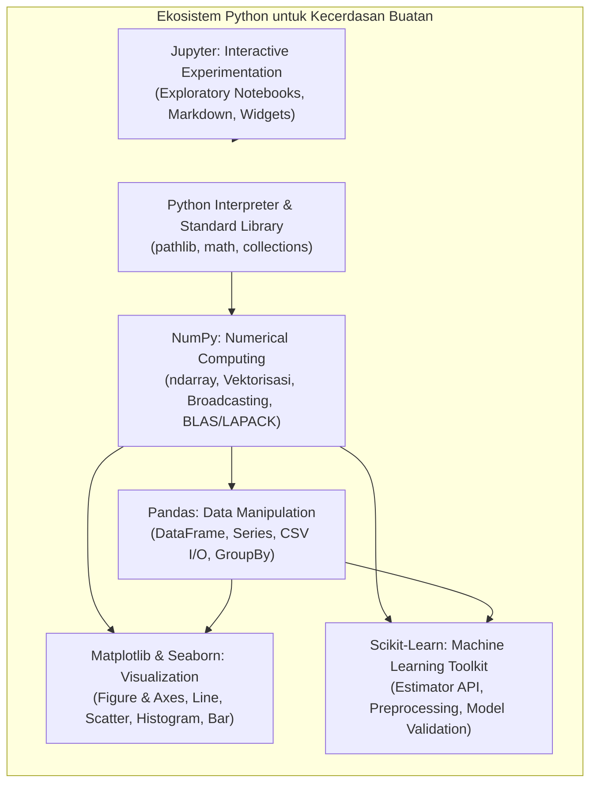
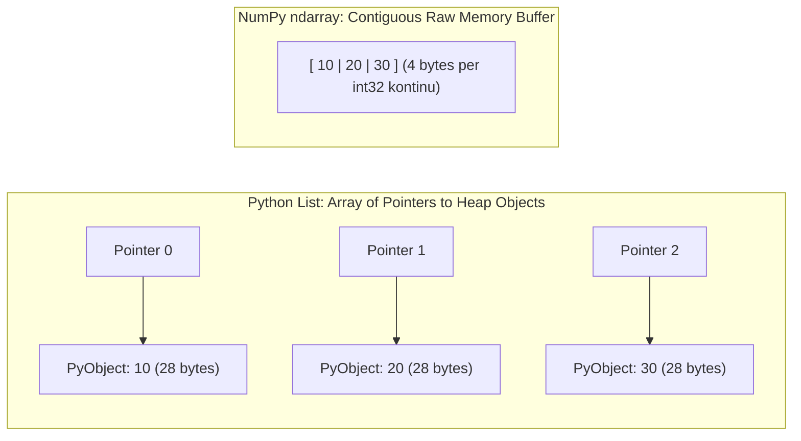
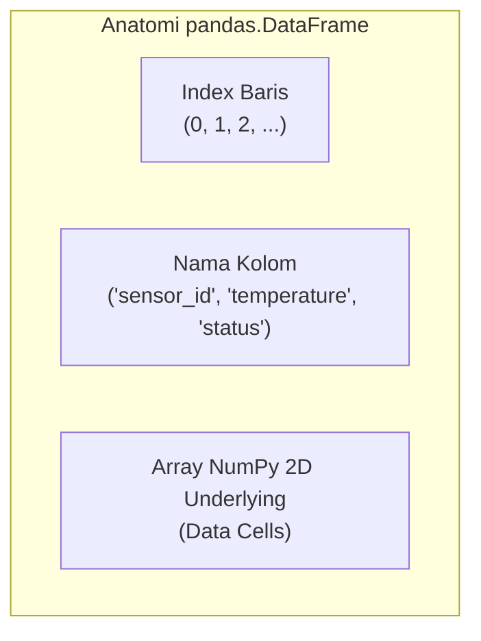

# Chapter 07: Python Ecosystem for AI

Selamat datang di **Chapter 07: Python Ecosystem for AI**. Bab ini membekali Anda dengan penguasaan praktis ekosistem perangkat lunak standar yang digunakan oleh jutaan insinyur dan peneliti kecerdasan buatan di seluruh dunia: **NumPy**, **Pandas**, **Matplotlib**, dan **Scikit-learn**, serta disiplin rekayasa perangkat lunak untuk eksperimen komputasi yang dapat direproduksi (*reproducible workflows*).

Pada Chapter 06, Anda telah memahami fondasi matematis: aljabar linear, probabilitas, statistik deskriptif, dan optimasi gradien. Kini, saatnya menerjemahkan perumusan matematika tersebut ke dalam kode komputasi modern yang berkinerja tinggi, bersih, terstruktur, dan siap pakai.

---

## 1. Capaian Pembelajaran (Learning Objectives)

Setelah menyelesaikan bab ini secara mendalam, pembelajar diharapkan mampu:
1. **Menjelaskan** arsitektur dan komponen utama ekosistem Python untuk kecerdasan buatan.
2. **Menggunakan** lingkungan virtual (*Virtual Environment*) dan manajemen dependensi (`pip`, `requirements.txt`) untuk mengisolasi proyek AI.
3. **Menggunakan** pustaka NumPy untuk komputasi numerik array berkinerja tinggi, operasi tervektorisasi, dan penyesuaian dimensi otomatis (*broadcasting*).
4. **Menggunakan** pustaka Pandas untuk manipulasi tabel data terstruktur, pembacaan file CSV, penanganan nilai hilang, dan agregasi terkelompok (*GroupBy*).
5. **Membangun** visualisasi analitis profesional menggunakan paradigma *Figure and Axes* Matplotlib dalam mode *headless*.
6. **Mengenali** dan menerapkan konvensi pola antarmuka Estimator API Scikit-learn (`fit` dan `predict`).
7. **Menggunakan** Jupyter Notebook untuk komputasi eksploratif terstruktur dengan urutan eksekusi kernel yang bersih.
8. **Menyusun** arsitektur folder proyek Python yang modular, memisahkan data, kode sumber, dan dokumentasi.
9. **Mengelola** replikasi hasil eksperimen komputasi menggunakan kontrol *random seed* dan referensi jalur berkas relatif (`pathlib`).
10. **Menjalankan** alur kerja (*workflow*) AI terpadu dari pembersihan data mentah hingga evaluasi dasar tanpa perlu mempelajari seluruh rincian algoritma Machine Learning lanjutan.

---

## 2. Prasyarat & Pengetahuan Awal

Sebelum mempelajari materi bab ini, Anda diharapkan telah:
- Memahami konsep dasar vektor, matriks, dan ringkasan statistik dari **Chapter 06: Probability, Statistics & Linear Algebra for AI**.
- Telah mengonfigurasi Python 3.11 atau 3.12 dan VS Code sesuai panduan **Getting Started** ([GS-02](file:///d:/Workstation/Repo%20My%20Corses/Kecerdasan%20Buatan/content/getting-started/gs-02.md), [GS-03](file:///d:/Workstation/Repo%20My%20Corses/Kecerdasan%20Buatan/content/getting-started/gs-03.md), dan [GS-04](file:///d:/Workstation/Repo%20My%20Corses/Kecerdasan%20Buatan/content/getting-started/gs-04.md)).

---

## 3. Peta Ekosistem Perangkat Lunak AI Python



---

## 4. Part A — Python Environment for AI

### 4.1 Mengapa Python Menjadi Lingua Franca AI?
Meskipun Python adalah bahasa *interpreted* yang memiliki overhead dinamis pada perulangan biasa, Python menjadi bahasa standar tak tertandingi di bidang AI karena tiga faktor fundamental:
1. **Sintaksis Deklaratif & Mirip Notasi Matematika**: Memungkinkan peneliti berfokus pada logika formulasi model alih-alih kompleksitas manajemen memori tingkat rendah.
2. **Kinerja Mesin Tingkat Rendah (*C/C++/CUDA Bindings*)**: Pustaka komputasi numerik intensif seperti NumPy, PyTorch, dan TensorFlow ditulis menggunakan bahasa C/C++ dan Fortran yang dioptimalkan untuk instruksi CPU modern (SIMD) dan GPU paralel. Kode Python bertindak sebagai lapisan pengendali (*orchestrator*) yang sangat cepat dan elegan.
3. **Ekosistem Terintegrasi Tanpa Batas**: Mulai dari *data ingestion* (Pandas, Polars), visualisasi (Matplotlib, Seaborn), pembelajaran mesin klasik (Scikit-learn), hingga jaringan saraf dalam (PyTorch, JAX, Hugging Face), seluruh pustaka berbagi struktur data array dasar yang sama.

### 4.2 Lingkungan Lokal vs Google Colab
- **Lingkungan Lokal (VS Code / Terminal)**: Memberikan kontrol penuh atas berkas, debugging baris demi baris, integrasi git, dan eksekusi skrip otomatis tanpa batasan kuota waktu komputasi atau pemutusan sesi daring.
- **Google Colab / Cloud Notebooks**: Lingkungan berbasis web yang menyediakan akses instan ke GPU/TPU akselerator gratis. Sangat ideal untuk eksperimen awal dan pelatihan cepat, namun kurang cocok untuk rekayasa perangkat lunak produksi yang membutuhkan struktur modul modular.

### 4.3 Virtual Environment & Manajemen Dependensi
Seperti yang telah dipelajari pada [GS-04: Virtual Environment & Package Management](file:///d:/Workstation/Repo%20My%20Corses/Kecerdasan%20Buatan/content/getting-started/gs-04.md), setiap proyek AI harus memiliki direktori lingkungan terisolasi (`.venv`):

```bash
# Membuat virtual environment
python -m venv .venv

# Mengaktifkan environment di Windows PowerShell
.venv\Scripts\Activate.ps1

# Memasang pustaka AI yang diperlukan
python -m pip install numpy pandas matplotlib scikit-learn
```

Untuk mengunci versi paket dan menjamin keterulangan (*reproducibility*), seluruh dependensi dicatat pada berkas `requirements.txt`:
```bash
python -m pip freeze > requirements.txt
```

### 4.4 Notebook vs Skrip Python: Kapan Menggunakan Masing-Masing?
- **Jupyter Notebook (`.ipynb`)**: Digunakan untuk **eksplorasi data tahap awal**, analisis visual iteratif, visualisasi grafik langkah demi langkah, dan presentasi edukasi interaktif.
- **Skrip Python Standar (`.py`)**: Digunakan untuk **logika inti yang dapat diuji**, fungsi reusable (*modules*), pipeline otomatisasi batch, integrasi ke sistem produksi, dan pengendalian versi Git yang bersih.

### 4.5 Struktur Direktori Proyek AI Terstandarisasi
Arsitektur proyek AI yang profesional memisahkan data mentah, data bersih, kode logika, dan luaran:

```text
my_ai_project/
├── data/
│   ├── raw/                 # Data mentah asli (bersifat READ-ONLY)
│   └── processed/           # Data bersih hasil prapemrosesan
├── notebooks/               # Eksplorasi interaktif tahap awal
├── src/                     # Modul kode sumber reusable (.py)
│   ├── __init__.py
│   ├── preprocessing.py
│   └── models.py
├── tests/                   # Skrip pengujian otomatis (pytest)
├── requirements.txt         # Daftar spesifikasi dependensi dan versi
└── README.md                # Dokumentasi tata cara menjalankan proyek
```

---

## 5. Part B — NumPy Fundamentals

NumPy (*Numerical Python*) adalah fondasi komputasi kuantitatif dari seluruh pustaka data science di ekosistem Python.

### 5.1 Objek Array Multidimensi (`ndarray`)
Inti dari NumPy adalah objek kelas `numpy.ndarray` (N-dimensional array).
Perbedaan mendasar antara **List Python** bawaan dan **NumPy Array**:
- **List Python**: Merupakan deretan pointer yang menunjuk ke objek Python terpisah di memori *heap*. Setiap elemen memiliki overhead metadata objek (~28 byte untuk sebuah integer), dan elemen-elemennya tersebar tidak beraturan di memori (*scattered allocation*).
- **NumPy Array**: Menyimpan data dengan tipe data homogen (*homogenous dtype*) dalam satu blok memori kontinu (*contiguous memory buffer C*). Hanya membutuhkan 4 byte untuk sebuah `int32`, dan mendukung instruksi vektorisasi perangkat keras CPU (*SIMD - Single Instruction, Multiple Data*).



### 5.2 Atribut Kunci Array NumPy
- **`.shape`**: Tuple yang merepresentasikan ukuran setiap dimensi. Contoh: Matriks 3 baris 4 kolom memiliki shape `(3, 4)`.
- **`.ndim`**: Jumlah dimensi (skalar = 0, vektor = 1, matriks = 2, volume = 3).
- **`.dtype`**: Tipe data elemen (misal: `np.float64`, `np.int32`, `np.bool_`).
- **`.size`**: Total jumlah elemen dalam array (hasil kali seluruh elemen di shape).

### 5.3 Pengindeksan, Slicing & Boolean Masking
NumPy mendukung pengindeksan berdimensi banyak dengan sintaksis ringkas `array[baris, kolom]`:

```python
import numpy as np

grid = np.array([
    [10, 20, 30],
    [40, 50, 60],
    [70, 80, 90]
])

# Mengambil baris indeks 1 lengkap: [40, 50, 60]
row_1 = grid[1, :]

# Mengambil kolom indeks 2 lengkap: [30, 60, 90]
col_2 = grid[:, 2]

# Sub-matriks 2x2 kiri atas:
sub_grid = grid[0:2, 0:2]  # [[10, 20], [40, 50]]

# Boolean Masking: memilih seluruh elemen > 45 tanpa loop for
mask = grid > 45
filtered_vals = grid[mask]  # [50, 60, 70, 80, 90]
```

### 5.4 Operasi Tervektorisasi & Mekanisme Broadcasting
**Vektorisasi (*Vectorization*)** menghilangkan kebutuhan loop `for` di Python:
```python
x = np.array([1.0, 2.0, 3.0])
y = x * 2.0 + 5.0  # Dihitung secara paralel di tingkat C: [7.0, 9.0, 11.0]
```

**Broadcasting** adalah mekanisme cerdas NumPy untuk melakukan operasi aritmetika antara array yang memiliki bentuk (*shape*) berbeda:
- Dua dimensi dikatakan kompatibel jika:
  1. Dimensi keduanya bernilai sama, **ATAU**
  2. Salah satu dimensi bernilai 1.

Contoh: Jika kita memiliki matriks fitur $\mathbf{X}$ berukuran $(4 \times 3)$ dan vektor rata-rata fitur $\boldsymbol{\mu}$ berukuran $(3,)$, NumPy secara otomatis memperluas vektor $\boldsymbol{\mu}$ menjadi $(4 \times 3)$ secara konseptual tanpa menyalin memori fisik tambahan, sehingga $\mathbf{X} - \boldsymbol{\mu}$ dapat dieksekusi secara instan!

### 5.5 Agregasi Sepanjang Sumbu (`axis=0` vs `axis=1`)
Dalam matriks 2D $(m \times n)$:
- **`axis=0` (Mereduksi Baris)**: Operasi berjalan ke bawah menelusuri baris, menghasilkan ringkasan per **kolom/fitur** (hasil berukuran $n$).
- **`axis=1` (Mereduksi Kolom)**: Operasi berjalan ke samping menelusuri kolom, menghasilkan ringkasan per **baris/sampel** (hasil berukuran $m$).

```python
X = np.array([[1, 2], [3, 4], [5, 6]])
mean_features = X.mean(axis=0)  # [3.0, 4.0] (Rata-rata fitur 1 dan fitur 2)
sum_instances = X.sum(axis=1)   # [3, 7, 11] (Penjumlahan nilai per instans)
```

---

## 6. Part C — Pandas Fundamentals

Jika NumPy adalah mesin komputasi numerik mentah, Pandas adalah perkakas pengolahan tabel data berlabel (*tabular data*).

### 6.1 Struktur Data: Series vs DataFrame
- **`pandas.Series`**: Array 1D berlabel yang mampu menampung tipe data apapun. Memiliki indeks baris bernama (*named index*).
- **`pandas.DataFrame`**: Tabel data 2D berlabel yang terdiri dari kumpulan satu atau lebih objek Series yang berbagi indeks baris yang sama.



### 6.2 Membaca Data CSV dengan Jalur Relatif Aman
Penggunaan jalur absolut *hardcoded* (seperti `D:\folder\data.csv`) sangat dilarang karena akan gagal dieksekusi saat kode dijalankan di komputer lain. Selalu gunakan modul `pathlib.Path`:

```python
from pathlib import Path
import pandas as pd

base_dir = Path(__file__).resolve().parent
csv_path = base_dir / "data" / "sensor_readings.csv"
df = pd.read_csv(csv_path)
```

### 6.3 Pengaksesan Data: `.loc` vs `.iloc`
- **`.loc` (Label-based)**: Mengakses baris dan kolom berdasarkan **nama label** atau kondisi ekspresi boolean.
  `df.loc[0:3, 'temperature_c']`
- **`.iloc` (Integer-based position)**: Mengakses baris dan kolom berdasarkan **indeks integer posisi** (0 hingga $n-1$).
  `df.iloc[0:4, 2]`

### 6.4 Penanganan Nilai Hilang (Missing Values)
Nilai hilang (*missing values*) dilambangkan sebagai `NaN` (*Not a Number*) atau `None`:
1. **Deteksi**: `df.isna().sum()` menghitung jumlah nilai kosong di setiap kolom.
2. **Penghapusan (*Dropping*)**: `df.dropna()` membuang baris yang memuat nilai hilang. Hanya bijak jika jumlah baris hilang sangat sedikit (<1%).
3. **Imputasi (*Imputation*)**: Mengisi nilai hilang dengan taksiran statistik:
   ```python
   mean_temp = df['temperature_c'].mean()
   df['temperature_c'] = df['temperature_c'].fillna(mean_temp)
   ```

### 6.5 Operasi Agregasi Terkelompok (GroupBy)
Pola **Split-Apply-Combine** memungkinkan analisis agregasi per segmen:
```python
grouped_stats = df.groupby('location')[['temperature_c', 'vibration_mms']].agg(['mean', 'max'])
```

---

## 7. Part D — Matplotlib Fundamentals

Matplotlib adalah pustaka visualisasi data tingkat dasar yang menyediakan kendali penuh atas setiap elemen grafis.

### 7.1 Paradigma Figure and Axes (Object-Oriented API)
Matplotlib memiliki dua komponen utama:
- **`Figure`**: Kanvas gambar keseluruhan (bisa memuat satu atau lebih grafik).
- **`Axes`**: Bidang grafik tempat data digambar (memiliki sumbu X, sumbu Y, judul, dan legenda).

Gunakan selalu pendekatan berorientasi objek (*Object-Oriented Interface*):
```python
import matplotlib.pyplot as plt

fig, ax = plt.subplots(figsize=(8, 5))
ax.plot(x, y, label='Garis Tren')
ax.set_title('Judul Grafik')
ax.set_xlabel('Label X')
ax.set_ylabel('Label Y')
ax.legend()
plt.show()
```

### 7.2 Eksekusi Headless (Mode Terminal Tanpa GUI)
Di lingkungan server atau pipeline otomatisasi di mana display window desktop tidak tersedia, kita wajib mengonfigurasi backend non-GUI `Agg` sebelum mengimpor `pyplot`:
```python
import matplotlib
matplotlib.use('Agg')  # Mencegah error 'no display name and no $DISPLAY environment variable'
import matplotlib.pyplot as plt

# Simpan grafik langsung ke berkas gambar
plt.savefig('output_plot.png', dpi=150, bbox_inches='tight')
plt.close(fig)
```

### 7.3 Empat Jenis Grafik Fundamental AI

| Jenis Grafik | Fungsi Utama | Kasus Penggunaan Khas AI |
|:---|:---|:---|
| **Line Plot** (`ax.plot`) | Menampilkan perubahan kuantitas sepanjang waktu berurutan. | Kurva penurunan nilai loss per iterasi (*training loss curve*), tren time-series sensor. |
| **Scatter Plot** (`ax.scatter`) | Menampilkan hubungan korelasi antara dua fitur kontinu. | Sebaran fitur (Suhu vs Getaran), visualisasi klaster data (*clustering*). |
| **Histogram** (`ax.hist`) | Memperlihatkan bentuk distribusi frekuensi variabel tunggal. | Memeriksa apakah fitur terdistribusi normal atau mengalami kemiringan (*skewness*). |
| **Bar Chart** (`ax.bar` / `ax.barh`) | Membandingkan besaran metrik agregasi antar kategori. | Akurasi perbandingan model, rata-rata anomali per lokasi fasilitas. |

---

## 8. Part E — Scikit-learn Overview

Scikit-learn (`sklearn`) adalah pustaka baku emas (*gold standard*) untuk pembelajaran mesin klasik. Bab ini memperkenalkan **antarmuka standar (API pattern)**, sedangkan pembahasan matematis mendalam mengenai tiap algoritma klasifikasi dan regresi akan dipelajari pada Level 2.

### 8.1 Pola Desain Antarmuka: Estimator API
Hampir seluruh algoritma di Scikit-learn mengimplementasikan antarmuka seragam:
1. **Inisialisasi**: Memilih model dan menetapkan *hyperparameter*.
   `model = LogisticRegression(random_state=42)`
2. **Pelatihan (`.fit(X, y)`)**: Menyesuaikan parameter model dengan data latih.
3. **Prediksi (`.predict(X_new)`)**: Menggunakan model yang telah dilatih untuk memprediksi label data baru.
4. **Transformasi (`.transform(X)`)**: Untuk pemroses awal data (*transformers* seperti `StandardScaler`).

### 8.2 Representasi Data: Matriks Fitur $\mathbf{X}$ dan Target $\mathbf{y}$
- **Matriks Fitur $\mathbf{X}$**: Wajib berupa array 2D dengan bentuk `(n_samples, n_features)`. Baris mewakili instans pengamatan, kolom mewakili variabel pengukur.
- **Vektor Target $\mathbf{y}$**: Berupa array 1D dengan bentuk `(n_samples,)` yang memuat label kelas atau nilai kontinu yang ingin diprediksi.

### 8.3 Pembagian Data: Train / Test Split
Untuk menguji kemampuan generalisasi model secara jujur, dataset wajib dibagi menjadi data latih (*training set*) dan data uji (*testing set*):
```python
from sklearn.model_selection import train_test_split

X_train, X_test, y_train, y_test = train_test_split(
    X, y, test_size=0.30, random_state=42, stratify=y
)
```

### 8.4 Pencegahan Kebocoran Data (Data Leakage)
> [!CAUTION]
> **Aturan Sakral Prapemrosesan Fitur**:
> Jangan pernah memanggil `StandardScaler().fit()` pada seluruh dataset sebelum pemisahan data!
> Melakukan fit pada seluruh data membocorkan informasi rata-rata dan deviasi data uji ke dalam data latih (*Data Leakage*).
> **Pola yang benar**:
> 1. `scaler.fit(X_train)` (Hanya pelajari statistik dari data latih)
> 2. `X_train_scaled = scaler.transform(X_train)`
> 3. `X_test_scaled = scaler.transform(X_test)` (Terapkan statistik data latih ke data uji)

---

## 9. Part F — Jupyter & Reproducible Workflow

### 9.1 Siklus Eksekusi Jupyter Notebook
Jupyter Notebook mengeksekusi kode di dalam sel yang berbagi keadaan memori (*state*) pada satu proses latar belakang (*Kernel*).
- **Nomor Urut Eksekusi `[ ]`**: Menunjukkan urutan fisik sel tersebut dijalankan. Sel yang dieksekusi di bawah dapat mengubah variabel sel di atasnya!
- **Disiplin "Restart and Run All"**: Sebelum membagikan notebook kepada orang lain, selalu lakukan **Kernel -> Restart & Run All** untuk membuktikan bahwa notebook Anda dapat dijalankan dari atas ke bawah tanpa kesalahan dependensi keadaan sel yang teracak.

### 9.2 Prinsip Reproduksibilitas Riset AI
Sebuah eksperimen AI dikatakan dapat direproduksi (*reproducible*) jika peneliti lain pada komputer yang berbeda mampu memperoleh luaran numerik yang identik menggunakan data dan kode yang sama.

Langkah-langkah esensial menjamin reproduksibilitas:
1. **Kunci Nilai Seed Acak**:
   ```python
   import random, os, numpy as np
   def set_seed(seed=42):
       random.seed(seed)
       np.random.seed(seed)
       os.environ['PYTHONHASHSEED'] = str(seed)
   ```
2. **Kunci Versi Pustaka**: Catat seluruh pustaka pada berkas `requirements.txt`.
3. **Gunakan Jalur Relatif**: Manfaatkan `pathlib.Path` untuk mengakses berkas lokal.

---

## 10. Latihan Bertingkat & Pembahasan Komprehensif

### 10.1 Latihan Tingkat Dasar (Level 1)
**Soal 1.1**: Buatlah sebuah array NumPy 2D berukuran $3 \times 3$ yang memuat bilangan bulat dari $1$ sampai $9$.
1. Cetak bentuk (*shape*) dan tipe data (*dtype*) array tersebut.
2. Ambil elemen baris ke-2 kolom ke-3 (ingat konvensi indeks 0-based).
3. Ambil kolom ke-2 secara lengkap.

**Pembahasan 1.1**:
```python
import numpy as np

# 1. Pembuatan array
arr = np.arange(1, 10).reshape((3, 3))
print("Array:\n", arr)
print("Shape:", arr.shape)
print("Dtype:", arr.dtype)

# 2. Baris ke-2 (indeks 1), Kolom ke-3 (indeks 2)
val = arr[1, 2]
print("Elemen (1, 2):", val)  # Output: 6

# 3. Kolom ke-2 (indeks 1) lengkap
col_1 = arr[:, 1]
print("Kolom 1:", col_1)      # Output: [2, 5, 8]
```

---

### 10.2 Latihan Tingkat Menengah (Level 2)
**Soal 2.1**: Diberikan sebuah DataFrame pengamatan sensor:
```python
df = pd.DataFrame({
    'suhu': [22.0, np.nan, 28.0, 31.0, 24.0],
    'lokasi': ['Ruang A', 'Ruang B', 'Ruang A', 'Ruang B', 'Ruang A']
})
```
1. Periksa jumlah nilai kosong pada kolom `suhu`.
2. Isi nilai kosong tersebut menggunakan rata-rata suhu dari lokasi yang bersangkutan (imputasi bersyarat per grup lokasi).

**Pembahasan 2.1**:
```python
import pandas as pd
import numpy as np

# 1. Deteksi missing values
print("Missing values awal:\n", df.isna().sum())

# 2. Imputasi berbasis rata-rata kelompok lokasi
df['suhu'] = df.groupby('lokasi')['suhu'].transform(lambda g: g.fillna(g.mean()))
print("DataFrame setelah imputasi:\n", df)
# Baris indeks 1 (Ruang B) terisi nilai 31.0 (karena hanya ada satu data valid di Ruang B yakni 31.0)
```

---

### 10.3 Latihan Tingkat Lanjut (Level 3)
**Soal 3.1**: Mengapa potongan kode di bawah ini melanggar etika rekayasa machine learning dan memicu kebocoran data (*data leakage*)? Jelaskan koreksinya secara bertahap:
```python
from sklearn.preprocessing import StandardScaler
from sklearn.model_selection import train_test_split

# Kode bermasalah:
scaler = StandardScaler()
X_scaled = scaler.fit_transform(X)  # <-- KESALAHAN FATAL
X_train, X_test, y_train, y_test = train_test_split(X_scaled, y, test_size=0.25)
```

**Pembahasan 3.1**:
- **Penyebab Pelanggaran**: Pemanggilan `scaler.fit_transform(X)` menghitung mean $\mu$ dan standar deviasi $\sigma$ dari **seluruh dataset**, termasuk data uji ($X_{test}$). Ini berarti data latih telah "terkontaminasi" oleh informasi distribusi statistik data uji yang seharusnya tidak boleh diketahui oleh model sebelum fase pengujian. Hal ini menyebabkan estimasi akurasi model terlihat terlalu optimis (*over-optimistic*) namun jeblok ketika di-deploy ke dunia nyata.
- **Koreksi yang Benar**:
```python
# 1. Pisahkan data terlebih dahulu
X_train, X_test, y_train, y_test = train_test_split(X, y, test_size=0.25, random_state=42)

# 2. Fit HANYA pada data latih
scaler = StandardScaler()
X_train_scaled = scaler.fit_transform(X_train)

# 3. Transform data uji menggunakan parameter statistik yang dipelajari dari data latih
X_test_scaled = scaler.transform(X_test)
```

---

## 11. Tugas Mini Project: Reproducible Python Data Analysis Workflow

### 11.1 Deskripsi Masalah
Sebagai insinyur AI di laboratorium industri manufaktur cerdas, Anda diminta mengembangkan modul analisis data otomatis yang dapat direproduksi secara mandiri oleh tim audit eksternal. Modul ini bertugas membaca dataset log sensor getaran dan suhu, membersihkan anomali pencatatan, memvisualisasikan korelasi multi-metrik, dan menyiapkan pipeline prapemrosesan fitur Scikit-learn yang terstandarisasi.

### 11.2 Persyaratan Pengerjaan
Mahasiswa diwajibkan menyusun paket berkas Python mandiri (`sensor_analysis_pipeline.py`) atau companion notebook yang memenuhi kriteria:
1. **Pengorganisasian Proyek & Lingkungan**:
   - Memiliki berkas `requirements.txt` yang valid.
   - Menggunakan `pathlib.Path` untuk seluruh operasi I/O berkas (tanpa hardcoded absolute path).
   - Mengendalikan *random seed* global (`seed=42`).
2. **Manipulasi Data NumPy & Pandas**:
   - Memuat dataset pengamatan [`data/sensor_readings.csv`](file:///d:/Workstation/Repo%20My%20Corses/Kecerdasan%20Buatan/content/level-1-ai-foundations/chapter-07/code/data/sensor_readings.csv).
   - Mendeteksi dan mengimputasi nilai hilang secara metodologis.
   - Melakukan agregasi statistik terkelompok (*GroupBy*) berdasarkan lokasi fasilitas.
   - Menghasilkan matriks fitur NumPy $\mathbf{X}$ dan vektor target $\mathbf{y}$ (0=Normal, 1=Anomali).
3. **Visualisasi Data Matplotlib**:
   - Menghasilkan kanvas dashboard multi-grafik (minimal 2 subplot: tren runut waktu dan sebaran korelasi fitur).
   - Menata label sumbu, judul, legenda, dan mengekspor gambar ke berkas PNG dalam mode *headless*.
4. **Siklus Estimator API Scikit-learn**:
   - Melakukan *train/test split* dengan stratifikasi kelas.
   - Menstandarisasi fitur menggunakan `StandardScaler` tanpa kebocoran data.
   - Menjalankan demonstrasi alur Estimator (`fit` dan `predict`).
   - Melaporkan akurasi pengujian dan matriks konfusi (*confusion matrix*).
5. **Uji Validasi Reproduksibilitas**:
   - Menyertakan fungsi asersi yang membuktikan bahwa dua eksekusi pipeline berturut-turut menghasilkan nilai prediksi numerik yang tepat identik (selisih nol mutlak).
6. **Laporan & Dokumentasi**:
   - Menyusun berkas `README.md` yang memuat petunjuk eksekusi langkah demi langkah beserta catatan keterbatasan teknis.

---

### 11.3 Rubrik Penilaian 100 Poin

| Kriteria Penilaian | Bobot | Deskripsi Skor Penuh (100%) | Deskripsi Skor Parsial (50-80%) | Tidak Terpenuhi (0-40%) |
|:---|:---:|:---|:---|:---|
| **Project Organization** | 15 poin | Struktur folder teratur, referensi jalur berkas menggunakan `pathlib` relatif kebal lingkungan, dependensi tercatat rapi di `requirements.txt`. | Berkas bekerja tetapi menggunakan sebagian hardcoded path atau struktur folder kurang terstandarisasi. | Jalur berkas rusak saat dijalankan di komputer lain, absolute path hardcoded. |
| **NumPy Implementation** | 20 poin | Manipulasi array, slicing, operasi tervektorisasi, dan penanganan dimensi konsisten dan efisien tanpa perulangan `for` lambat. | Menggunakan NumPy tetapi masih terdapat loop `for` yang tidak perlu untuk operasi elemen. | Kesalahan bentuk (*shape mismatch*) atau tipe data array salah. |
| **Pandas Data Handling** | 20 poin | Deteksi missing values tepat, strategi imputasi jelas dan beralasan, agregasi GroupBy menghasilkan wawasan analitis bermakna. | Missing values diisi tetapi strategi kurang tepat (misal membuang baris data tanpa alasan jelas). | Kode memicu error saat memproses DataFrame atau data rusak. |
| **Visualization Quality** | 15 poin | Dashboard minimal 2 plot rapi, informatif, berlabel lengkap, menggunakan paradigma Figure & Axes, diekspor via backend headless. | Visualisasi terbentuk tetapi label sumbu/judul hilang, atau grafik bertumpuk tanpa penataan layout. | Gagal menyimpan visualisasi atau memicu GUI error saat dijalankan di terminal. |
| **Reproducibility & Validation** | 20 poin | Random seed terkendali, pipeline deterministik, menyertakan uji kesamaan luaran numerik antar siklus eksekusi. | Random seed diatur tetapi urutan eksekusi memicu perbedaan hasil pada pengujian berulang. | Hasil tidak konsisten antar eksekusi, tanpa kontrol seed. |
| **Documentation & References** | 10 poin | Dokumentasi petunjuk eksekusi jelas, mencantumkan penjelasan hasil, keterbatasan teknis, dan referensi resmi. | Dokumentasi ada namun sangat singkat atau minim penjelasan interpretasi hasil. | Tidak ada dokumentasi atau plagiasi. |

---

## 12. Ringkasan Bab (Summary)

1. **Python sebagai Lingua Franca**: Menghubungkan kenyamanan sintaks tingkat tinggi dengan efisiensi komputasi mesin biner C/C++ dan akselerasi perangkat keras GPU.
2. **NumPy `ndarray`**: Menyimpan data homogen dalam blok memori kontinu C yang sangat efisien, mendukung operasi tervektorisasi tanpa loop `for`, serta penyesuaian dimensi otomatis (*broadcasting*).
3. **Pandas DataFrame**: Struktur tabel data 2D berlabel yang menyediakan fungsi pemuatan data CSV fleksibel, imputasi nilai hilang, dan agregasi terkelompok (*GroupBy*).
4. **Matplotlib Object-Oriented**: Memisahkan kanvas (`Figure`) dan bidang grafik (`Axes`). Penggunaan backend `Agg` memungkinkan eksekusi dan ekspor gambar grafik secara *headless* di server terminal.
5. **Konvensi Estimator API Scikit-learn**: Pola desain seragam `.fit(X, y)` untuk pelatihan dan `.predict(X_new)` untuk inferensi. Standarisasi fitur wajib dilakukan setelah pemisahan *train/test split* guna mencegah kebocoran data (*data leakage*).
6. **Disiplin Reproduksibilitas**: Pengaturan nilai *random seed* global, penggunaan jalur berkas relatif `pathlib`, isolasi lingkungan virtual, dan penguncian dependensi `requirements.txt` adalah pilar integritas penelitian AI modern.

---

## 13. Referensi Primer Terverifikasi

1. **Harris, C. R., Millman, K. J., van der Walt, S. J., et al.** (2020). *Array programming with NumPy*. Nature, 585(7825), 357–362. https://doi.org/10.1038/s41586-020-2649-2
2. **McKinney, W.** (2022). *Python for Data Analysis: Data Wrangling with pandas, NumPy, and Jupyter (3rd ed.)*. O'Reilly Media. https://wesmckinney.com/book/
3. **Hunter, J. D.** (2007). *Matplotlib: A 2D Graphics Environment*. Computing in Science & Engineering, 9(3), 90–95. https://doi.org/10.1109/MCSE.2007.55
4. **Pedregosa, F., Varoquaux, G., Gramfort, A., et al.** (2011). *Scikit-learn: Machine Learning in Python*. Journal of Machine Learning Research, 12, 2825–2830. https://scikit-learn.org/
5. **Kluyver, T., Ragan-Kelley, B., Pérez, F., et al.** (2016). *Jupyter Notebooks — a publishing format for reproducible computational workflows*. Positioning and Power in Academic Publishing: Players, Agents and Agendas, 87–90. https://jupyter.org/

