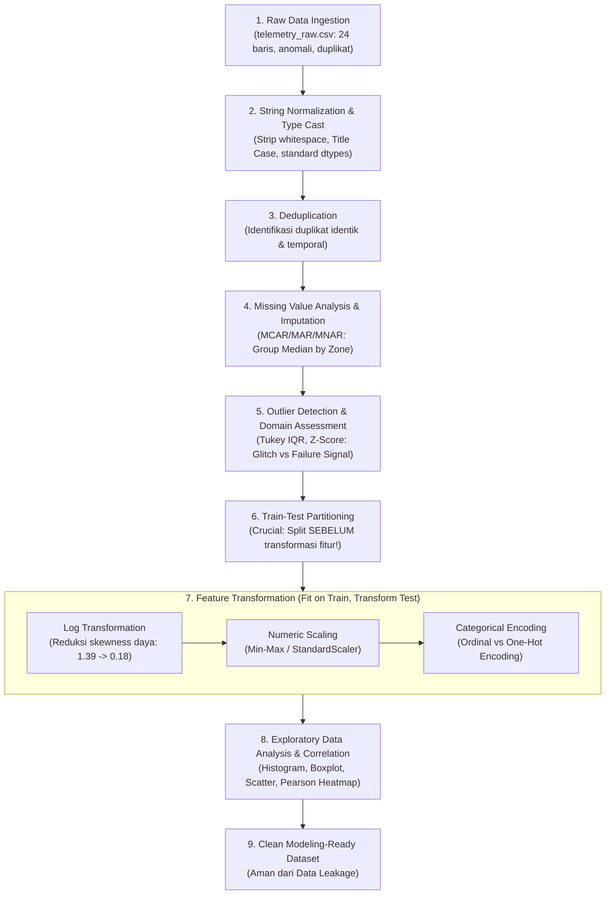

# Chapter 08: Data Preparation & Exploratory Analysis

Selamat datang di **Chapter 08: Data Preparation & Exploratory Analysis**. Bab ini membekali Anda dengan metodologi, disiplin rekayasa, dan fondasi analitis untuk mempersiapkan data mentah (*raw data*) menjadi representasi terstruktur yang berkualitas tinggi sebelum dimasukkan ke dalam model kecerdasan buatan.

Pada Chapter 07, Anda telah menguasai ekosistem pemrograman Python (NumPy, Pandas, Matplotlib, dan Scikit-learn). Di dunia nyata, data yang dihasilkan oleh sensor industri, catatan transaksi perbankan, maupun log sistem komputasi jarang sekali berada dalam kondisi bersih dan siap latih. Tanpa pembersihan data (*data cleaning*), penanganan nilai hilang (*missing values*), deteksi pencilan (*outliers*), transformasi skala, dan analisis korelasi eksploratif (*Exploratory Data Analysis* - EDA), model AI secanggih apa pun akan gagal memprediksi secara akurat akibat prinsip dasar komputasi: **Garbage In, Garbage Out (GIGO)**.

---

## 1. Capaian Pembelajaran (Learning Objectives)

Setelah menyelesaikan bab ini secara mendalam, pembelajar diharapkan mampu:
1. **Menjelaskan** filosofi *Data-Centric AI* serta dampak kualitas data mentah terhadap keandalan sistem kecerdasan buatan.
2. **Mengidentifikasi** tipe-tipe anomali data tabular, termasuk ketidakkonsistenan penulisan teks, duplikasi baris, dan kesalahan format tipe data.
3. **Menganalisis** tiga mekanisme kekosongan data (*Missing Completely at Random* [MCAR], *Missing at Random* [MAR], dan *Missing Not at Random* [MNAR]) untuk memilih metode imputasi yang tepat.
4. **Menerapkan** teknik imputasi terkelompok (*group-based median imputation*) berbasis fitur kontekstual menggunakan Pandas.
5. **Mendeteksi** pencilan (*outliers*) menggunakan metode statistik non-parametrik (Tukey's Interquartile Range - IQR) dan parametrik (Z-Score).
6. **Mengevaluasi** konteks rekayasa domain (*domain engineering*) untuk membedakan apakah pencilan merupakan *sensor glitch* yang harus disaring atau sinyal kegagalan mekanis kritis yang wajib dipertahankan.
7. **Membandingkan** efek penyekalaan fitur (*Min-Max Scaling*, *StandardScaler*, dan *RobustScaler*) serta mereduksi *skewness* distribusi menggunakan transformasi logaritma.
8. **Mengimplementasikan** pengkodean variabel kategorikal (*Ordinal Encoding* vs *One-Hot Encoding*) dan menghindari jebakan multikolinearitas (*Dummy Variable Trap*).
9. **Membangun** visualisasi analitis univariat, bivariat, dan matriks korelasi Pearson secara terstruktur menggunakan Matplotlib dalam mode *headless*.
10. **Merancang** alur kerja pemrosesan data yang bebas dari kebocoran data (*data leakage*) dengan memisahkan partisi *training* dan *testing* sebelum estimasi parameter statistik.

---

## 2. Prasyarat & Pengetahuan Awal

Sebelum mempelajari materi bab ini, Anda diharapkan telah:
- Memahami konsep dasar statistik deskriptif (mean, median, variansi, standar deviasi, persentil, dan korelasi) dari [Chapter 06: Probability, Statistics & Linear Algebra for AI](file:///d:/Workstation/Repo%20My%20Corses/Kecerdasan%20Buatan/content/level-1-ai-foundations/chapter-06/index.md).
- Menguasai manipulasi DataFrame Pandas, komputasi array NumPy, dan visualisasi Matplotlib dari [Chapter 07: Python Ecosystem for AI](file:///d:/Workstation/Repo%20My%20Corses/Kecerdasan%20Buatan/content/level-1-ai-foundations/chapter-07/index.md).

---

## 3. Peta Alur Kerja Data Preparation & EDA



---

## 4. Part A — Fondasi & Filosofi Data dalam AI

### 4.1 Prinsip GIGO: Garbage In, Garbage Out
Salah satu kesalahpahaman umum dalam kecerdasan buatan adalah anggapan bahwa algoritma pembelajaran mesin mutakhir (seperti Deep Neural Networks atau Gradient Boosted Trees) dapat secara otomatis mengatasi data input yang cacat. Pada kenyataannya, algoritma AI bersifat murni matematis: model memetakan relasi fungsional dari pola data yang disajikan kepadanya.

Jika data pelatihan mengandung:
- **Noise pengukuran tinggi**: Model akan mempelajari *spurious correlation* (pola kebetulan semu).
- **Nilai hilang tak tertangani**: Algoritma komputasi matriks akan memicu kegagalan numerik (`NaN / Inf`).
- **Skala variabel timpang**: Fitur bernilai ribuan (misal: daya listrik dalam Watt) akan mendominasi fungsi objektif gradien dibandingkan fitur bernilai desimal (misal: getaran mekanis dalam mm/s).
- **Label bias**: Model akan mereplikasi ketidakadilan sistemik masa lalu.

Prinsip **Garbage In, Garbage Out** menegaskan bahwa kapasitas performa model AI dibatasi secara fundamental oleh kualitas representasi data yang dikonsumsinya.

### 4.2 Data-Centric AI vs Model-Centric AI
Secara historis, komunitas kecerdasan buatan berfokus pada paradigma **Model-Centric**, di mana data dianggap statis (tetap), sementara para peneliti terus-menerus memodifikasi arsitektur neural, hyperparameter, atau fungsi aktivasi guna menaikkan skor metrik 0.5%.

Sebaliknya, paradigma modern yang dipopulerkan oleh Andrew Ng memperkenalkan gerakan **Data-Centric AI**:
> *"Dalam Data-Centric AI, arsitektur model dipertahankan konstan (menggunakan algoritma standar yang terbukti stabil), sementara upaya rekayasa difokuskan secara sistematis pada perbaikan kualitas data: membersihkan label yang salah, mengisi missing values secara cerdas, mengoreksi inkonsistensi sensor, dan memastikan distribusi data seimbang."*

Tabel berikut merangkum perbedaan esensial kedua paradigma:

| Dimensi | Paradigma Model-Centric | Paradigma Data-Centric |
| :--- | :--- | :--- |
| **Fokus Utama** | Mencari arsitektur algoritma terbaik | Meningkatkan konsistensi & kebersihan data |
| **Status Dataset** | Dianggap *benchmark* beku (*frozen*) | Ditingkatkan dan dibersihkan secara iteratif |
| **Penanganan Error** | Menambah kedalaman layer model | Menyelidiki sampel data spesifik yang memicu salah prediksi |
| **Efektivitas Industri** | Sering kali *diminishing returns* | Menghasilkan peningkatan akurasi dramatis di produksi |

---

## 5. Part B — Data Cleaning: Missing Values, Duplikasi, dan Inkonsistensi

### 5.1 Mekanisme Kekosongan Data (Missing Data Mechanisms)
Donald Rubin (1976) mengklasifikasikan nilai hilang menjadi tiga mekanisme probabilistik utama:

1. **Missing Completely at Random (MCAR)**:
   Probabilitas terjadinya nilai hilang sama sekali tidak bergantung pada variabel yang diamati maupun variabel yang tidak teramati.
   $$\mathbb{P}(M | Y_{\text{obs}}, Y_{\text{mis}}) = \mathbb{P}(M)$$
   *Contoh*: Seorang operator pabrik tidak sengaja tersandung kabel transmisi sehingga 2 pembacaan sensor putus sesaat secara acak.

2. **Missing at Random (MAR)**:
   Probabilitas terjadinya nilai hilang bergantung pada variabel teramati lainnya, tetapi tidak bergantung pada nilai dari variabel yang hilang itu sendiri.
   $$\mathbb{P}(M | Y_{\text{obs}}, Y_{\text{mis}}) = \mathbb{P}(M | Y_{\text{obs}})$$
   *Contoh*: Sensor suhu di *Server Room* lebih sering mati saat pendingin ruangan berada dalam status `OFF` (karena sensor mendeteksi kondensasi eksternal), tetapi peluang matinya sensor tidak bergantung pada apakah suhu ruang server tersebut $25^\circ\text{C}$ atau $26^\circ\text{C}$.

3. **Missing Not at Random (MNAR)**:
   Probabilitas terjadinya nilai hilang secara langsung bergantung pada nilai yang seharusnya tercatat (nilai yang hilang tersebut).
   $$\mathbb{P}(M | Y_{\text{obs}}, Y_{\text{mis}}) \neq \mathbb{P}(M | Y_{\text{obs}})$$
   *Contoh*: Termokopel industri meleleh dan berhenti mengirim sinyal justru karena suhu turbin melampaui ambang batas maksimumnya ($>100^\circ\text{C}$). Jika baris data ini dibuang begitu saja, dataset akan kehilangan sampel-sampel kegagalan termal paling kritis!

### 5.2 Strategi Penanganan Missing Values
- **Listwise Deletion (Penghapusan Baris)**: Hanya dibenarkan jika sampel data sangat masif ($>100.000$ baris) dan proporsi missing sangat kecil ($<1\%$) dengan mekanisme MCAR murni. Jika diterapkan pada MAR/MNAR, penghapusan baris akan menimbulkan bias estimasi yang parah.
- **Global Mean/Median Imputation**: Mengisi nilai kosong dengan rata-rata atau median seluruh kolom. Meskipun cepat, metode ini mereduksi variansi alami data dan mengabaikan segmentasi data.
- **Group-Based Imputation (Imputasi Terkelompok)**: Mengelompokkan data berdasarkan fitur kategori kunci (seperti zona atau fasilitas) lalu mengisi missing values menggunakan median kelompok terkait. Ini mempertahankan struktur fisik data.

Pada dataset pengamatan telemetri turbin kami ([`telemetry_raw.csv`](file:///d:/Workstation/Repo%20My%20Corses/Kecerdasan%20Buatan/content/level-1-ai-foundations/chapter-08/code/data/telemetry_raw.csv)), zona *Production* memiliki suhu median $\approx 43.1^\circ\text{C}$, sedangkan *Server Room* memiliki suhu median $\approx 24.5^\circ\text{C}$. Mengisi missing value di *Production* dengan rata-rata global ($35.3^\circ\text{C}$) akan menggeser suhu ruang produksi menjadi tidak realistis dingin!

```python
# Penerapan Group-Based Median Imputation
df['zone_clean'] = df['zone'].astype(str).str.strip().str.title()
df['temperature_c'] = df.groupby('zone_clean')['temperature_c'].transform(
    lambda s: s.fillna(s.median())
)
```

### 5.3 Normalisasi String dan Deduplikasi
Data mentah sering tercemar oleh inkonsistensi kapitalisasi (`'production'` vs `'Production'`) dan spasi liar (`' Server Room '`). Jika tidak dinormalisasi, pustaka agregasi akan memperlakukan string tersebut sebagai entitas kategori yang terpisah.
Setelah standardisasi teks selesai, duplikasi identik dapat dideteksi dan dieliminasi menggunakan `drop_duplicates(keep='first')`.

---

## 6. Part C — Deteksi dan Penanganan Pencilan (Outliers)

Pencilan (*outlier*) adalah titik pengamatan yang memiliki deviasi jarak yang sangat jauh dari pola distribusi mayoritas sampel lainnya.

### 6.1 Metode Tukey Interquartile Range (IQR)
Metode Tukey adalah uji statistik non-parametrik yang tangguh (*robust*) terhadap bentuk sebaran data (tidak mengasumsikan data terdistribusi normal).
Diberikan kuartil bawah $Q_1$ (persentil ke-25) dan kuartil atas $Q_3$ (persentil ke-75):
$$\text{IQR} = Q_3 - Q_1$$

Batas ambang pagar dalam didefinisikan sebagai:
$$\text{Batas Bawah} = Q_1 - 1.5 \times \text{IQR}$$
$$\text{Batas Atas} = Q_3 + 1.5 \times \text{IQR}$$

Observasi di luar rentang $[\text{Batas Bawah}, \text{Batas Atas}]$ ditandai sebagai pencilan.

### 6.2 Metode Z-Score
Untuk data yang diasumsikan berdistribusi Gaussian/Normal $\mathcal{N}(\mu, \sigma^2)$, Z-score mengukur seberapa banyak standar deviasi suatu titik data $x$ berada dari rata-rata populasi $\mu$:
$$Z = \frac{x - \mu}{\sigma}$$
Titik data umumnya diklasifikasikan sebagai pencilan ekstrim jika $|Z| > 3.0$ (probabilitas kemunculan di bawah $0.27\%$).

### 6.3 Analisis Kritis Domain Engineering: Noise vs Sinyal Kegagalan
Salah satu kekeliruan paling fatal seorang analis data pemula adalah secara otomatis membuang semua pencilan statistik yang terdeteksi.
Pertimbangkan observasi indeks 10 pada dataset kita:
- Suhu: $88.5^\circ\text{C}$ (Ambang batas atas IQR: $57.15^\circ\text{C}$, $Z = +3.65$).
- Getaran: $3.85\text{ mm/s}$ (Normal: $0.1 - 0.9\text{ mm/s}$).
- Daya: $210.5\text{ kW}$ (Normal: $45 - 125\text{ kW}$).

Korelasi multivariat menunjukkan ketiga parameter melonjak secara simultan. Ini membuktikan bahwa suhu $88.5^\circ\text{C}$ **bukanlah kesalahan transmisi sensor (bukan noise)**, melainkan kejadian fisik nyata berupa *mechanical overheating overload*. Jika baris ini dihapus secara gegabah, sistem AI deteksi dini kerusakan pabrik tidak akan pernah mempelajari pola kerusakan mesin!

Jika algoritma yang digunakan sensitif terhadap magnitudo skala (misalnya regresi linier tanpa penalti), teknik yang tepat adalah **Winsorization / Capping**:
$$x_{\text{capped}} = \min(\max(x, \text{Persentil}_5), \text{Persentil}_{95})$$

---

## 7. Part D — Transformasi dan Penyekalaan Fitur

Fitur numerik mentah sering kali memiliki satuan dan rentang nilai yang sangat timpang. Algoritma berbasis jarak (k-NN, SVM, K-Means) dan algoritma berbasis optimasi gradien (Gradient Descent, Neural Networks) akan mengalami kendala konvergensi jika fitur tidak diselaraskan.

### 7.1 Min-Max Scaling (Normalisasi)
Mentransformasikan nilai fitur ke rentang tertutup yang seragam, biasanya $[0, 1]$:
$$x_{\text{norm}} = \frac{x - x_{\min}}{x_{\max} - x_{\min}}$$
- **Kelebihan**: Mengunci batas ekstremitas secara presisi, sangat cocok untuk citra piksel atau algoritma yang membutuhkan batas tegas.
- **Kelemahan**: Sangat rentan terhadap pencilan. Satu outlier ekstrem akan memampatkan seluruh data normal lainnya mendekati angka 0.

### 7.2 Standardisasi Z-Score (StandardScaler)
Mentransformasikan fitur sehingga memiliki rata-rata nol ($\mu = 0$) dan variansi satu ($\sigma = 1$):
$$x_{\text{std}} = \frac{x - \mu}{\sigma}$$
- **Kelebihan**: Tidak membatasi nilai pada interval tertentu, menjaga struktur sebaran data, dan sangat kompatibel dengan asumsi algoritma linear serta neural network.
- **Kelemahan**: Nilai ekstrem tetap menghasilkan skala besar.

### 7.3 Transformasi Logaritma untuk Mereduksi Skewness
Banyak fitur riil (seperti konsumsi daya, pendapatan finansial, atau durasi waktu) memiliki distribusi miring ke kanan (*positively skewed*) dengan ekor panjang (*long tail*). Kemiringan (*skewness*) yang tinggi dapat menurunkan linearitas model.

Transformasi $\log(1 + x)$ atau `np.log1p()` memampatkan ekor panjang:
$$y = \ln(1 + x)$$
Pada data telemetri kita, fitur `power_kw` memiliki skewness awal $+1.3959$ (sangat miring). Setelah diterapkan transformasi logaritma, nilai skewness berhasil ditekan menjadi $+0.1829$ (mendekati distribusi normal simetris sempurna).

---

## 8. Part E — Encoding Variabel Kategorikal

Algoritma AI beroperasi pada matriks aljabar linier numerik dan tidak dapat memproses string mentah. Oleh karena itu, variabel kategorikal harus dikonversi ke representasi numerik.

### 8.1 Ordinal Encoding
Digunakan secara eksklusif untuk variabel kategorikal yang memiliki **hierarki atau urutan alami (*inherent order*)**.
*Contoh*: Status pendingin mesin turbin:
$$\text{OFF} \to 0, \quad \text{STANDBY} \to 1, \quad \text{ACTIVE} \to 2$$
Pemetaan ini masuk akal secara semantik karena level pendinginan memang meningkat secara bertingkat.

### 8.2 One-Hot Encoding & Dummy Variable Trap
Digunakan untuk variabel nominal **tanpa hierarki urutan**.
*Contoh*: Lokasi zona turbin (`Production`, `Server Room`, `Warehouse`).
Jika zona ini dipetakan secara ordinal ($0, 1, 2$), algoritma linear akan salah menafsirkan bahwa *Warehouse (2)* bernilai "dua kali lipat lebih besar" daripada *Server Room (1)*.

One-Hot Encoding membuat $k$ kolom biner baru:
- `zone_Production`: $[1, 0, 0]$
- `zone_Server Room`: $[0, 1, 0]$
- `zone_Warehouse`: $[0, 0, 1]$

**Dummy Variable Trap**:
Perhatikan bahwa jika kita mengetahui suatu baris bernilai `0` untuk *Production* dan `0` untuk *Server Room*, maka dapat dipastikan secara matematis bahwa zona tersebut adalah *Warehouse*.
$$\text{zone\_Warehouse} = 1 - (\text{zone\_Production} + \text{zone\_Server Room})$$
Kondisi ini menimbulkan **multikolinearitas sempurna (*perfect collinearity*)**, yang menyebabkan matriks kovarians $(\mathbf{X}^T \mathbf{X})$ menjadi singular dan tidak dapat diinverskan dalam regresi linier OLS standar. Untuk mengatasinya, gunakan parameter `drop_first=True` ($k-1$ kolom dummy) pada model parametrik.

---

## 9. Part F — Analisis Data Eksploratif (EDA) & Analisis Korelasi

Exploratory Data Analysis (EDA) adalah pendekatan analisis kumpulan data untuk merangkum karakteristik utamanya, sering kali dengan representasi visual grafis.

### 9.1 Taksonomi Analisis Visual
1. **Analisis Univariat**: Memeriksa sebaran satu variabel secara mandiri (Histogram untuk frekuensi, KDE untuk kurva densitas, Boxplot untuk deteksi kuartil).
2. **Analisis Bivariat**: Menyelidiki hubungan antara dua variabel (Scatter plot untuk kontinu vs kontinu, Boxplot terkelompok untuk kategori vs kontinu).
3. **Analisis Multivariat**: Mengkaji interaksi tiga atau lebih variabel secara simultan (Pairplot, bubble scatter berdimensi warna, atau matriks korelasi).

Visualisasi dashboard analitis yang dihasilkan oleh skrip [`exploratory_analysis.py`](file:///d:/Workstation/Repo%20My%20Corses/Kecerdasan%20Buatan/content/level-1-ai-foundations/chapter-08/code/exploratory_analysis.py) tersimpan pada [`telemetry_eda_dashboard.png`](file:///d:/Workstation/Repo%20My%20Corses/Kecerdasan%20Buatan/content/level-1-ai-foundations/chapter-08/code/data/telemetry_eda_dashboard.png).

### 9.2 Koefisien Korelasi Linear Pearson
Koefisien korelasi Pearson $r$ mengukur derajat hubungan linear antara dua variabel kontinu $X$ dan $Y$:
$$r_{xy} = \frac{\sum_{i=1}^{n} (x_i - \bar{x})(y_i - \bar{y})}{\sqrt{\sum_{i=1}^{n} (x_i - \bar{x})^2} \sqrt{\sum_{i=1}^{n} (y_i - \bar{y})^2}}$$
Nilai $r$ berada dalam rentang $[-1.0, +1.0]$:
- $r = +1.0$: Korelasi linear positif sempurna.
- $r = 0.0$: Tidak ada korelasi linear.
- $r = -1.0$: Korelasi linear negatif sempurna.

Dari matriks korelasi telemetri industri kita:
- $r(\text{vibration}, \text{power}) = +0.8921$: Hubungan positif sangat kuat; kenaikan konsumsi daya turbin berbanding lurus dengan amplitudo vibrasi poros mekanis.
- $r(\text{temperature}, \text{vibration}) = +0.8412$: Disipasi panas akibat gesekan mekanik berkorelasi kuat dengan getaran.

---

## 10. Part G — Bahaya Kebocoran Data (Data Leakage) & Best Practices

### 10.1 Definisi dan Anatomi Data Leakage
**Data Leakage (Kebocoran Data)** terjadi ketika informasi dari luar data pelatihan (*khususnya dari subset data uji atau data evaluasi masa depan*) secara tidak sengaja terserap ke dalam proses pelatihan model.

Akibat fatal data leakage:
- Model menunjukkan skor akurasi yang luar biasa tinggi (misal $99.8\%$) saat dievaluasi di laboratorium.
- Namun saat diimplementasikan di lingkungan produksi nyata (*production deployment*), akurasi model anjlok drastis karena model bergantung pada "bocoran informasi" yang tidak tersedia pada saat inferensi nyata.

### 10.2 Skenario Klasik Kebocoran Prapemrosesan
Kesalahan paling umum yang sering dilakukan insinyur AI adalah menjalankan penyekalaan fitur (*scaling*) atau imputasi pada **seluruh dataset** sebelum melakukan partisi `train_test_split`:

```python
# CONTOH KELIRU (DATA LEAKAGE BERBAHAYA)
scaler = StandardScaler()
X_scaled = scaler.fit_transform(X) # <-- Leakage! Mean & Std melibatkan data uji!
X_train, X_test, y_train, y_test = train_test_split(X_scaled, y)
```

Pada kode keliru di atas, rata-rata $\mu_{\text{global}}$ dan standar deviasi $\sigma_{\text{global}}$ dihitung dari keseluruhan sampel. Dengan demikian, data uji telah membocorkan informasi sebaran statistiknya ke dalam representasi data latih!

### 10.3 Protokol Ketat Pencegahan Kebocoran Data
Aturan emas rekayasa AI:
> **Seluruh estimasi parameter statistik ($\mu, \sigma, Q_1, Q_3$, batas kategori One-Hot) HANYA BOLEH dihitung dari subset data pelatihan (`X_train`) menggunakan metode `.fit()` atau `.fit_transform()`. Subset data uji (`X_test`) dan data produksi hanya boleh dikenai metode `.transform()` murni.**

```python
# PROTOKOL STANDAR BEBAS KEBOCORAN (STRICT PRODUCTION PIPELINE)
# 1. Pisahkan partisi data terlebih dahulu
X_train, X_test, y_train, y_test = train_test_split(X, y, test_size=0.3, random_state=42)

# 2. Fit HANYA pada data latih
scaler = StandardScaler()
X_train_scaled = scaler.fit_transform(X_train)

# 3. Transformasi data uji menggunakan parameter latih yang telah dipelajari
X_test_scaled = scaler.transform(X_test)
```

Pada eksperimen numerik di [`data_leakage_demo.py`](file:///d:/Workstation/Repo%20My%20Corses/Kecerdasan%20Buatan/content/level-1-ai-foundations/chapter-08/code/data_leakage_demo.py), kami membuktikan bahwa rata-rata suhu data latih murni adalah $34.625^\circ\text{C}$, sedangkan rata-rata populasi bocor adalah $35.342^\circ\text{C}$. Terdapat bias kebocoran sebesar $0.7167^\circ\text{C}$ yang mendistorsi batas keputusan model.

---

## 11. Part H — Latihan Pemahaman & Analisis Kritis

Kerjakan lima latihan analisis kritis berikut untuk menguji pemahaman konseptual dan analitis Anda:

1. **Analisis Mekanisme Missing**:  
   Sebuah stasiun cuaca otomatis mengalami kegagalan transmisi data kelembaban setiap kali kecepatan angin melampaui $60\text{ knot}$ (karena antena bergoyang hebat). Namun saat cuaca tenang, data kelembaban selalu tercatat sempurna. Apakah mekanisme missing ini tergolong MCAR, MAR, atau MNAR? Jelaskan penalaran statistik Anda dan rekomendasikan metode imputasi yang sesuai!

2. **Dilema Outlier Sensor vs Kegagalan Nyata**:  
   Dalam pemantauan gempa bumi menggunakan sensor akselerometer, terjadi lonjakan getaran tanah hingga $1000\times$ lipat dari baseline ambient. Jika seorang *data scientist* menerapkan aturan Z-score ($|Z| > 3.0$) dan membuang titik data tersebut sebagai "anomali noise", bencana apa yang akan menimpa sistem peringatan dini tsunami? Rumuskan kriteria kapan pencilan harus dipertahankan!

3. **Komparasi Penyekalaan Fitur**:  
   Mengapa algoritma berbasis pohon keputusan (*Decision Tree* dan *Random Forest*) tidak terpengaruh oleh apakah suatu fitur telah dinormalisasi dengan Min-Max Scaling atau tidak, sedangkan algoritma *Support Vector Machine* (SVM) dan *K-Nearest Neighbors* (k-NN) sangat bergantung pada penskalaan fitur?

4. **Kalkulasi Dummy Variable Trap**:  
   Diberikan sebuah fitur wilayah dengan 4 kategori unik: `['Sumatera', 'Jawa', 'Kalimantan', 'Sulawesi']`. Jika Anda menyertakan 4 kolom dummy biner ke dalam persamaan regresi linier dengan intersep $\beta_0$:
   $$y = \beta_0 + \beta_1 D_1 + \beta_2 D_2 + \beta_3 D_3 + \beta_4 D_4$$
   Buktikan secara aljabar linier mengapa matriks desain $(\mathbf{X}^T \mathbf{X})$ tidak memiliki invers (mengalami singularitas)!

5. **Audit Kebocoran Data (Data Leakage Audit)**:  
   Seorang insinyur AI melakukan seleksi fitur (*feature selection*) menggunakan skor korelasi Pearson terhadap variabel target $y$ pada seluruh dataset berukuran 10.000 sampel. Setelah terpilih 5 fitur dengan korelasi tertinggi, ia baru membagi dataset menjadi 8.000 sampel data latih dan 2.000 sampel data uji. Identifikasi titik kebocoran data pada prosedur tersebut dan perbaiki alur kerjanya!

---

## 12. Part I — Mini Project: Pipeline Pembersihan & EDA Data Sensor Industri

### 12.1 Skenario dan Deskripsi Tugas
Sebagai konsultan kecerdasan buatan di fasilitas pembangkit energi terbarukan, Anda menerima berkas telemetri mentah industri turbin uap [`content/level-1-ai-foundations/chapter-08/code/data/telemetry_raw.csv`](file:///d:/Workstation/Repo%20My%20Corses/Kecerdasan%20Buatan/content/level-1-ai-foundations/chapter-08/code/data/telemetry_raw.csv). Data ini tercatat selama shift operasional dan mengandung anomali penulisan teks, missing values, duplikasi identik, serta pencilan akibat lonjakan beban termomekanis.

Tugas Anda adalah merancang dan mengimplementasikan paket skrip pemrosesan data Python mandiri yang dapat direproduksi (*reproducible pipeline*) dan bebas dari kebocoran data.

### 12.2 Persyaratan Teknis Pengerjaan
Paket skrip Anda harus memenuhi spesifikasi teknis berikut:
1. **Normalisasi String & Deduplikasi**:
   - Membersihkan karakter spasi liar dan menyeragamkan kapitalisasi kolom `zone` dan `cooling_status`.
   - Mengidentifikasi dan membuang duplikasi observasi dengan mempertahankan rekaman valid pertama.
2. **Imputasi Terkelompok Kontekstual**:
   - Mengimputasi missing values pada kolom `temperature_c` dan `humidity_pct` menggunakan nilai median terkelompok berdasarkan zona operasional turbin.
3. **Analisis Pencilan & Capping**:
   - Menghitung batas pagar Tukey IQR untuk fitur suhu.
   - Memberikan evaluasi domain terhadap anomali indeks 10 ($88.5^\circ\text{C}$), serta menerapkan opsi pembatasan (*capping/Winsorizing*) persentil 95 tanpa menghapus sampel informasi fisik kritis tersebut.
4. **Transformasi Distribusi & Penyekalaan**:
   - Menghitung skewness awal `power_kw` dan mereduksinya menggunakan transformasi $\log(1+x)$.
   - Menerapkan Min-Max Scaling atau Standard Scaling.
5. **Encoding Kategorikal**:
   - Menerapkan One-Hot Encoding dengan opsi pencegahan *dummy variable trap* (`drop_first=True` atau `drop_first=False` dengan penjelasan kontekstual).
6. **Visualisasi EDA & Matriks Korelasi**:
   - Menghasilkan kanvas visualisasi dashboard multi-panel dan grafik korelasi Pearson berformat PNG dalam mode *headless*.
7. **Pemisahan Partisi Bebas Leakage**:
   - Memastikan pemisahan data latih dan uji dilakukan sebelum penghitungan parameter statistik penskalaan.

---

### 12.3 Rubrik Penilaian 100 Poin

| Kriteria Penilaian | Bobot | Kinerja Unggul (90–100%) | Kinerja Cukup (60–89%) | Kinerja Kurang (< 60%) |
| :--- | :---: | :--- | :--- | :--- |
| **Integritas Pembersihan Data** | 20 poin | Pembersihan string menyeluruh, deduplikasi tepat sasaran, dan imputasi *group median* berbasis zona tereksekusi tanpa kehilangan data valid. | Imputasi berhasil namun menggunakan rata-rata global sederhana tanpa mempertimbangkan dinamika zona. | Terjadi kegagalan penanganan missing values atau membuang baris data secara sembarangan. |
| **Penalaran Outlier & Domain** | 20 poin | Menghitung Tukey IQR dengan presisi, membedakan secara kritis antara *sensor glitch* dan insiden fisik nyata, serta menerapkan teknik *capping* terukur. | Outlier terdeteksi secara matematis tetapi diputuskan untuk dihapus tanpa analisis dampak fisika sistem. | Gagal mendeteksi outlier atau salah rumus dalam perhitungan pagar kuartil IQR. |
| **Transformasi & Encoding Fitur** | 20 poin | Berhasil mereduksi skewness daya listrik via transformasi logaritma, penskalaan fitur rapi, dan encoding kategorikal memperhitungkan multikolinearitas. | Penskalaan fitur dilakukan tetapi transformasi skewness diabaikan, atau salah menentukan ordinal vs nominal. | Penggunaan One-Hot Encoding keliru atau memicu *shape mismatch* pada DataFrame. |
| **Kualitas Visualisasi EDA** | 15 poin | Dashboard multi-plot dan heatmap korelasi rapi, berlabel sumbu jelas, informatif, dan diekspor menggunakan backend Matplotlib *headless*. | Grafik visual berhasil digenerasi tetapi tata letak (*layout*) berantakan atau tanpa interpretasi korelasi. | Visualisasi gagal dirender atau memicu crash GUI display di lingkungan terminal. |
| **Disiplin Pencegahan Leakage** | 15 poin | Pemisahan partisi latih/uji dilakukan secara ketat sebelum fitting parameter statistik, dilengkapi pembuktian selisih numerik bias. | Pembagian train-test dilakukan tetapi scaler masih di-*fit* pada seluruh populasi data secara tidak sengaja. | Tidak ada pemisahan data latih/uji, data leakage terjadi di seluruh tahap pipeline. |
| **Dokumentasi & Reproduksibilitas** | 10 poin | Berkas `README.md` terstruktur, kode terdokumentasi rapi dengan type hints/docstrings, dan eksekusi skrip deterministik. | Kode dapat dijalankan tetapi minim penjelasan alur kerja dan tidak menyertakan interpretasi data. | Skrip gagal dieksekusi di lingkungan Python bersih atau dependensi tidak tercatat. |

---

## 13. Part J — Ringkasan Materi (Summary)

1. **Filosofi Data-Centric**: Kinerja dan keamanan sistem kecerdasan buatan ditentukan oleh kualitas representasi data. Prinsip *Garbage In, Garbage Out* menegaskan pembersihan data sebagai fondasi yang lebih krusial daripada sekadar kompleksitas arsitektur model.
2. **Taksonomi Missing Values**: Analisis mekanisme kekosongan data (MCAR, MAR, MNAR) adalah prasyarat menentukan apakah data boleh diimputasi atau harus dianalisis secara terpisah. Imputasi berbasis kelompok (*group median*) mempertahankan struktur spasial dan operasional data.
3. **Pencilan sebagai Sinyal**: Nilai ekstrim tidak selalu merupakan *noise* sensor. Dalam rekayasa industri, pencilan termal dan getaran sering kali merupakan sinyal kerusakan mekanis kritis yang tidak boleh dieliminasi.
4. **Normalisasi Distribusi**: Transformasi logaritma $\log(1+x)$ secara efektif mereduksi *skewness* positif, menstabilkan variansi, dan memfasilitasi algoritma linier untuk konvergen lebih cepat.
5. **Integritas Skalabilitas**: Min-Max Scaling mengompresi fitur ke rentang $[0, 1]$, sedangkan Standard Scaling mentransformasikannya ke rata-rata 0 dan variansi 1. Variabel nominal wajib di-encode dengan One-Hot Encoding dengan kesadaran penuh terhadap *Dummy Variable Trap*.
6. **Hukum Mutlak Pencegahan Data Leakage**: Parameter statistik pra-pemrosesan data hanya boleh dipelajari dari subset data latih. Data uji dan data masa depan harus diperlakukan sebagai entitas yang tidak diketahui hingga waktu inferensi tiba.

---

## 14. Part K — Referensi Primer Terverifikasi

1. **Wickham, H.** (2014). *Tidy Data*. Journal of Statistical Software, 59(10), 1–23. https://doi.org/10.18637/jss.v059.i10
2. **Tukey, J. W.** (1977). *Exploratory Data Analysis*. Addison-Wesley Publishing Company. https://www.scirp.org/reference/referencespapers?referenceid=1587841
3. **Little, R. J. A., & Rubin, D. B.** (2019). *Statistical Analysis with Missing Data (3rd ed.)*. John Wiley & Sons. https://doi.org/10.1002/9781119013563
4. **Pedregosa, F., Varoquaux, G., Gramfort, A., et al.** (2011). *Scikit-learn: Machine Learning in Python*. Journal of Machine Learning Research, 12, 2825–2830. https://scikit-learn.org/
5. **Kaufman, S., Rosset, S., Perlich, C., & Stitelman, O.** (2012). *Leakage in data mining: Formulation, detection, and avoidance*. ACM Transactions on Knowledge Discovery from Data (TKDD), 6(4), 1–21. https://doi.org/10.1145/2382577.2382579

