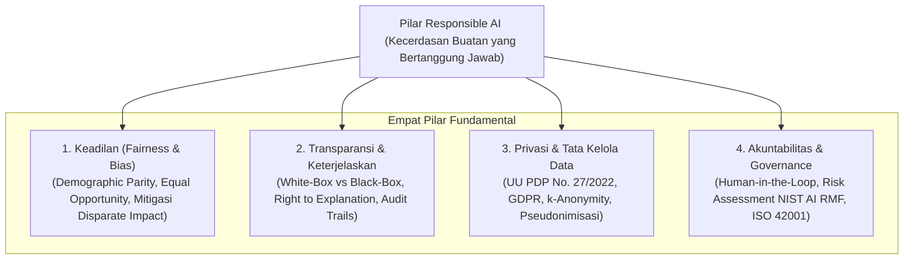

# Chapter 09: AI Ethics, Bias & Responsible AI

Selamat datang di **Chapter 09: AI Ethics, Bias & Responsible AI**. Bab penutup dari Level 1 (AI Foundations) ini membekali Anda dengan kesadaran kritis, prinsip moral, landasan hukum, dan metodologi komputasional untuk memastikan bahwa sistem kecerdasan buatan yang Anda rancang dan kembangkan bersifat adil (*fair*), transparan (*transparent*), akuntabel (*accountable*), menghormati privasi (*privacy-preserving*), serta aman bagi masyarakat.

Sepanjang Chapter 01 hingga 08, Anda telah mempelajari bagaimana AI berevolusi dari pencarian heuristik, representasi pengetahuan, komputasi matriks aljabar, ekosistem pustaka Python, hingga penyiapan data industri. Namun, kecerdasan buatan bukanlah sekadar optimasi fungsi kerugian matematis atau komputasi matriks tak berjiwa. Ketika sistem AI digunakan untuk menentukan siapa yang berhak menerima beasiswa perguruan tinggi, siapa yang dipanggil wawancara kerja, siapa yang disetujui pinjaman modal usahanya, atau bagaimana dokter mendiagnosis penyakit, keputusan algoritmik tersebut berdampak langsung terhadap nasib, martabat, dan hak asasi manusia.

---

## 1. Capaian Pembelajaran (Learning Objectives)

Setelah menyelesaikan bab ini secara mendalam, pembelajar diharapkan mampu:
1. **Menjelaskan** prinsip-prinsip etika kecerdasan buatan serta tanggung jawab moral seorang insinyur sistem cerdas.
2. **Mengidentifikasi** taksonomi bias dalam siklus hidup AI (bias historis, bias representasi, bias pengukuran, bias agregasi, dan bias algoritmik).
3. **Merumuskan** definisi matematika metrik keadilan kelompok formal (*Demographic Parity*, *Equalized Odds*, dan *Equal Opportunity*).
4. **Menganalisis** Teorema Ketidakmungkinan Keadilan (*Impossibility Theorem of Fairness*) yang membuktikan trade-off tak terhindarkan antar metrik keadilan.
5. **Membedakan** antara model kotak putih (*interpretable white-box*) dan model kotak hitam (*explainable black-box*), serta hak subjek atas penjelasan (*Right to Explanation*).
6. **Mengevaluasi** kepatuhan hukum privasi data sistem AI berdasarkan Undang-Undang Perlindungan Data Pribadi (UU PDP No. 27/2022) dan General Data Protection Regulation (GDPR).
7. **Menganalisis** kerentanan serangan tautan *quasi-identifier* (*linkage attack*) dan membuktikan mengapa penyamaran sederhana (*pseudonymization*) bukan anonimisasi mutlak.
8. **Menerapkan** mekanisme pengawasan manusia (*Human-in-the-Loop*, *Human-on-the-Loop*, *Human-in-Command*) pada sistem kecerdasan buatan berisiko tinggi.
9. **Mengidentifikasi** risiko-risiko etis kecerdasan buatan generatif, termasuk halusinasi, bias budaya, *deepfake*, dan pelanggaran hak cipta.
10. **Merancang** matriks penilaian risiko dampak sosial dan etika AI (*AI Ethics Risk Assessment Matrix*) berdasarkan kerangka kerja NIST AI RMF 1.0 dan ISO/IEC 42001.

---

## 2. Prasyarat & Pengetahuan Awal

Sebelum mempelajari materi bab ini, Anda diharapkan telah:
- Memahami konsep probabilitas bersyarat, teorema Bayes, dan metrik klasifikasi (True Positive, False Positive, Precision, Recall) dari [Chapter 06: Probability, Statistics & Linear Algebra for AI](file:///d:/Workstation/Repo%20My%20Corses/Kecerdasan%20Buatan/content/level-1-ai-foundations/chapter-06/index.md).
- Menguasai pembersihan data, penanganan outlier, deteksi kebocoran data, dan manipulasi DataFrame Pandas dari [Chapter 08: Data Preparation & Exploratory Analysis](file:///d:/Workstation/Repo%20My%20Corses/Kecerdasan%20Buatan/content/level-1-ai-foundations/chapter-08/index.md).

---

## 3. Peta Pilar Responsible AI



---

## 4. Part A — Pengantar Etika Kecerdasan Buatan & Tanggung Jawab Moral Insinyur

### 4.1 Mengapa Etika AI Sangat Krusial Hari Ini?
Kecerdasan buatan tidak lagi berada dalam lingkup eksperimen laboratorium sempit. Algoritma telah mengambil alih peranan sebagai gerbang penentu (*gatekeeper*) berbagai aspek kehidupan sosial-ekonomi. Berbeda dengan perangkat lunak konvensional yang perilakunya didefinisikan secara eksplisit oleh baris aturan kode yang ditulis pemrogram, model pembelajaran mesin modern **mempelajari pola perilakunya dari data masa lalu**.

Hal ini melahirkan ilusi objektivitas (*myth of machine objectivity*): masyarakat awam sering mengira bahwa keputusan komputer bebas dari emosi manusia, sehingga pasti adil dan objektif. Padahal kenyataannya, **jika dunia masa lalu tidak adil, maka model AI yang dilatih pada data masa lalu akan mereplikasi, memperkuat, dan melegitimasi ketidakadilan tersebut secara otomatis dalam skala masif**.

### 4.2 Tanggung Jawab Moral Insinyur Sistem Cerdas
Sebagai insinyur AI, kita terikat oleh tanggung jawab moral profesional (mirip dengan sumpah etika insinyur sipil atau dokter). Sebuah jembatan tidak boleh dibangun hanya dengan menghitung efisiensi biaya tanpa memperhitungkan faktor keamanan beban angin dan gempa; demikian pula, sebuah sistem AI tidak boleh dideploy hanya karena akurasi globalnya mencapai $95\%$, jika ternyata sisa error $5\%$ tersebut secara sistematis menimpa kelompok masyarakat rentan (*vulnerable groups*).

---

## 5. Part B — Taksonomi Bias dalam Sistem AI

Bias dalam sistem kecerdasan buatan tidak muncul secara gaib; bias menyusup ke dalam sistem melalui berbagai tahapan siklus hidup pengembangan data dan pemodelan (*AI lifecycle*). Harini Suresh dan John Guttag (2021) mengidentifikasi taksonomi bias utama:

```mermaid
flowchart LR
    World["Dunia Nyata (Masyarakat)"] -->|1. Historical Bias| DataGeneration["Pengumpulan Data"]
    DataGeneration -->|2. Representation Bias| Sampling["Sampling Dataset"]
    Sampling -->|3. Measurement Bias| FeatureEng["Pemilihan Fitur & Label"]
    FeatureEng -->|4. Aggregation Bias| Modeling["Pelatihan Model"]
    Modeling -->|5. Algorithmic Bias| Deployment["Penerapan di Produksi"]
```



### 5.1 Bias Historis (*Historical Bias*)
Terjadi ketika data yang dikumpulkan merefleksikan ketimpangan, prasangka, atau diskriminasi sosial yang memang sudah ada dalam sejarah masyarakat. Bahkan jika proses sampling data dilakukan dengan sempurna tanpa kesalahan teknis, model tetap akan mewarisi bias masa lalu tersebut.
*Contoh Riil*: Algoritma rekrutmen otomatis Amazon (2018) mendiskriminasi kandidat perempuan untuk posisi insinyur perangkat lunak karena model dilatih menggunakan data resume pelamar selama 10 tahun sebelumnya yang didominasi oleh laki-laki.

### 5.2 Bias Representasi (*Representation Bias*)
Terjadi ketika populasi sampel yang digunakan untuk melatih model tidak mencerminkan keragaman populasi sasaran dunia nyata (terjadi *under-representation* pada kelompok tertentu).
*Contoh Riil*: Studi *Gender Shades* oleh Joy Buolamwini dan Timnit Gebru (2018) membuktikan bahwa sistem pengenalan wajah komersial memiliki tingkat error di bawah $1\%$ untuk pria berkulit terang, namun tingkat error melonjak hingga $34.7\%$ untuk wanita berkulit gelap karena dataset latih didominasi subjek kulit terang.

### 5.3 Bias Pengukuran (*Measurement Bias*)
Terjadi ketika fitur atau proksi yang dipilih untuk mengukur suatu konsep abstrak tidak mencerminkan kualitas sebenarnya dari konsep tersebut, atau diukur dengan derajat ketelitian yang berbeda antar kelompok.
*Contoh Riil*: Menggunakan "jumlah penangkapan polisi di suatu distrik" sebagai proksi untuk mengukur "tingkat kejahatan". Wilayah dengan populasi minoritas sering dipatroli lebih intensif oleh aparat, sehingga angka penangkapannya tinggi bukan karena warganya lebih banyak berbuat jahat, melainkan karena mereka diperiksa lebih sering.

### 5.4 Bias Agregasi (*Aggregation Bias*)
Terjadi ketika satu model tunggal dipaksakan untuk melayani seluruh populasi yang heterogen, mengabaikan fakta bahwa sub-populasi yang berbeda memiliki karakteristik, relasi variabel, dan latar belakang budaya yang berbeda.

### 5.5 Bias Algoritmik (*Algorithmic Bias*)
Terjadi ketika fungsi objektif matematika dari algoritma itu sendiri (seperti minimisasi Mean Squared Error atau Cross-Entropy Loss) secara inheren mengorbankan akurasi pada kelompok minoritas demi memaksimalkan skor rata-rata pada kelompok mayoritas.

---

## 6. Part C — Formulasi Matematika Keadilan Algoritmik

Untuk mengaudit dan memitigasi bias secara saintifik, komunitas riset AI merumuskan metrik keadilan kelompok (*group fairness metrics*) berbasis teori probabilitas.

Misalkan:
- $X \in \mathbb{R}^d$: Vektor fitur kandidat (skor tes, IPK, pengalaman).
- $A \in \{a, b\}$: Atribut terlindungi / demografis (*sensitive/protected attribute*), misalnya gender, suku, atau wilayah asal.
- $Y \in \{0, 1\}$: Label kelayakan sebenarnya (*ground truth target*), misalnya $1 = \text{berkualifikasi tinggi}$.
- $\hat{Y} \in \{0, 1\}$: Keputusan prediksi model, misalnya $1 = \text{diterima beasiswa}$.

### 6.1 Demographic Parity (Statistical Parity)
Demographic Parity menuntut bahwa **tingkat seleksi (peluang untuk menerima hasil positif) harus setara antar kelompok**, tanpa memandang status kelayakan sebenarnya ($Y$):
$$\mathbb{P}(\hat{Y} = 1 \mid A = a) = \mathbb{P}(\hat{Y} = 1 \mid A = b)$$

Selisih Demographic Parity diukur melalui:
$$\Delta DP = \lvert \mathbb{P}(\hat{Y} = 1 \mid A = a) - \mathbb{P}(\hat{Y} = 1 \mid A = b) \rvert$$
Ambang batas disparitas yang dapat diterima secara etis umumnya adalah $\Delta DP < 0.10$.

#### Kaidah Empat-Perlima (*The Four-Fifths Rule / Disparate Impact Ratio*)
Diadopsi dari panduan ketenagakerjaan Equal Employment Opportunity Commission (EEOC) Amerika Serikat:
$$\text{Disparate Impact Ratio} = \frac{\mathbb{P}(\hat{Y} = 1 \mid A = \text{Minoritas})}{\mathbb{P}(\hat{Y} = 1 \mid A = \text{Mayoritas})} \ge 0.80$$
Jika rasio seleksi kelompok minoritas berada di bawah $80\%$ ($0.80$) dari tingkat seleksi kelompok mayoritas, maka sistem secara hukum dianggap melakukan **Disparate Impact (diskriminasi dampak tidak langsung)**, meskipun sistem tidak secara eksplisit mencantumkan kolom suku/ras dalam modelnya.

### 6.2 Equal Opportunity (Kesetaraan Peluang)
Hardt, Price, dan Srebro (2016) mengkritik Demographic Parity karena mengabaikan kualifikasi riil kandidat. Mereka merumuskan **Equal Opportunity**, yang menuntut bahwa **kandidat yang benar-benar berkualifikasi ($Y = 1$) harus memiliki peluang yang sama untuk diterima, terlepas dari kelompok demografisnya**:
$$\mathbb{P}(\hat{Y} = 1 \mid Y = 1, A = a) = \mathbb{P}(\hat{Y} = 1 \mid Y = 1, A = b)$$
Ini setara dengan menuntut kesetaraan **True Positive Rate (TPR / Recall)** antar kelompok:
$$\text{TPR}_a = \text{TPR}_b$$
$$\Delta EO = \lvert \text{TPR}_a - \text{TPR}_b \rvert < 0.10$$

### 6.3 Equalized Odds
Equalized Odds adalah kriteria yang lebih ketat, yang menuntut kesetaraan **True Positive Rate (TPR)** sekaligus kesetaraan **False Positive Rate (FPR)** antar kelompok:
$$\mathbb{P}(\hat{Y} = 1 \mid Y = y, A = a) = \mathbb{P}(\hat{Y} = 1 \mid Y = y, A = b) \quad \forall y \in \{0, 1\}$$

### 6.4 Teorema Ketidakmungkinan Keadilan (Kleinberg et al., 2016)
Salah satu pencapaian teoretis paling monumental dalam etika AI adalah pembuktian oleh Jon Kleinberg, Sendhil Mullainathan, dan Manish Raghavan (2016), serta Alexandra Chouldechova (2017):

> **Teorema Ketidakmungkinan Keadilan (*Impossibility Theorem of Fairness*)**:  
> Kecuali dalam dua kondisi sepele (prediksi model memiliki akurasi $100\%$ sempurna, atau base rate prevalensi kedua kelompok $\mathbb{P}(Y=1 \mid A=a)$ dan $\mathbb{P}(Y=1 \mid A=b)$ bernilai tepat sama), **adalah mustahil secara matematis untuk memenuhi Demographic Parity, Equal Opportunity (kesetaraan TPR), dan Predictive Parity (kesetaraan Precision) secara bersamaan!**

**Implikasi Etis Praktis**:  
Tidak ada algoritma magis yang dapat "menyelesaikan semua jenis keadilan sekaligus". Insinyur AI, pembuat kebijakan, dan pemangku kepentingan sosial **wajib berdiskusi secara sadar untuk memilih kriteria keadilan mana yang paling adil bagi konteks sistem tertentu**.

---

## 7. Part D — Transparansi, Keterjelaskan (*Explainability*), dan *Interpretability*

Sebuah keputusan algoritmik yang berdampak besar tidak boleh disajikan sebagai vonis gaib yang tidak dapat dipahami.

### 7.1 White-Box vs Black-Box Models
- **Interpretable Models (Kotak Putih)**: Arsitektur model yang mekanisme internalnya dapat dipahami secara langsung oleh manusia tanpa alat bantu khusus.
  *Contoh*: Regresi Linier berbobot, Pohon Keputusan (*Decision Tree*) dangkal ($< 4$ layer), Rule-Based Systems.
- **Explainable Models (Kotak Hitam)**: Arsitektur berkapasitas sangat tinggi yang perilakunya dihasilkan oleh interaksi non-linier jutaan parameter matematis.
  *Contoh*: Deep Neural Networks, Transformer LLM, Random Forest, XGBoost. Untuk model ini, diperlukan teknik pasca-pelatihan (*post-hoc explainability*) seperti SHAP (SHapley Additive exPlanations) atau LIME.

### 7.2 Hak atas Penjelasan (*Right to Explanation*)
Berdasarkan Pasal 22 GDPR dan Pasal 39-40 UU PDP, individu yang terkena dampak keputusan otomatis (*automated decision-making*) memiliki hak hukum untuk:
1. Mengetahui bahwa keputusan diambil oleh sistem kecerdasan buatan.
2. Memperoleh penjelasan yang bermakna mengenai logika dan kriteria utama yang mendasari keputusan tersebut (*meaningful information about the logic involved*).
3. Memperoleh intervensi manusia untuk meninjau kembali (*appeal / human contestability*).

---

## 8. Part E — Privasi Data, Keamanan, dan Tata Kelola Hukum

Pengembangan model AI membutuhkan volume data pelatihan yang masif. Namun, data pelatihan tersebut sering kali memuat jejak identitas, kebiasaan, preferensi, maupun rekam medis individu.

### 8.1 Kerangka Hukum Indonesia: UU PDP No. 27/2022
Undang-Undang Nomor 27 Tahun 2022 tentang Perlindungan Data Pribadi (UU PDP) adalah tonggak hukum tertinggi tata kelola data di Indonesia.

Poin-poin hukum fundamental bagi insinyur AI:
- **Pasal 1 angka 1**: Data Pribadi didefinisikan sebagai data tentang orang perseorangan yang teridentifikasi atau dapat diidentifikasi secara tersendiri **maupun dikombinasikan dengan informasi lainnya**, baik secara langsung maupun tidak langsung.
- **Klasifikasi Data Pribadi (Pasal 4)**:
  - *Data Pribadi Umum*: Nama lengkap, jenis kelamin, kewarganegaraan, agama, status perkawinan, dan data pribadi yang dikombinasikan.
  - *Data Pribadi Spesifik (Sensitif)*: Data dan informasi kesehatan, data biometrik (wajah, sidik jari), data genetika, catatan kejahatan, data anak, dan data keuangan pribadi. Pemrosesan data spesifik memerlukan standar keamanan enkripsi yang jauh lebih ketat!
- **Dasar Pemrosesan yang Sah (Pasal 20)**: Pemrosesan data wajib memiliki dasar hukum yang sah, terutama persetujuan yang sah secara eksplisit (*explicit consent*) dari subjek data untuk tujuan pemodelan AI yang spesifik.

### 8.2 Mengapa Pseudonimisasi Bukan Anonimisasi Mutlak?
Banyak pengembang AI beranggapan bahwa dengan sekadar menghapus kolom nama atau melakukan hashing pada NIK (*pseudonymization*), dataset mereka telah "anonim" dan bebas dibagikan ke publik. **Ini adalah kesalahan fatal!**

- **Pseudonimisasi (Pasal 35 UU PDP)**: Data pribadi yang telah diproses sedemikian rupa sehingga tidak lagi dapat dikaitkan dengan subjek data tertentu tanpa menggunakan informasi tambahan. *Status hukumnya tetap sebagai Data Pribadi yang tunduk pada UU PDP!*
- **Anonimisasi Sejati (Recital 26 GDPR)**: Data yang telah diubah secara permanen dan ireversibel sehingga subjek data tidak dapat lagi diidentifikasi dengan cara apa pun oleh siapa pun, termasuk dengan bantuan dataset eksternal masa depan.

#### Serangan Tautan Quasi-Identifier (*Linkage Attack*)
Penelitian legendaris Dr. Latanya Sweeney (2000) membuktikan bahwa:
> **$87\%$ populasi penduduk di Amerika Serikat dapat diidentifikasi secara unik hanya melalui kombinasi tiga atribut umum (*quasi-identifiers*): 5-digit Kode Pos, Jenis Kelamin, dan Tanggal Lahir!**

Sweeney mendemonstrasikannya dengan membeli data terbuka Daftar Pemilih Tetap (DPT) kota Cambridge seharga \$20, lalu menggabungkannya (*joining*) dengan catatan rawat inap pegawai negeri Massachusetts yang telah "dihapus namanya". Hasilnya, rekam medis rahasia Gubernur William Weld berhasil di-reidentifikasi secara akurat!

```python
# Demonstrasi Komputasi Serangan Tautan (Quasi-Identifier Linkage)
# Menggabungkan data pseudonim dengan data terbuka publik
re_identified = pd.merge(
    df_sanitized,
    public_voter_registry,
    on=['usia', 'kelamin', 'kode_pos'],
    how='inner'
)
# Menghasilkan identitas asli dan diagnosis penyakit sensitif!
```

---

## 9. Part F — Akuntabilitas, Auditabilitas, dan *Human-in-the-Loop*

Prinsip dasar tata kelola sistem otonom: **No Automation Without Accountability (Tidak Ada Otomasi Tanpa Akuntabilitas)**. Mesin tidak dapat dipenjara atau dituntut secara perdata; tanggung jawab hukum dan etis selalu bermuara pada organisasi dan manusia yang mengembangkan, memiliki, dan mengoperasikan sistem AI tersebut.

### 9.1 Taksonomi Keterlibatan Manusia
1. **Human-in-the-Loop (HITL)**:  
   AI hanya berfungsi sebagai sistem pendukung rekomendasi (*decision support*). Keputusan akhir wajib diambil, ditinjau, dan disahkan oleh manusia.  
   *Wajib untuk*: Diagnosis medis operatif, vonis peradilan pidana, penolakan beasiswa/kredit fatal.
2. **Human-on-the-Loop (HOTL)**:  
   AI mengeksekusi keputusan secara semi-otonom secara berkala, namun operator manusia memantau proses secara aktif dan memiliki tombol darurat (*kill switch / override power*) untuk membatalkan tindakan AI secara seketika.  
   *Contoh*: Pemantauan armada drone inspeksi, sistem perdagangan algoritmik bursa saham.
3. **Human-in-Command (HIC)**:  
   Manusia mengawasi dampak sosial makro dari sistem AI secara keseluruhan, menetapkan batas batasan operasional (*governance constraints*), dan dapat memutuskan untuk menonaktifkan sistem jika bertentangan dengan kebijakan publik.

---

## 10. Part G — Risiko AI Generatif & Model Fondasi

Kehadiran Large Language Models (LLM) dan model difusi generatif membawa tantangan etis baru yang melampaui paradigma machine learning klasik:

1. **Halusinasi Faktual (*Factuality & Hallucination*)**: LLM menghasilkan teks yang terdengar sangat meyakinkan dan fasih secara tata bahasa, namun faktanya keliru atau fiktif secara total. Dalam konteks medis atau konsultasi hukum, halusinasi dapat berakibat fatal.
2. **Deepfake & Disinformasi**: Sintesis wajah, suara, dan video yang realistis digunakan untuk penipuan finansial rekayasa sosial (*vishing*), pencemaran nama baik, atau manipulasi opini politik dalam pemilu.
3. **Hak Kekayaan Intelektual (HAKI)**: Pengikisan karya seni, sastra, dan kode sumber tanpa izin pembuat aslinya untuk melatih model fondasi memicu gugatan hukum hak cipta massal.
4. **Dampak Lingkungan (Jejak Karbon & Konsumsi Air)**: Pelatihan model fondasi ratusan miliar parameter membutuhkan konsumsi energi listrik megawatt dan jutaan liter air pendingin di pusat data.

---

## 11. Part H — Kerangka Kerja Etika & Tata Kelola Global

Untuk menstandarisasi tata kelola kecerdasan buatan yang bertanggung jawab, berbagai badan internasional telah menerbitkan kerangka kerja acuan:

### 11.1 NIST AI Risk Management Framework (AI RMF 1.0)
Diterbitkan oleh National Institute of Standards and Technology (NIST SP 1270, 2023). NIST membagi siklus manajemen risiko AI ke dalam empat fungsi inti:
- **GOVERN (Kelola)**: Membangun budaya organisasi, kebijakan, toleransi risiko, dan peran akuntabilitas yang jelas.
- **MAP (Petakan)**: Mengidentifikasi konteks sistem, potensi bahaya, pihak terdampak, dan batasan operasional.
- **MEASURE (Ukur)**: Menerapkan metrik kuantitatif dan kualitatif untuk menguji bias, akurasi, robustness, dan privasi.
- **MANAGE (Kendalikan)**: Mengalokasikan sumber daya mitigasi risiko secara berkelanjutan, respons insiden, dan audit berkala.

### 11.2 Rekomendasi UNESCO tentang Etika AI (2021)
Kesepakatan global pertama yang diadopsi oleh 193 negara anggota PBB, menetapkan nilai inti:
- Penghormatan, perlindungan, dan promosi hak asasi manusia dan martabat manusia.
- Kelestarian lingkungan dan ekosistem.
- Menjamin keberagaman (*diversity*) dan inklusivitas sosial.
- Melarang penerapan sistem skor sosial warga (*social scoring*) dan senjata otonom mematikan tanpa kendali manusia.

### 11.3 Surat Edaran Menkominfo/Kemkomdigi RI No. 9 Tahun 2023
Panduan nasional tentang Etika Kecerdasan Artifisial di Indonesia, memuat nilai-nilai:
- **Inklusivitas**: Menghormati keberagaman budaya dan kearifan lokal Indonesia.
- **Kemanusiaan**: Menempatkan manusia sebagai pusat kendali dan pemetik manfaat utama AI.
- **Keamanan & Perlindungan Data**: Menyelaraskan seluruh arsitektur data dengan UU PDP No. 27/2022.

---

## 12. Part I — Templat Penilaian Dampak Risiko Etis AI (*Risk Assessment Matrix*)

Sebelum sebuah model AI dideploy ke lingkungan produksi, tim teknik wajib mengisi matriks evaluasi risiko:
$$\text{Skor Risiko} = \text{Tingkat Kemungkinan (Likelihood: 1–5)} \times \text{Tingkat Keparahan Dampak (Impact: 1–5)}$$

| Skor Risiko | Kategori Risiko | Tindakan Wajib |
| :---: | :--- | :--- |
| **15 – 25** | **TINGGI (Kritis)** | Sistem DILARANG deploy secara otonom. Wajib audit independen, implementasi mitigasi bias ketat, dan pengawasan manusia langsung (*Human-in-the-Loop*). |
| **8 – 12** | **SEDANG (Perlu Mitigasi)** | Sistem dapat beroperasi dengan kontrol tambahan, pemantauan berkala (*monitoring logs*), dan mekanisme *appeals* bagi pengguna. |
| **1 – 6** | **RENDAH (Dapat Diterima)** | Risiko dapat diterima dengan pengawasan operasional standar. |

---

## 13. Part J — Studi Kasus: Audit Algoritma Seleksi Beasiswa Mahasiswa

Dalam praktikum laboratorium bab ini, Anda melakukan audit langsung pada dataset seleksi beasiswa universitas ([`scholarship_historical.csv`](file:///d:/Workstation/Repo%20My%20Corses/Kecerdasan%20Buatan/content/level-1-ai-foundations/chapter-09/code/data/scholarship_historical.csv)).

### Ringkasan Fakta Empiris:
1. **Objektivitas Kemampuan**: Rata-rata skor tes potensi akademik antara Kelompok A ($73.51$) dan Kelompok B ($71.70$) adalah setara ($p > 0.05$).
2. **Ketimpangan Masa Lalu**: Akibat bias akses kegiatan ekstrakurikuler masa lalu, tingkat kelulusan historis Kelompok B hanya $7.99\%$ berbanding $45.93\%$ pada Kelompok A (Rasio $0.1739$, melanggar aturan $80\%$).
3. **Penyebaran Bias oleh Model AI**: Model Logistic Regression standar yang dilatih pada label historis mewarisi bias tersebut, menghasilkan tingkat *Recall/TPR* yang sangat timpang: $78.26\%$ untuk Kelompok A vs **hanya $29.55\%$ untuk Kelompok B**!
4. **Solusi Mitigasi Pasca-Pemrosesan**: Dengan menerapkan ambang batas terpisah ($\tau_A = 0.50$ dan $\tau_B = 0.10$), peluang kandidat berprestasi dari Kelompok B untuk lolos melonjak menjadi $40.91\%$, menekan kesenjangan $\Delta EO$ secara drastis tanpa menurunkan akurasi keseluruhan sistem ($81.00\%$).

---

## 14. Part K — Latihan Pemahaman & Analisis Kritis

Kerjakan lima latihan analisis kritis berikut untuk menguji pemahaman etika, matematika keadilan, dan hukum data Anda:

1. **Analisis Disparate Impact**:  
   Sebuah bank menggunakan algoritma AI untuk menyetujui kredit perumahan. Dari 1.000 pelamar pria, sebanyak 600 pelamar disetujui ($60\%$). Dari 400 pelamar wanita, sebanyak 360 disetujui ($90\%$). Hitung rasio Disparate Impact untuk pelamar pria! Apakah model ini melanggar Kaidah Empat-Perlima terhadap pria?

2. **Dilema Impossibility Theorem**:  
   Sebuah pengadilan menguji algoritma penilai risiko residivisme kejahatan. Diketahui bahwa tingkat residivisme riil pada Kelompok X adalah $40\%$ dan pada Kelompok Y adalah $20\%$. Buktikan secara matematis mengapa sistem tidak mungkin memenuhi Demographic Parity dan Equal Opportunity secara bersamaan jika model memiliki kalibrasi prediktif yang valid!

3. **Audit Hukum UU PDP No. 27/2022**:  
   Sebuah startup teknologi pendidikan membuat model rekomendasi karir siswa SMA dengan mengunggah dataset nilai rapor, nomor telepon orang tua, dan riwayat bimbingan konseling psikologis ke server cloud publik tanpa enkripsi spesifik. Identifikasi minimal 3 pelanggaran pasal UU PDP pada skenario tersebut dan sebutkan sanksi yang membayangi!

4. **Kritik Teknis Anonimisasi Latanya Sweeney**:  
   Sebuah rumah sakit mempublikasikan data riset kesehatan masyarakat dengan menghapus Nama dan NIK, namun tetap mencantumkan Usia, Jenis Kelamin, dan Kelurahan Domisili. Mengapa dataset tersebut tetap merupakan Data Pribadi yang sah secara hukum? Bagaimana metode $k$-Anonymity dapat diterapkan untuk menambal celah tersebut?

5. **Rancang Mekanisme Human-in-the-Loop**:  
   Rancanglah alur kerja *Human-in-the-Loop* untuk sistem skrining otomatis penerimaan mahasiswa baru di perguruan tinggi negeri. Tentukan kondisi ambang batas probabilitas mana saja yang boleh diputuskan otomatis oleh AI, dan rentang probabilitas mana yang wajib dialihkan ke meja komite seleksi dosen manusia!

---

## 15. Part L — Mini Project: Audit Keadilan Algoritmik & Penilaian Risiko Sistem AI

### 15.1 Skenario dan Deskripsi Tugas
Sebagai Kepala Tim Etika & Tata Kelola AI (*Head of AI Governance*) di lembaga pendidikan tinggi, Anda diminta melakukan audit forensik menyeluruh terhadap sistem seleksi beasiswa mahasiswa berbasis AI yang tengah diuji coba. Lembaga tersebut mencurigai adanya bias diskriminatif yang merugikan mahasiswa dari latar belakang daerah tertinggal atau kelompok minoritas.

Tugas Anda adalah:
1. Mengembangkan skrip Python mandiri untuk mengaudit dataset seleksi beasiswa historis.
2. Menghitung matriks metrik keadilan kelompok formal: *Selection Rate*, *Demographic Parity*, *Equal Opportunity*, dan *Disparate Impact Ratio*.
3. Mengimplementasikan teknik mitigasi pasca-pemrosesan (*post-processing threshold tuning*) untuk menyamakan peluang seleksi kandidat minoritas.
4. Melakukan simulasi uji kerentanan re-identifikasi data privasi (*quasi-identifier linkage attack*) sesuai kaidah UU PDP No. 27/2022.
5. Menyusun laporan formal penilaian dampak risiko etika AI (*AI Ethics Risk Register*) menggunakan matriks Kemungkinan $\times$ Dampak.

---

### 15.2 Rubrik Penilaian 100 Poin

| Kriteria Penilaian | Bobot | Kinerja Unggul (90–100%) | Kinerja Cukup (60–89%) | Kinerja Kurang (< 60%) |
| :--- | :---: | :--- | :--- | :--- |
| **Audit Bias Historis & Formal Metrics** | 25 poin | Mampu menghitung $\Delta DP$, $\Delta EO$, TPR, FPR, dan Disparate Impact Ratio secara tepat, disertai analisis akar penyebab bias masa lalu. | Menghitung metrik akurasi dasar tetapi melewatkan salah satu metrik keadilan kelompok formal (misal tidak menghitung $\Delta EO$). | Kesalahan rumus metrik atau gagal mendeteksi ketimpangan yang ada pada data. |
| **Implementasi Mitigasi Keadilan** | 20 poin | Berhasil menerapkan penyesuaian ambang batas (*threshold tuning*), membuktikan penurunan kesenjangan $\Delta EO$, dan menganalisis *fairness-utility trade-off*. | Mitigasi dilakukan tetapi hanya berupa penjelasan naratif tanpa bukti eksekusi kode numerik yang dapat direproduksi. | Tidak ada upaya mitigasi teknis atau kode memicu error fatal saat tuning. |
| **Analisis Hukum & Privasi Data** | 20 poin | Menguraikan pasal-pasal relevan UU PDP No. 27/2022 dan GDPR, mendemonstrasikan kerentanan quasi-identifier, dan merekomendasikan generalisasi $k$-Anonymity. | Menyebutkan isu privasi secara umum tetapi tidak menghubungkannya dengan pasal UU PDP atau studi Sweeney. | Menganggap pseudonimisasi/masking sederhana sudah merupakan anonimisasi mutlak yang aman. |
| **Matriks Penilaian Risiko Etis** | 15 poin | Matriks risiko lengkap (5 skenario), memuat Likelihood, Impact, Risk Score, Kategori Tingkat Risiko, dan rencana mitigasi konkret berbasis NIST AI RMF. | Matriks disusun tetapi skala penilaian subjektif tanpa justifikasi dampak hukum/sosial yang jelas. | Matriks tidak lengkap atau tidak menyertakan kategori keparahan risiko. |
| **Akuntabilitas & Human-in-the-Loop** | 10 poin | Merancang mekanisme tata kelola pengawasan manusia (HITL/HOTL) yang terstruktur, lengkap dengan prosedur sanggahan (*appeals process*). | Menyebutkan perlunya manusia mengawasi tetapi tanpa prosedur operasional yang jelas. | Mengabaikan peranan pengawasan manusia dalam sistem berisiko tinggi. |
| **Dokumentasi & Reproduksibilitas** | 10 poin | Berkas `README.md` terstruktur, kode Python terdokumentasi bersih dengan type hints, bebas error, dan hasil eksekusi deterministik. | Kode dapat dijalankan tetapi minim komentar penjelas atau dependensi tidak dicatat di `requirements.txt`. | Kode gagal dieksekusi atau tidak ada dokumentasi petunjuk penggunaan. |

---

## 16. Part M — Ringkasan Materi & Referensi Primer

### 16.1 Ringkasan Bab
1. **Mitos Netralitas Algoritma**: Model pembelajaran mesin merefleksikan dan memperkuat bias yang terkandung dalam data pelatihan masa lalu. Insinyur bertanggung jawab secara moral atas dampak diskriminatif dari model yang mereka rancang.
2. **Keadilan Multidimensi**: Demographic Parity menuntut kesetaraan tingkat kelulusan, sedangkan Equal Opportunity menuntut kesetaraan peluang bagi kandidat yang berkualifikasi riil.
3. **Teorema Ketidakmungkinan Kleinberg**: Mustahil secara matematis untuk memuaskan seluruh metrik keadilan kelompok secara bersamaan jika base rate antar kelompok berbeda. Kriteria keadilan harus dipilih secara sadar sesuai konteks.
4. **Pseudonimisasi $\neq$ Anonimisasi**: Berdasarkan UU PDP No. 27/2022 dan studi Latanya Sweeney, data yang telah di-masking tetap rentan terhadap serangan re-identifikasi melalui tautan *quasi-identifiers*.
5. **Prinsip Human-in-the-Loop**: Sistem AI berisiko tinggi yang menyangkut hak asasi, kesehatan, dan kebebasan individu wajib berada di bawah pengawasan dan pertanggungjawaban manusia.

---

### 16.2 Referensi Primer Terverifikasi
1. **Barocas, S., Hardt, M., & Narayanan, A.** (2023). *Fairness and Machine Learning: Limitations and Opportunities*. MIT Press. https://fairmlbook.org/
2. **Kleinberg, J., Mullainathan, S., & Raghavan, M.** (2016). *Inherent Trade-Offs in the Fair Determination of Risk Scores*. Proceedings of Innovations in Theoretical Computer Science (ITCS 2017). https://arxiv.org/abs/1609.05807
3. **Sweeney, L.** (2000). *Simple Demographics Often Identify People Uniquely*. Carnegie Mellon University, Data Privacy Working Paper 3. https://dataprivacylab.org/projects/identifiability/paper1.pdf
4. **National Institute of Standards and Technology (NIST)**. (2023). *Artificial Intelligence Risk Management Framework (AI RMF 1.0)*. NIST Trustworthy and Responsible AI, NIST SP 1270. https://doi.org/10.6028/NIST.SP.1270
5. **UNESCO**. (2021). *Recommendation on the Ethics of Artificial Intelligence*. United Nations Educational, Scientific and Cultural Organization. https://unesdoc.unesco.org/ark:/48223/pf0000381137

