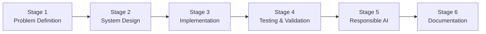
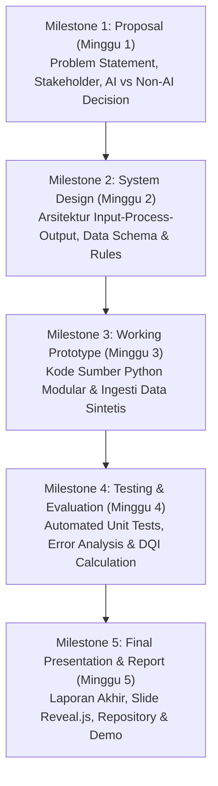

# Chapter 10: AI Foundations Capstone

Selamat datang di **Chapter 10: AI Foundations Capstone**, puncak integrasi kurikuler dari seluruh rangkaian pembelajaran **Level 1 — AI Foundations** pada Artificial Intelligence Learning Hub.

Sepanjang sembilan bab terdahulu, Anda telah membangun fondasi konseptual, matematis, komputasional, dan etis yang esensial:
- Dari sejarah dan paradigma AI ([Chapter 01](file:///d:/Workstation/Repo%20My%20Corses/Kecerdasan%20Buatan/content/level-1-ai-foundations/chapter-01/index.md) & [02](file:///d:/Workstation/Repo%20My%20Corses/Kecerdasan%20Buatan/content/level-1-ai-foundations/chapter-02/index.md)),
- Karakterisasi agen cerdas dan perumusan masalah PEAS ([Chapter 03](file:///d:/Workstation/Repo%20My%20Corses/Kecerdasan%20Buatan/content/level-1-ai-foundations/chapter-03/index.md)),
- Algoritma pencarian ruang keadaan (*Uninformed & Informed Search*) ([Chapter 04](file:///d:/Workstation/Repo%20My%20Corses/Kecerdasan%20Buatan/content/level-1-ai-foundations/chapter-04/index.md)),
- Representasi pengetahuan simbolik dan inferensi logika (*Knowledge Base & Rule-Based Reasoning*) ([Chapter 05](file:///d:/Workstation/Repo%20My%20Corses/Kecerdasan%20Buatan/content/level-1-ai-foundations/chapter-05/index.md)),
- Pondasi probabilitas, statistik, aljabar linear, dan kalkulus optimasi ([Chapter 06](file:///d:/Workstation/Repo%20My%20Corses/Kecerdasan%20Buatan/content/level-1-ai-foundations/chapter-06/index.md)),
- Lingkungan kerja ekosistem Python ([Chapter 07](file:///d:/Workstation/Repo%20My%20Corses/Kecerdasan%20Buatan/content/level-1-ai-foundations/chapter-07/index.md)),
- Rekayasa dan pembersihan data industri (*Data Preparation & EDA*) ([Chapter 08](file:///d:/Workstation/Repo%20My%20Corses/Kecerdasan%20Buatan/content/level-1-ai-foundations/chapter-08/index.md)),
- Hingga prinsip keadilan, mitigasi bias, privasi hukum UU PDP No. 27/2022, dan tata kelola AI yang bertanggung jawab ([Chapter 09](file:///d:/Workstation/Repo%20My%20Corses/Kecerdasan%20Buatan/content/level-1-ai-foundations/chapter-09/index.md)).

Proyek Capstone ini tidak meminta Anda mempelajari algoritma Machine Learning tingkat lanjut yang belum diajarkan—pelatihan model statistik baru akan dimulai pada **Level 2 (Chapter 11: Introduction to Machine Learning)**. Sebaliknya, Capstone Level 1 dirancang untuk membuktikan bahwa Anda mampu menerapkan kompetensi fundamental ini secara mandiri, rasional, terukur, dan bertanggung jawab dalam menyelesaikan persoalan nyata.

---

## 1. Capaian Pembelajaran (Learning Objectives)

Setelah menyelesaikan chapter ini secara tuntas, pembelajar diharapkan mampu:
1. **Mengidentifikasi** dan merumuskan masalah nyata yang sesuai untuk penyelesaian berbasis AI atau pendekatan deterministik.
2. **Memilih** pendekatan AI yang sesuai dengan karakteristik masalah.
3. **Merancang** input, processing, output, dan evaluation.
4. **Mengintegrasikan** minimal beberapa kompetensi dari Chapter 01–09.
5. **Mengimplementasikan** prototype sederhana menggunakan Python.
6. **Mengelola** data dan melakukan Data Preparation jika diperlukan.
7. **Menyusun** testing dan evaluation berdasarkan kriteria keberhasilan.
8. **Mengevaluasi** risiko, keterbatasan, dan Responsible AI.
9. **Mendokumentasikan** project secara reproducible.
10. **Mengomunikasikan** hasil project secara akademik.

---

## 2. Part A — Capstone Foundations

### A.1 Filosofi dan Tujuan Capstone Level 1
Capstone Project Level 1 berlandaskan pedagogi *Project-Based Learning* (PBL). Tujuan utamanya bukan untuk membangun sistem komersial berskala industri atau melatih arsitektur *deep neural network* yang rumit, melainkan menumbuhkan kedewasaan berpikir insinyur sistem cerdas:
- Mampu membedakan kapan kecerdasan buatan benar-benar dibutuhkan dan kapan aturan deterministik sederhana sudah memadai.
- Mampu menyusun perumusan masalah yang presisi (*Problem Formulation*).
- Mampu menguji dan memverifikasi fungsionalitas kode secara objektif dan *reproducible*.
- Mampu mempertanggungjawabkan dampak etika, privasi, dan batasan sistem secara jujur.

### A.2 Matriks Integrasi Kompetensi Level 1

```mermaid
flowchart TD
    Capstone["AI Foundations Capstone (Chapter 10)"]
    
    subgraph Conceptual ["Pilar Konseptual & Model Masalah"]
        Ch01_03["Ch 01 & Ch 03<br/>Definisi Rasionalitas, Agen Cerdas & Spesifikasi PEAS"]
        Ch02["Ch 02<br/>Evolusi Paradigma Simbolik vs Koneksionis"]
    end

    subgraph Computational ["Pilar Komputasi & Solusi Masalah"]
        Ch04["Ch 04: Search Algorithms<br/>Pencarian Graf State Space & Heuristik A*"]
        Ch05["Ch 05: Knowledge Representation<br/>Logika Simbolik & Mesin Inferensi Aturan"]
        Ch06["Ch 06: Math Foundations<br/>Statistik Deskriptif, Probabilitas & Aljabar Matriks"]
    end

    subgraph Engineering ["Pilar Rekayasa Perangkat Lunak & Data"]
        Ch07["Ch 07: Python Ecosystem<br/>NumPy, Pandas, Matplotlib & Reproducibility"]
        Ch08["Ch 08: Data Preparation<br/>Deteksi Outlier, Imputasi Data & EDA"]
    end

    subgraph Governance ["Pilar Tata Kelola & Etika"]
        Ch09["Ch 09: Responsible AI<br/>Audit Keadilan, Privasi UU PDP & NIST AI RMF"]
    end

    Ch01_03 --> Capstone
    Ch02 --> Capstone
    Ch04 --> Capstone
    Ch05 --> Capstone
    Ch06 --> Capstone
    Ch07 --> Capstone
    Ch08 --> Capstone
    Ch09 --> Capstone
```



### A.3 Alur Kerja Rekayasa (Project-Based Learning Workflow)
Setiap mahasiswa menjalani enam tahapan sekuensial yang saling terhubung:
1. **Problem Identification**: Menemukan permasalahan empiris di sekitar kita (kampus, jaringan, fasilitas, energi).
2. **Problem Formulation**: Menyusun spesifikasi formal PEAS (*Performance measure, Environment, Actuators, Sensors*), definisi input/output, dan batas ruang keadaan (*State Space*).
3. **Stakeholder & Requirement Analysis**: Mengidentifikasi siapa pengguna akhir, apa kebutuhan fungsional perangkat lunak, serta apa batasan sumber dayanya.
4. **Baseline Solution**: Mengembangkan solusi dasar (*naive baseline*) sebagai pembanding awal.
5. **Keputusan AI vs Non-AI (Prinsip Kehati-hatian)**:
   > [!IMPORTANT]
   > Solusi yang paling kompleks **bukanlah** solusi terbaik. Jika suatu masalah dapat diselesaikan secara efisien, transparan, dan andal menggunakan logika deterministik (misalnya algoritma pencarian standar, aturan *if-else* berbasis domain pakar, atau rumus fisika langsung), maka pendekatan non-AI tersebut wajib diprioritaskan. Gunakan AI hanya jika terdapat ketidakpastian, kompleksitas ruang pencarian kombinasional yang besar, atau kebutuhan penalaran inferensial dari data yang beragam.
6. **Scope and Constraints**: Menetapkan batas yang realistis (apa yang dikerjakan dan apa yang sengaja dikecualikan).
7. **Success Criteria & Evaluation Plan**: Menetapkan metrik kuantitatif keberhasilan (misalnya persentase anomali yang terdeteksi, rasio penghematan simpul, kepatuhan batas fisika).
8. **Responsible AI Considerations**: Meninjau risiko bias, transparansi, batasan privasi data, dan keharusan pengawasan manusia (*Human Oversight*).
9. **Project Deliverables**: Menyusun kode sumber modular, dataset sintetis pengujian, dokumen teknis, dan presentasi akademik.

---

## 3. Part B — Project Options

Mahasiswa dapat memilih salah satu dari lima pilihan proyek standar berikut atau mengajukan proyek opsional mandiri:

| No | Pilihan Proyek | Domain & Deskripsi Singkat | Kompetensi Kunci Terintegrasi |
| :-: | :--- | :--- | :--- |
| **1** | **Rule-Based Network Troubleshooting Assistant** | Asisten berbasis *Knowledge Base* dan *Forward Chaining* untuk memandu teknisi mendiagnosis gangguan konektivitas jaringan komputer kampus. | Ch 01, 03, 05, 07, 09 (Knowledge Representation, Rule Engine, Explainability) |
| **2** | **Search-Based Indoor Navigation System** | Prototype navigasi ruang dalam ruangan (*indoor grid*) menggunakan algoritma pencarian $A^*$ dan BFS untuk mencari rute darurat bebas rintangan. | Ch 01, 03, 04, 06, 07 (SearchProblem, Graph Search, Manhattan Heuristic) |
| **3** | **Smart Sensor Data Quality Monitor** *(Primary Reference)* | Sistem pemantau kualitas data telemetri sensor IoT industri untuk mendeteksi data hilang, pelanggaran batas fisika, dan outlier statistik via aturan inferensi. | Ch 03, 06, 07, 08, 09 (Data Preparation, Tukey IQR, Rule-Based Alerts, Headless EDA) |
| **4** | **Explainable Scholarship Screening Prototype** | Prototype penapisan administratif calon penerima beasiswa yang transparan dengan penjelasan logika dan mekanisme sanggahan (*appeal*). | Ch 03, 05, 07, 08, 09 (Fairness, Data Minimisation, UU PDP, Human-in-the-Loop) |
| **5** | **Intelligent Energy Usage Advisory System** | Sistem penasihat efisiensi konsumsi listrik gedung perkuliahan berbasis analisis statistik pola pemakaian dan aturan beban puncak. | Ch 03, 06, 07, 08, 09 (Summary Statistics, Usage Profiling, Advisory Rule Engine) |

### Option 1 — Rule-Based Network Troubleshooting Assistant
- **Deskripsi**: Membantu teknisi pemula mendiagnosis gejala gangguan jaringan (kabel putus, DHCP gagal, gateway unreachable, DNS misconfiguration, firewall drop).
- **Fitur Minimal**: Input gejala interaktif, Knowledge Base formal First-Order Logic, mesin inferensi Forward Chaining, pelaporan diagnosis beserta rantai aturan penjelas (*audit trail*), serta penanganan gejala yang tidak lengkap.
- **Batasan**: Sistem dilarang mengklaim diagnosis sebagai kepastian mutlak; status selalu berupa dugaan awal berbobot yang memerlukan verifikasi fisik teknisi.

### Option 2 — Search-Based Indoor Navigation System
- **Deskripsi**: Memetakan lantai gedung perkuliahan ke dalam representasi graf koordinat 2D dan merutekan jalur terpendek dari ruang kuliah ke pintu darurat.
- **Fitur Minimal**: Representasi grid/graf berukuran minimal $10 \times 10$, simpul awal dan simpul tujuan majemuk, rintangan statis/dinamis, algoritma $A^*$ dengan heuristik jarak Manhattan terbukti *admissible*, perbandingan jumlah simpul dieksplorasi terhadap BFS, serta penanganan kasus simpul target tak terjangkau (*unreachable goal*).

### Option 3 — Smart Sensor Data Quality Monitor *(Reference Implementation Utama)*
- **Deskripsi**: Menganalisis aliran data telemetri multi-sensor sintetis untuk membedakan antara nilai hilang, nilai fisik mustahil, dan lonjakan statistik sesaat (*spikes*), serta menghasilkan Data Quality Index (DQI).
- **Fitur Minimal**: Ingesti CSV, validasi skema, imputasi terarah, perhitungan pagar Tukey ($Q_1 - 1.5 \text{IQR}$, $Q_3 + 1.5 \text{IQR}$), mesin inferensi peringatan kualitas, dashboard analitik Matplotlib nir-layar (*headless*), dan pengujian unit otomatis.

### Option 4 — Explainable Scholarship Screening Prototype
- **Deskripsi**: Menyaring berkas administratif pelamar beasiswa secara transparan berdasarkan kriteria IPK, batas pendapatan orang tua, dan kelengkapan dokumen pendukung.
- **Fitur Minimal**: Dataset pelamar sintetis (dilarang menggunakan data mahasiswa riil), basis aturan kelayakan, penjelasan transparan mengapa seorang kandidat lolos atau ditolak ke peninjauan manusia, audit disparitas demografis, dan perancangan mekanisme banding (*appeal mechanism*).
- **Batasan**: Prototype dilarang membuat keputusan final otomatis; sistem hanya berperan memilah berkas untuk komite seleksi manusia (*Human Oversight*).

### Option 5 — Intelligent Energy Usage Advisory System
- **Deskripsi**: Mengevaluasi data konsumsi daya kilowatt-hour (kWh) per lantai gedung kampus untuk mendeteksi pemborosan di luar jam operasional.
- **Fitur Minimal**: Dataset deret waktu konsumsi sintetis, ringkasan statistik harian/mingguan, deteksi konsumsi beban dasar (*phantom load*), rekomendasi jadwal otomatisasi pendingin udara, dan estimasi potensi penghematan.
- **Batasan**: Dilarang mengklaim penghematan riil tanpa verifikasi lapangan jangka panjang.

### Proyek Opsional Mandiri (Custom Project)
Mahasiswa diperkenankan mengusulkan topik proyek mandiri dengan syarat:
1. Memenuhi minimal 4 pilar kompetensi dari Level 1 (misalnya: Perumusan Masalah, Representasi Pengetahuan, Ekosistem Python, dan Responsible AI).
2. Memiliki tingkat kompleksitas teknis yang setara dengan lima opsi di atas.
3. Mendapatkan persetujuan tertulis (*sign-off*) dari dosen pengampu sebelum Milestone 1 berakhir.

---

## 4. Part C — Alur Kerja Capstone Bertahap (6 Stages)



### Stage 1 — Problem Definition
- **Fokus**: Menjawab *mengapa* masalah ini penting, *siapa* pemangku kepentingannya, dan *apakah* solusi AI benar-benar dibutuhkan.
- **Deliverables**: Laporan ringkas berisi *Problem Statement*, latar belakang, analisis pemangku kepentingan (*stakeholders*), batasan lingkup, usulan solusi awal, dan pembanding solusi non-AI dasar (*baseline*).

### Stage 2 — System Design
- **Fokus**: Merancang arsitektur input–processing–output secara konseptual dan modular.
- **Deliverables**: Diagram arsitektur sistem, spesifikasi format data input/output, rancangan aturan logika atau formulasi graf ruang keadaan, diagram alir proses (*flowchart*), serta kriteria keberhasilan terukur.

### Stage 3 — Implementation
- **Fokus**: Mengubah rancangan menjadi kode sumber Python yang bersih, terstruktur, dan modular.
- **Deliverables**: Berkas skrip Python runnable, berkas konfigurasi, dataset pengujian sintetis, serta dokumentasi instruksi instalasi dan eksekusi.

### Stage 4 — Testing & Validation
- **Fokus**: Memverifikasi kebenaran fungsional dan menganalisis perilaku sistem saat menghadapi data ekstrem.
- **Deliverables**: Skenario pengujian unit (*unit tests*), tabel hasil pengujian *Expected vs Actual*, analisis galat (*error analysis*), serta dokumentasi keterbatasan sistem.

### Stage 5 — Responsible AI Assessment
- **Fokus**: Menilai dampak keselamatan, keadilan, privasi, dan transparansi sistem.
- **Deliverables**: Evaluasi risiko bias, audit perlindungan data pribadi (UU PDP No. 27/2022), perancangan mekanisme pengawasan manusia (*Human-in-the-Loop*), dan matriks mitigasi risiko berbasis NIST AI RMF 1.0.

### Stage 6 — Documentation & Presentation
- **Fokus**: Mengomunikasikan karya ilmiah dan rekayasa secara profesional.
- **Deliverables**: Laporan akhir lengkap, repositori kode sumber yang *reproducible*, bukti eksekusi pengujian, slide presentasi pengajaran Reveal.js, serta video/demonstrasi langsung sistem.

---

## 5. Part D — Reference Implementation: Smart Sensor Data Quality Monitor

Sebagai acuan standar kualitas dan kedalaman teknis bagi mahasiswa, proyek **Smart Sensor Data Quality Monitor** disediakan sebagai *Reference Implementation* resmi Chapter 10.

### D.1 Arsitektur Perangkat Lunak
Sistem dibangun secara modular di dalam direktori `content/level-1-ai-foundations/chapter-10/code/`:

```text
code/
├── dataset_generator.py      # Pembangkit dataset telemetri multi-sensor sintetis deterministik
├── validator.py              # Validator integritas skema data dan rentang batas operasional fisik
├── statistics_analyzer.py    # Komputasi statistik deskriptif & Pagar Tukey (IQR outlier detection)
├── rule_engine.py            # Mesin inferensi First-Order Logic & kalkulasi Data Quality Index (DQI)
├── visualization.py          # Generator dashboard 3-panel Matplotlib nir-layar (headless mode)
├── main.py                   # Pipeline runner terintegrasi dari data mentah hingga rekomendasi
├── test_sensor_monitor.py    # Unit tests komprehensif (6 skenario uji fungsional)
├── README.md                 # Katalog berkas, panduan eksekusi, dan tabel hasil numerik aktual
└── data/
    ├── sensor_telemetry_raw.csv      # Dataset 120 rekaman telemetri 3 sensor
    └── sensor_quality_dashboard.png  # Hasil visualisasi visual dashboard mutu
```

### D.2 Aturan Pembangkitan Data Sintetis Deterministik
Dataset dibangkitkan oleh [`dataset_generator.py`](file:///d:/Workstation/Repo%20My%20Corses/Kecerdasan%20Buatan/content/level-1-ai-foundations/chapter-10/code/dataset_generator.py) menggunakan *random seed* tetap (`seed=42`) untuk menjamin sifat *reproducibility*:
- Tiga instrumen sensor: Suhu (`TEMP-01`, satuan $^\circ\text{C}$), Kelembapan (`HUMID-01`, satuan $\%RH$), dan Vibrasi Mesin (`VIB-01`, satuan $\text{mm/s}$).
- Total rekaman: 120 sampel deret waktu interval 5 menit.
- Sematan anomali terkontrol:
  1. *Missing Values* ($3$ rekaman kosong pada indeks 12, 45, 88).
  2. *Nilai Fisik Mustahil* (Suhu $-300.0^\circ\text{C}$ di bawah nol mutlak pada indeks 24; Kelembapan $145.0\%$ pada indeks 66).
  3. *Statistical Outliers* (Lonjakan vibrasi $18.5\text{ mm/s}$ pada indeks 51; Lonjakan suhu $62.0^\circ\text{C}$ pada indeks 93).

### D.3 Validasi Skema & Batas Fisika Pengukuran
Modul [`validator.py`](file:///d:/Workstation/Repo%20My%20Corses/Kecerdasan%20Buatan/content/level-1-ai-foundations/chapter-10/code/validator.py) memeriksa setiap baris terhadap tabel batas operasional fisik (*physical bounds*):
- Suhu Operasional Valid: $[-10.0^\circ\text{C}, 100.0^\circ\text{C}]$
- Kelembapan Valid: $[0.0\%, 100.0\%]$
- Vibrasi Mesin Valid: $[0.0\text{ mm/s}, 25.0\text{ mm/s}]$

Setiap rekaman yang melanggar batas fisika diberi label `INVALID_BOUNDS` beserta alasan audit eksplisit, tanpa langsung dihapus dari memori agar jejak audit forensik tetap terjaga.

### D.4 Analisis Statistik Deskriptif & Pagar Tukey
Modul [`statistics_analyzer.py`](file:///d:/Workstation/Repo%20My%20Corses/Kecerdasan%20Buatan/content/level-1-ai-foundations/chapter-10/code/statistics_analyzer.py) menghitung parameter distribusi hanya dari sampel yang berstatus `VALID`:
$$\text{IQR} = Q_3 - Q_1$$
$$\text{Lower Fence} = Q_1 - 1.5 \times \text{IQR}, \quad \text{Upper Fence} = Q_3 + 1.5 \times \text{IQR}$$

Nilai yang berada di luar rentang $[\text{Lower Fence}, \text{Upper Fence}]$ diklasifikasikan sebagai *Statistical Outlier*. Hal ini memisahkan konsep *outlier statistik* (yang mungkin mencerminkan beban operasional puncak riil) dari *kerusakan fisik sensor* (nilai di luar batas fisika).

### D.5 Mesin Inferensi Peringatan & Data Quality Index (DQI)
Modul [`rule_engine.py`](file:///d:/Workstation/Repo%20My%20Corses/Kecerdasan%20Buatan/content/level-1-ai-foundations/chapter-10/code/rule_engine.py) menerapkan tiga aturan inferensi First-Order Logic:
1. `RULE-01-MISSING-BURST`:
   $$\forall r \; (\text{Status}(r) = \text{MISSING} \implies \text{Alert}(\text{WARNING}, \text{Gangguan Transmisi Jaringan}))$$
2. `RULE-02-PHYSICAL-IMPOSSIBLE`:
   $$\forall r \; (\text{Status}(r) = \text{INVALID\_BOUNDS} \implies \text{Alert}(\text{CRITICAL}, \text{Kerusakan Sensor/Grounding}))$$
3. `RULE-03-STATISTICAL-SPIKE`:
   $$\forall r \; (\text{Value}(r) > \text{UpperFence} \lor \text{Value}(r) < \text{LowerFence} \implies \text{Alert}(\text{MEDIUM}, \text{Lonjakan Beban Puncak}))$$

Sistem kemudian menghitung skor **Data Quality Index (DQI)** dalam rentang $[0, 100]$:
$$\text{DQI} = \max \left( 0.0, \; 100 \times \left(1.0 - \frac{N_{\text{missing}} \times 1.0 + N_{\text{invalid}} \times 1.5 + N_{\text{outlier}} \times 0.5}{N_{\text{total}}}\right) \right)$$

Hasil skor empiris yang terverifikasi:
- `VIB-01`: **$100.00 / 100$** (Status: EXCELLENT)
- `HUMID-01`: **$97.50 / 100$** (Status: EXCELLENT)
- `TEMP-01`: **$85.00 / 100$** (Status: EXCELLENT)

### D.6 Visualisasi Dashboard Nir-Layar (Headless Mode)
Modul [`visualization.py`](file:///d:/Workstation/Repo%20My%20Corses/Kecerdasan%20Buatan/content/level-1-ai-foundations/chapter-10/code/visualization.py) mengonfigurasi backend Matplotlib non-interaktif `Agg` (`matplotlib.use("Agg")`) agar skrip dapat berjalan pada lingkungan server tanpa server grafis X11/Wayland. Dashboard menghasilkan citra resolusi tinggi tiga panel:
1. Plot deret waktu telemetri suhu lengkap dengan penanda titik valid, titik hilang, dan titik rusak.
2. Boxplot Tukey per instrumen sensor.
3. Diagram batang skor DQI per sensor dilengkapi garis ambang batas mutu tinggi ($85.0$).

---

## 6. Part E — Project Evaluation & Testing

Sistem cerdas tidak boleh dianggap berhasil hanya karena kode dapat dieksekusi tanpa pesan galat. Mahasiswa wajib menyusun rencana pengujian (*Testing Plan*) komprehensif yang mencakup sepuluh dimensi:

1. **Functional Testing**: Menguji apakah setiap modul menghasilkan keluaran yang sesuai dengan spesifikasi fungsi.
2. **Unit Testing**: Memverifikasi logika internal unit terkecil secara terisolasi menggunakan pustaka `unittest` standar Python.
3. **Input Validation**: Menguji respons perangkat lunak terhadap berkas CSV yang rusak, kolom yang hilang, atau tipe data yang tidak sesuai.
4. **Edge Cases**: Menguji kondisi ekstrem seperti dataset kosong, hanya ada satu baris data, atau sensor yang tidak terdaftar (`UNKNOWN_SENSOR`).
5. **Expected vs Actual Results**: Membandingkan hasil numerik yang diantisipasi secara teoritis dengan luaran aktual mesin.
6. **Reproducibility**: Menjamin bahwa saat dijalankan ulang pada komputer yang berbeda dengan dependensi yang sama, sistem menghasilkan angka yang identik.
7. **Error Analysis**: Menganalisis mengapa suatu anomali terlewat (*false negative*) atau mengapa data normal terdeteksi anomali (*false positive*).
8. **Limitations**: Mendokumentasikan secara transparan apa saja kelemahan sistem yang belum terselesaikan.
9. **Human Review**: Menyertakan ruang bagi operator manusia untuk memeriksa ulang temuan sistem sebelum keputusan diambil.
10. **Responsible AI Checks**: Memastikan data tidak memuat informasi pribadi yang tidak perlu dan aturan keputusan tidak mendiskriminasi entitas tertentu.

> [!WARNING]
> **Pembedaan Krusial Evaluasi**:
> - *Testing Code*: Memastikan kode tidak *crash* (sintaks benar, variabel terdefinisi).
> - *Evaluating System Output*: Memastikan angka keluaran valid secara matematis (akurasi, presisi deteksi anomali).
> - *Evaluating Problem-Solving*: Memastikan apakah sistem benar-benar menyelesaikan masalah awal pemangku kepentingan (misalnya apakah sistem benar-benar mencegah kerusakan mesin di pabrik tanpa menambah beban kerja palsu bagi teknisi).
> 
> Keberhasilan *unit tests* **tidak sama** dengan keberhasilan sistem di dunia nyata!

---

## 7. Part F — Responsible AI Capstone Checklist

Sebelum menyerahkan laporan Capstone, setiap tim mahasiswa wajib mengisi dan melampirkan lembar verifikasi 12 pertanyaan kritis Responsible AI berikut:

| No | Pertanyaan Evaluasi Etika & Tata Kelola | Kriteria Pemenuhan Wajib |
| :-: | :--- | :--- |
| **1** | Apakah sistem benar-benar membutuhkan AI? | Mampu menjelaskan mengapa solusi statistik/heuristik diperlukan dan bukan sekadar kalkulasi statis. |
| **2** | Apakah solusi deterministik telah dipertimbangkan lebih dahulu? | Mampu mendokumentasikan baseline deterministik sebagai pembanding awal. |
| **3** | Apakah data memiliki sumber dan izin yang jelas? | Data sintetis memiliki aturan pembangkitan tertulis; data eksternal memiliki lisensi terbuka yang sah. |
| **4** | Apakah mutu data telah divalidasi sebelum diproses? | Menerapkan pengecekan skema, penanganan nilai hilang, dan batas keabsahan domain. |
| **5** | Apakah terdapat risiko bias algoritmik atau demografis? | Mengidentifikasi potensi ketimpangan representasi pada sampel data. |
| **6** | Apakah seluruh keputusan sistem dapat dijelaskan logikanya? | Setiap luaran (*alert*, rute, atau skor) memiliki rantai aturan penjelas (*audit trail*). |
| **7** | Apakah pengguna akhir memahami batasan sistem? | Terdapat penafian (*disclaimer*) eksplisit bahwa sistem adalah alat bantu rekomendasi (*advisory tool*). |
| **8** | Apakah mekanisme pengawasan manusia (*Human Oversight*) tersedia? | Keputusan berisiko tinggi wajib membutuhkan konfirmasi dan otorisasi teknisi manusia. |
| **9** | Apakah prinsip perlindungan data pribadi (UU PDP No. 27/2022) dipatuhi? | Menerapkan asas pembatasan penyimpanan (*ephemeral cache*) dan minimisasi data (tanpa PII). |
| **10** | Apakah seluruh luaran sistem dapat diverifikasi secara independen? | Penguji pihak ketiga dapat mengulang eksekusi dan memperoleh hasil numerik yang sama. |
| **11** | Bagaimana sistem menangani anomali dan kondisi kegagalan? | Memiliki mekanisme *fallback* atau *graceful degradation* saat input tidak terduga terjadi. |
| **12** | Bagaimana pemeliharaan dan evaluasi berkelanjutan direncanakan? | Menyediakan panduan audit berkala terhadap kinerja sistem pasca implementasi. |

---

## 8. Part G — Latihan Mandiri, Tugas Proyek & Capstone Milestones

Bab Capstone berorientasi pada pencapaian proyek bertahap. Selesaikan lima latihan analitis serta tugas proyek capstone berikut sebagai persiapan penyusunan proposal:

### Latihan Mandiri

#### Exercise 1 — Problem Selection
Pilihlah minimal **dua** alternatif permasalahan nyata di lingkungan sekitar Anda (misalnya: antrean kantin kampus, efisiensi pendingin ruangan laboratorium, pemilahan surat elektronik, atau navigasi parkir). Bandingkan keduanya berdasarkan: ketersediaan data, kompleksitas ruang keadaan, dan urgensi solusi. Tentukan satu masalah terpilih beserta alasannya.

#### Exercise 2 — AI vs Non-AI Analysis
Jelaskan secara kritis apakah masalah terpilih pada Exercise 1 mutlak membutuhkan AI atau dapat diselesaikan menggunakan formula matematika statis/aturan basis data konvensional. Identifikasi risiko teknis jika pendekatan AI yang terlalu kompleks dipaksakan pada masalah yang sebenarnya sederhana.

#### Exercise 3 — System Design
Rancanglah arsitektur input–processing–output untuk masalah terpilih. Buatlah diagram alir (*flowchart*) yang merinci bagaimana data mentah diterima, divalidasi, dianalisis melalui logika atau algoritma pencarian, dan disajikan kepada pengguna akhir.

#### Exercise 4 — Testing Plan
Susunlah tabel rencana pengujian (*Testing Plan*) yang memuat minimal 5 skenario uji: 2 skenario data normal, 2 skenario data anomali/ekstrem (*edge cases*), dan 1 skenario data tidak valid. Tuliskan luaran yang diharapkan (*expected result*) untuk setiap skenario.

#### Exercise 5 — Responsible AI Review
Identifikasi minimal 3 potensi risiko kegagalan sistem Anda (misalnya: salah deteksi, kebocoran data pengguna, atau kepanikan massal akibat *false alert*). Rancang strategi mitigasi konkret untuk masing-masing risiko dan tentukan peran pengawasan manusia (*Human-in-the-Loop*).

---

### Capstone Milestones

Pelaksanaan proyek dibagi menjadi lima *milestones* terstruktur:



---

## 9. Part H — Rubrik Penilaian Capstone (100 Poin)

Evaluasi proyek Capstone Level 1 didasarkan pada ketepatan konsep, keterverifikasian implementasi, dan kedewasaan analisis etis. Skema penilaian menggunakan rubrik 100 poin berbobot adil:

| Kriteria Penilaian | Bobot | Full Credit (Skor Maksimal) | Partial Credit (Skor Sebagian) | Insufficient Evidence (Skor Rendah) |
| :--- | :---: | :--- | :--- | :--- |
| **1. Problem Formulation & Requirement Analysis** | **15 Poin** | Perumusan masalah sangat presisi, spesifikasi PEAS lengkap, analisis pemangku kepentingan mendalam, dan justifikasi AI vs non-AI sangat logis dan kritis. (13–15 poin) | Masalah terdefinisi cukup baik, PEAS ada namun kurang lengkap, justifikasi AI vs non-AI kurang tajam. (8–12 poin) | Masalah kabur, tidak ada formulasi formal, mengasumsikan AI tanpa analisis kebutuhan riil. (0–7 poin) |
| **2. System Design & Technical Approach** | **20 Poin** | Arsitektur input–processing–output sangat modular dan jelas, skema data terdefinisi presisi, pendekatan algoritma/aturan logika sesuai dengan materi Level 1. (17–20 poin) | Arsitektur ada namun kurang terstruktur, keterkaitan antar modul kurang jelas, representasi data belum standar. (11–16 poin) | Tidak ada rancangan sistem formal, arsitektur monolitik membingungkan, pendekatan teknis tidak relevan. (0–10 poin) |
| **3. Implementation & Functional Correctness** | **25 Poin** | Kode Python bersih, modular (*clean code*), tereksekusi tanpa galat, bebas dependensi berbayar, dan memproses data sintetis/riil secara akurat. (21–25 poin) | Kode berjalan namun berantakan, beberapa fungsi redundan, terdapat *minor bug* yang tidak membatalkan eksekusi utama. (14–20 poin) | Kode gagal dieksekusi (*syntax/runtime error*), implementasi tidak sesuai dengan rancangan sistem. (0–13 poin) |
| **4. Testing, Evaluation & Reproducibility** | **20 Poin** | Memiliki *unit tests* otomatis, skenario *edge cases* teruji, luaran *expected vs actual* terdokumentasi, dan hasil dapat diulang (*reproducible*). (17–20 poin) | Pengujian dilakukan manual tanpa otomatisasi, analisis galat dangkal, dokumentasi reproduksibilitas kurang lengkap. (10–16 poin) | Tidak ada pengujian formal, tidak ada evaluasi galat, klaim keberhasilan tanpa bukti eksekusi. (0–9 poin) |
| **5. Responsible AI & Risk Assessment** | **10 Poin** | Mengisi 12 checklist Responsible AI secara komprehensif, mengidentifikasi batasan sistem secara jujur, dan merancang protokol pengawasan manusia. (9–10 poin) | Analisis risiko hanya formalitas di permukaan, penanganan privasi dan keterbatasan sistem kurang diuraikan. (5–8 poin) | Mengabaikan aspek etika, mengklaim sistem sempurna tanpa batasan, tidak ada mekanisme pengawasan manusia. (0–4 poin) |
| **6. Documentation & Presentation** | **10 Poin** | Laporan teknis ditulis secara akademik, struktur repositori rapi, README informatif, dan presentasi lisan/slide komunikatif. (9–10 poin) | Laporan ada namun tidak mengikuti format standar, README minim petunjuk instalasi, presentasi kurang fokus. (5–8 poin) | Dokumentasi tidak memadai, tidak ada instruksi menjalankan kode, presentasi tidak menyampaikan esensi proyek. (0–4 poin) |
| **Total Skor Kelulusan** | **100 Poin** | **Ambang Batas Kelulusan Tingkat Mahir Level 1: Minimal 80 Poin** | | |

---

## 10. Part I — Referensi Akademik Terverifikasi

1. **Russell, S., & Norvig, P.** (2020). *Artificial Intelligence: A Modern Approach* (4th ed.). Pearson. (Rujukan primer formalisme agen PEAS, ruang pencarian teroptimasi, dan inferensi logika First-Order).
2. **ACM / IEEE-CS / AAAI**. (2024). *Computer Science Curricula 2023 (CS2023): Artificial Intelligence Knowledge Area*. ACM Press. (Standar acuan kurikulum internasional untuk kompetensi dasar sistem cerdas).
3. **National Institute of Standards and Technology (NIST)**. (2023). *Artificial Intelligence Risk Management Framework (AI RMF 1.0)*. U.S. Department of Commerce. (Panduan resmi tata kelola risiko keselamatan, keadilan, dan akuntabilitas sistem AI).
4. **UNESCO**. (2024). *AI Competency Framework for Students and Teachers*. United Nations Educational, Scientific and Cultural Organization. (Standar kompetensi literasi etika dan rekayasa kecerdasan buatan global).
5. **Python Software Foundation**. (2024). *The Python Standard Library Documentation*. Python Docs. (Dokumentasi pustaka standar untuk unit testing, manipulasi struktur data, dan rekayasa perangkat lunak mandiri).

---

## 11. Part J — Jembatan Menuju Level 2: Machine Learning

Selamat! Dengan menyelesaikan Chapter 10, Anda telah resmi menuntaskan seluruh kurikulum **Level 1 — AI Foundations**.

### Refleksi Paradigma Level 1 vs Level 2
- **Level 1 (Simbolik, Heuristik & Aturan Domain)**:
  Sepanjang Level 1, sistem cerdas yang Anda bangun bergantung pada pengetahuan yang dirumuskan secara eksplisit oleh manusia (*Hand-crafted Knowledge & Deductive Rules*). Agen mengetahui apa yang kita ajarkan secara terstruktur.
- **Tantangan Menuju Level 2**:
  Ketika parameter dunia nyata membengkak menjadi ribuan dimensi data yang bising (seperti jutaan piksel gambar, transkripsi suara, atau transaksi keuangan per detik), manusia tidak lagi sanggup menuliskan jutaan aturan *if-else* secara manual.
- **Level 2 (Machine Learning — Mulai Chapter 11)**:
  Kita akan beralih ke paradigma **induktif statistik**: komputer diberikan data pengamatan historis dan fungsi tujuan, lalu algoritma akan **mempelajari pola dan bobot keputusan secara otomatis dari data**.

Persiapkan diri Anda untuk menyambut **Chapter 11: Introduction to Machine Learning**!
