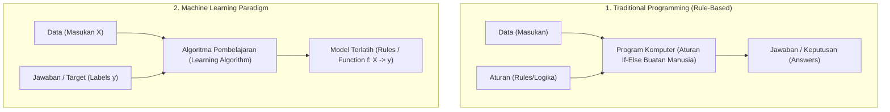
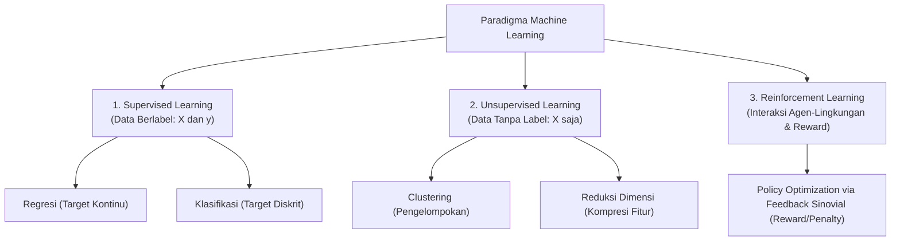
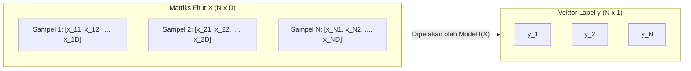
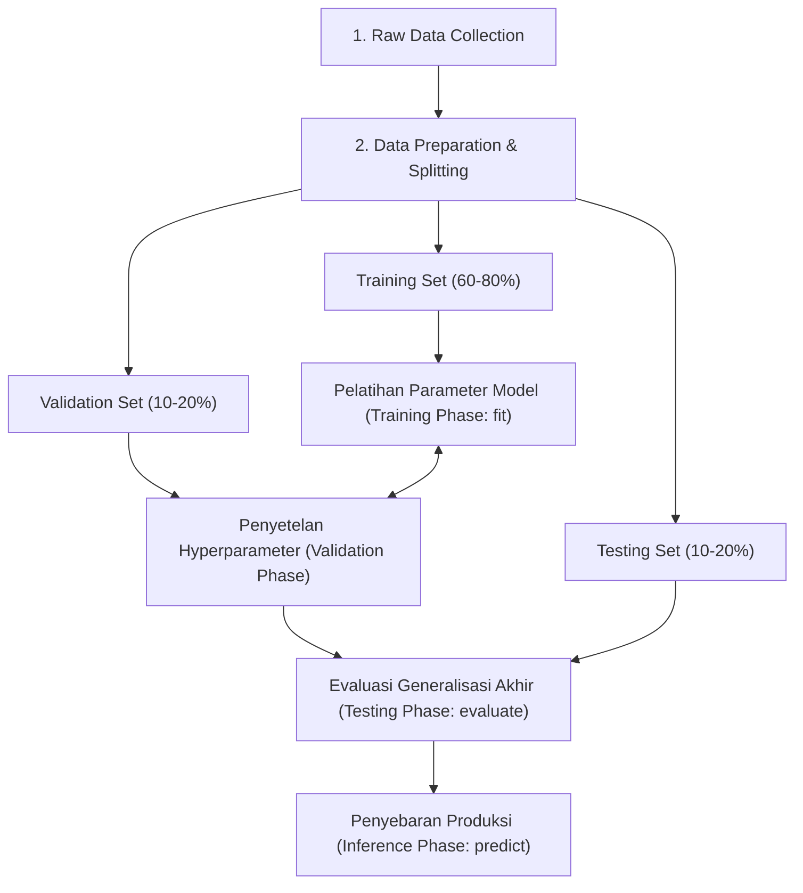
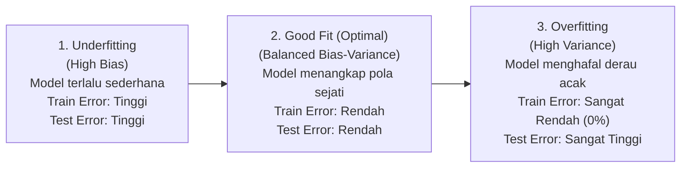

# Chapter 11: Introduction to Machine Learning

Selamat datang di **Chapter 11: Introduction to Machine Learning**. Bab ini merupakan gerbang pembuka dari **Level 2: Machine Learning** pada Artificial Intelligence Learning Hub.

Pada Level 1 (AI Foundations, Bab 01–10), Anda telah mempelajari bagaimana agen cerdas bekerja menggunakan logika simbolik, aturan pakar eksplisit (*Rule-Based Systems*), dan algoritma pencarian heuristik (*State Space Search*). Dalam paradigma tersebut, manusia merumuskan seluruh aturan logika dan batasan masalah secara manual ke dalam kode program. Namun, ketika kita berhadapan dengan dunia nyata yang bising, berdimensi tinggi, dan penuh ketidakpastian—seperti pengenalan wajah dari jutaan piksel citra, penyaringan surat spam dari jutaan kemungkinan kalimat, atau prediksi fluktuasi ekonomi—kemampuan manusia untuk menuliskan miliaran aturan *if-else* secara manual mencapai batas kebuntuan (*knowledge acquisition bottleneck*).

Di sinilah **Machine Learning (ML)** hadir sebagai perubahan paradigma (*paradigm shift*): alih-alih memprogram aturan keputusan secara manual, kita memberikan data pengamatan historis kepada algoritma, dan komputer secara otonom mempelajari pola keteraturan, relasi statistik, serta representasi matematis dari data tersebut.

---

## 1. Capaian Pembelajaran (Learning Objectives)

Setelah mempelajari bab ini secara tuntas, pembelajar diharapkan mampu:
1. **Menjelaskan** konsep Machine Learning dan perbedaannya dengan Rule-Based Systems.
2. **Mengidentifikasi** Supervised, Unsupervised, dan Reinforcement Learning.
3. **Menjelaskan** features, labels, samples, models, dan predictions.
4. **Menjelaskan** Training, Validation, Testing, dan Inference.
5. **Memahami** generalization, overfitting, dan underfitting.
6. **Menjelaskan** peran baseline dalam evaluasi model.
7. **Mengenali** data leakage dan konsekuensinya.
8. **Menginterpretasikan** hasil model sederhana tanpa membuat klaim berlebihan.

---

## 2. Paradigma: Pemrograman Tradisional vs Machine Learning

Perbedaan fundamental antara pendekatan rekayasa perangkat lunak tradisional dan Machine Learning dapat dipahami melalui diagram alur berikut:

### 1. Definisi Formal Machine Learning
- **Arthur Samuel (1959)**:
  > *"Machine Learning adalah bidang studi yang memberikan komputer kemampuan untuk belajar tanpa diprogram secara eksplisit."*
- **Tom M. Mitchell (1997)**:
  > *"Sebuah program komputer dikatakan belajar dari pengalaman $E$ (*Experience*) berkenaan dengan suatu kelas tugas $T$ (*Task*) dan ukuran kinerja $P$ (*Performance measure*), jika kinerjanya pada tugas-tugas dalam $T$, sebagaimana diukur oleh $P$, meningkat seiring dengan pengalaman $E$."*

$$\text{Experience } (E) + \text{Learning Algorithm} \longrightarrow \text{Model } (f: X \to y) \quad \text{dievaluasi dengan } P$$

---

## 3. Tiga Paradigma Utama Machine Learning

### A. Supervised Learning (Pembelajaran Terbimbing)
Algoritma diberikan sekumpulan pasangan masukan dan luaran yang benar: $\mathcal{D} = \{(x_1, y_1), (x_2, y_2), \dots, (x_N, y_N)\}$. Tujuannya adalah mengestimasi fungsi pemetaan $f(x) \approx y$ sedemikian rupa sehingga model mampu memprediksi label untuk data baru yang belum pernah dilihat.
- **Regresi (Regression)**: Target $y$ berupa besaran skalar kontinu ($y \in \mathbb{R}$). Contoh: memprediksi suhu turbin ($^\circ\text{C}$), harga properti (Rp), atau konsumsi daya (Watt).
- **Klasifikasi (Classification)**: Target $y$ berupa kategori diskrit ($y \in \{0, 1, \dots, C-1\}$). Contoh: mendeteksi email spam vs ham, diagnosis tumor ganas vs jinak, atau klasifikasi digit tulisan tangan 0–9.

### B. Unsupervised Learning (Pembelajaran Tak Terbimbing)
Algoritma hanya menerima matriks fitur masukan tanpa target bimbingan manusia: $\mathcal{D} = \{x_1, x_2, \dots, x_N\}$. Tujuannya adalah menemukan struktur intrinsik, kepadatan probabilitas, atau pola tersembunyi di dalam data.
- **Clustering (Pengelompokan)**: Mempartisi data ke dalam $K$ kelompok alami berdasarkan kedekatan jarak geometris (misalnya segmentasi profil konsumsi energi gedung kampus).
- **Dimensionality Reduction**: Memproyeksikan fitur berdimensi tinggi ke dimensi yang lebih rendah tanpa kehilangan variansi informasi esensial.

### C. Reinforcement Learning (Pembelajaran Penguatan)
Bukan belajar dari dataset statis, melainkan melalui **interaksi aktif agen dengan lingkungan dinamis**. Agen mengambil aksi $a_t \in \mathcal{A}$ dari keadaan $s_t \in \mathcal{S}$, menerima sinyal umpan balik berupa skor imbalan numerik (*reward/penalty* $r_{t+1}$), dan memperbarui kebijakan tindakannya (*policy* $\pi$) untuk memaksimalkan akumulasi imbalan jangka panjang (*cumulative return*).
> [!IMPORTANT]
> **Pembedaan Konseptual Kritis**: Jangan menyamakan Reinforcement Learning dengan Supervised Learning! Pada Supervised Learning, data memiliki label jawaban yang benar secara eksplisit (*ground truth*). Pada Reinforcement Learning, lingkungan **tidak memberikan jawaban benar**, melainkan hanya memberikan skor evaluasi (*reward signal*) atas aksi yang telah dilakukan agen.

---

## 4. Anatomi Data: Samples, Features, dan Labels

Dalam ekosistem komputasi ilmiah Python (NumPy & Pandas), data terstruktur direpresentasikan dalam format matriks standar:

1. **Sample (Instance / Baris $N$)**: Satu unit observasi independen (misalnya satu mahasiswa, satu transaksi bank, atau satu detik pembacaan sensor).
2. **Feature (Atribut / Kolom $D$)**: Variabel independen terukur yang mendeskripsikan sifat sampel ($x_{i,j}$). Contoh: jam belajar mingguan, persentase kehadiran, suhu ruangan.
3. **Label (Target $y$)**: Variabel dependen yang menjadi sasaran prediksi model.
4. **Model ($f_{\theta}(x)$)**: Fungsi matematis dengan parameter terbobot $\theta$ yang memetakan masukan menjadi estimasi prediksi $\hat{y} = f_{\theta}(x)$.

---

## 5. Siklus Hidup Machine Learning (Workflow Overview)

### 1. Training (Fase Pelatihan)
Proses komputasi di mana algoritma menyesuaikan parameter internal model (seperti bobot $w$ dan bias $b$ pada regresi linier) menggunakan algoritma optimasi (misalnya *Gradient Descent*) untuk meminimalkan fungsi kerugian (*Loss Function*) pada data latih.

### 2. Validation (Fase Validasi)
Pengujian berkala pada dataset terpisah untuk memilih arsitektur model terbaik atau menyetel *hyperparameter* (misalnya memilih nilai $k$ terbaik pada $k$-NN atau derajat polinomial) tanpa mengotori data uji akhir.

### 3. Testing (Fase Pengujian Final)
Evaluasi yang dilakukan **hanya satu kali di akhir** pada data uji yang benar-benar independen dan belum pernah dilihat model selama proses pelatihan maupun penyetelan. Tujuannya adalah mengestimasi performa model di dunia nyata secara tidak bias.

### 4. Inference (Fase Inferensi / Prediksi)
Pengoperasian model yang telah terlatih pada data baru di lingkungan produksi untuk menghasilkan prediksi langsung tanpa memperbarui bobot model.

---

## 6. Generalisasi, Overfitting, dan Underfitting

Tujuan utama Machine Learning **bukanlah** menghafal data latih dengan akurasi $100\%$, melainkan mencapai **generalisasi**—kemampuan model untuk memprediksi secara akurat pada data baru yang belum pernah ditemui.

### Bias–Variance Trade-off
Secara teoritis, total galat prediksi (*Expected Prediction Error*) dapat diuraikan menjadi tiga komponen:
$$\mathbb{E}[(y - \hat{f}(x))^2] = \underbrace{\text{Bias}[\hat{f}(x)]^2}_{\text{Kekakuan Asumsi Model}} + \underbrace{\text{Var}[\hat{f}(x)]}_{\text{Sensitivitas terhadap Derau Latih}} + \underbrace{\sigma^2}_{\text{Derau Tak Tereduksi (Irreducible Error)}}$$

- **High Bias (Underfitting)**: Model memiliki asumsi yang terlalu kaku sehingga mengabaikan relasi penting dalam data (misal memaksakan garis lurus linier pada kurva kuadratik).
- **High Variance (Overfitting)**: Model terlalu fleksibel dan kompleks sehingga mempelajari derau acak (*noise*) data latih sebagai pola sejati. Akibatnya, perubahan kecil pada data latih menyebabkan model berubah drastis.

---

## 7. Mengapa Baseline Model Wajib Ada?

Salah satu kesalahan paling fatal bagi pemula adalah mengevaluasi performa model dalam ruang hampa tanpa pembanding dasar (*Baseline*).

### Ilusi Akurasi pada Data Tidak Seimbang (Class Imbalance)
Bayangkan sebuah sistem deteksi penyakit langka di mana dari $1.000$ pasien, hanya ada $10$ orang yang sakit ($1\%$) dan $990$ orang sehat ($99\%$).
- Jika seorang pembuat model membuat fungsi sederhana:
  $$\hat{y} = \text{Sehat} \quad (\forall x)$$
- Model sepele ini akan memiliki akurasi:
  $$\text{Akurasi} = \frac{990}{1.000} = 99.0\%$$
- Model ini memiliki akurasi $99\%$, namun sama sekali **tidak berguna** karena tidak mampu mendeteksi satu pun orang sakit!

Oleh karena itu, sebelum mengklaim keberhasilan model machine learning yang kompleks:
1. Wajib membangun **Trivial Baseline** (misalnya `DummyClassifier(strategy='most_frequent')` pada klasifikasi atau `DummyRegressor(strategy='mean')` pada regresi).
2. Wajib membangun **Simple Heuristic Baseline** (misalnya aturan *if-else* sederhana pakar domain).
3. Gunakan metrik evaluasi yang tepat, seperti *Balanced Accuracy*, *Precision*, *Recall*, atau *F1-Score*.

---

## 8. Pengantar Data Leakage (Kebocoran Data)

**Data Leakage** adalah kondisi di mana informasi dari luar data latih (khususnya informasi dari data uji atau masa depan) secara tidak sengaja merembes masuk ke dalam proses pelatihan model.

### Bentuk-Bentuk Umum Data Leakage
1. **Preprocessing Sebelum Splitting**: Melakukan standardisasi `StandardScaler.fit_transform()` pada seluruh dataset sebelum memanggil `train_test_split`. Akibatnya, nilai rata-rata $\mu$ dan standar deviasi $\sigma$ dari data uji telah bocor ke dalam data latih.
2. **Feature Leakage**: Memasukkan variabel fitur yang secara fisik baru tersedia **setelah** target terjadi (misalnya menggunakan fitur "jumlah obat yang diresepkan dokter" untuk memprediksi "apakah pasien akan didiagnosis sakit").
3. **Temporal Leakage**: Menggunakan data masa depan untuk memprediksi masa lalu pada data deret waktu (*time-series*).

Konsekuensi dari data leakage adalah **performa model yang tampak luar biasa di komputer pengembang, namun gagal total saat diimplementasikan di dunia nyata**.

---

## 9. Responsible Machine Learning

Sejalan dengan prinsip yang dibangun di Chapter 09:
- **Transparansi Keterbatasan**: Jangan mengklaim bahwa model Anda bekerja sempurna. Nyatakan domain batasan data secara eksplisit.
- **Bukan Pengganti Otoritas Manusia**: Pada aplikasi berisiko tinggi (kesehatan, kelayakan finansial, peradilan), model ML harus diposisikan sebagai alat bantu pengambil keputusan (*Advisory Tool*) dengan mekanisme pengawasan manusia (*Human-in-the-Loop*).
- **Audit Bias Data**: Model tidak menciptakan objektivitas baru; model mereplikasi bias yang ada pada data pengamatan masa lalu.

---

## 10. Mitos dan Kesalahpahaman Umum (Common Misconceptions)

| Mitos Populer | Fakta Ilmiah Sebenarnya |
| :--- | :--- |
| *"Machine Learning selalu lebih baik daripada aturan if-else."* | Salah. Jika masalah memiliki aturan deterministik yang pasti dan stabil, sistem berbasis aturan jauh lebih cepat, hemat komputasi, dan mudah diaudit. |
| *"Semakin kompleks model (misal Deep Learning), semakin bagus hasilnya."* | Salah. Model yang terlalu kompleks pada dataset kecil justru rentan mengalami *overfitting* parah. |
| *"Akurasi pelatihan 100% adalah tanda model yang hebat."* | Salah. Akurasi latih 100% hampir selalu merupakan indikasi kuat bahwa model hanya menghafal data (*overfitting*). |
| *"Semua Machine Learning membutuhkan label jawaban."* | Salah. Unsupervised Learning bekerja menemukan klaster dan pola tanpa label sama sekali. |
| *"Reinforcement Learning sama dengan Supervised Learning yang diberi reward."* | Salah. Reinforcement Learning tidak memiliki label jawaban benar dan agen harus aktif mengeksplorasi lingkungannya. |

---

## 11. Latihan Mandiri (Exercises)

### Latihan Tingkat Dasar
1. **Identifikasi Paradigma ML**: Tentukan apakah kasus-kasus berikut tergolong *Supervised Learning*, *Unsupervised Learning*, atau *Reinforcement Learning*:
   - Mengelompokkan pelanggan e-commerce berdasarkan kemiripan pola belanja tanpa kategori awal.
   - Memprediksi harga sewa apartemen bulanan berdasarkan luas kamar dan jarak ke stasiun.
   - Program catur yang belajar langkah terbaik dengan bermain melawan dirinya sendiri jutaan kali.
2. **Fitur dan Label**: Pada sebuah sistem pendeteksi kerusakan motor listrik, sebutkan minimal 3 fitur ($X$) yang dapat diukur dan 1 target label ($y$).

### Latihan Tingkat Menengah
3. **Training vs Inference**: Jelaskan perbedaan beban komputasi dan kebutuhan perangkat keras antara fase *Training* dan fase *Inference*. Mengapa fase inferensi sering kali dapat dijalankan pada mikrokontroler atau smartphone, sedangkan fase pelatihan membutuhkan GPU bertenaga tinggi?
4. **Analisis Kurva Belajar**: Jika seorang insinyur mendapati bahwa modelnya memperoleh akurasi $99.8\%$ pada data latih namun hanya $61.2\%$ pada data uji, diagnosislah masalah apa yang sedang terjadi dan sebutkan 2 strategi penanganannya.

### Latihan Tingkat Lanjut
5. **Bahaya Data Leakage**: Seorang peneliti menggabungkan seluruh dataset gambar medis dari Rumah Sakit A dan Rumah Sakit B, melakukan normalisasi kontras gambar secara global, lalu membaginya menjadi train dan test set secara acak. Jelaskan secara kritis potensi kebocoran data (*data leakage*) yang terjadi dan bagaimana cara memperbaikinya.
6. **Desain Evaluasi Baseline**: Pada proyek klasifikasi deteksi spam email dengan rasio kelas $98\%$ email sah dan $2\%$ email spam, rancanglah strategi evaluasi baseline dan tentukan metrik apa yang wajib digunakan selain akurasi mentah (*raw accuracy*).

---

## 12. Mini Project: Machine Learning Problem Identification & Baseline Study

Sebagai tugas mini project Chapter 11, Anda diminta menyusun laporan studi perumusan masalah Machine Learning dan pembuktian baseline:

### Panduan Pengerjaan
1. **Deskripsi Masalah**: Pilih satu masalah nyata di bidang akademik, industri, atau lingkungan kampus yang relevan diselesaikan dengan Machine Learning.
2. **Pemilihan Paradigma**: Tentukan paradigma pembelajaran yang tepat (Supervised, Unsupervised, atau RL) disertai alasan ilmiah.
3. **Deskripsi Dataset**: Jelaskan sumber data, format sampel, daftar fitur ($X$), dan target ($y$) jika menggunakan supervised learning.
4. **Model Baseline**: Bangun satu model pembanding dasar (*Naive/Trivial Baseline*, misalnya `DummyClassifier` atau rata-rata konstan).
5. **Demonstrasi Model Sederhana**: Latih satu model ML sederhana menggunakan Scikit-learn (misalnya Logistic Regression atau Linear Regression) pada pembagian data latih/uji yang benar.
6. **Analisis Komparatif**: Bandingkan performa model ML terhadap baseline dan jelaskan keterbatasan generalisasinya secara transparan.

### Rubrik Penilaian Mini Project (Total 100 Poin)

| Kriteria Evaluasi | Bobot | Full Credit (Skor Maksimal) | Partial Credit (Skor Sebagian) | Insufficient Evidence (Skor Rendah) |
| :--- | :---: | :--- | :--- | :--- |
| **1. Problem Formulation** | **20 Poin** | Masalah didefinisikan sangat spesifik, batasan ruang lingkup jelas, dan justifikasi penggunaan ML vs aturan deterministik sangat logis. (18–20 poin) | Masalah terdefinisi namun batasan lingkup kurang tajam, alasan pemilihan ML kurang mendalam. (11–17 poin) | Masalah kabur, memaksakan ML tanpa alasan yang jelas. (0–10 poin) |
| **2. Paradigm & Data Understanding** | **20 Poin** | Paradigma ML dipilih tepat, matriks fitur $X$ dan target $y$ terdefinisi presisi dengan satuan dan tipe data yang jelas. (18–20 poin) | Paradigma tepat namun deskripsi fitur kurang lengkap atau representasi matematis belum rapi. (11–17 poin) | Salah mengidentifikasi paradigma (misal menganggap clustering sebagai supervised). (0–10 poin) |
| **3. Baseline & Evaluation** | **25 Poin** | Membangun model baseline eksplisit, menggunakan metrik evaluasi yang relevan (bukan sekadar akurasi mentah), dan perbandingan disajikan dalam tabel rapi. (22–25 poin) | Baseline ada namun metrik evaluasi kurang komprehensif atau perbandingan kurang tajam. (14–21 poin) | Tidak ada model baseline, mengevaluasi model kompleks dalam ruang hampa. (0–13 poin) |
| **4. Generalization & Limitations** | **20 Poin** | Membagi data train/test secara benar tanpa leakage, menganalisis potensi overfitting/underfitting, dan mendokumentasikan keterbatasan model secara jujur. (17–20 poin) | Data dibagi namun analisis generalisasi dangkal, keterbatasan model hanya disinggung sekilas. (10–16 poin) | Mengevaluasi model pada data latih saja atau terjadi kebocoran data yang fatal. (0–9 poin) |
| **5. Documentation & References** | **15 Poin** | Kode terstruktur, *reproducible* dengan random seed, ditulis dalam bahasa akademik yang baik, dan menyertakan referensi primer bereputasi. (13–15 poin) | Laporan rapi namun referensi kurang mutakhir atau instruksi eksekusi kurang lengkap. (8–12 poin) | Format laporan berantakan, kode tidak dapat dijalankan ulang, bibliografi fiktif. (0–7 poin) |
| **Total Skor Kelulusan** | **100 Poin** | **Standar Kelulusan Minimum: 80 Poin** | | |

---

## 13. Referensi Akademik Terverifikasi

1. **Russell, S., & Norvig, P.** (2020). *Artificial Intelligence: A Modern Approach* (4th ed.). Pearson. (Rujukan primer untuk definisi pembelajaran agen, induksi pohon keputusan, dan evaluasi empiris).
2. **Mitchell, T. M.** (1997). *Machine Learning*. McGraw-Hill. (Karya fundamental perumusan formal konsep pembelajaran $E$, tugas $T$, dan metrik performa $P$).
3. **Hastie, T., Tibshirani, R., & Friedman, J.** (2009). *The Elements of Statistical Learning: Data Mining, Inference, and Prediction* (2nd ed.). Springer. (Rujukan otoritatif untuk dekomposisi Bias–Variance Trade-off dan konsep generalisasi statistik).
4. **Goodfellow, I., Bengio, Y., & Courville, A.** (2016). *Deep Learning*. MIT Press. (Rujukan komprehensif Bab 5: Machine Learning Basics, pembagian train/val/test, dan optimasi berbasis gradien).
5. **ACM / IEEE-CS / AAAI**. (2024). *Computer Science Curricula 2023 (CS2023): Artificial Intelligence Knowledge Area*. ACM Press. (Standar panduan kurikulum internasional untuk kompetensi dasar pembelajaran mesin).

